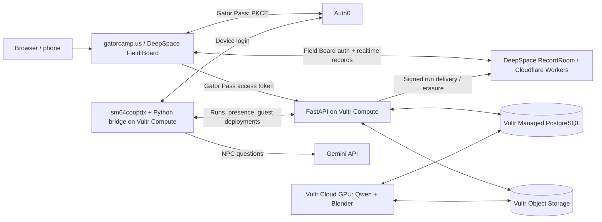

# Super Gatorlator 64

**The University of Florida campus as a co-op Super Mario 64 game, with our friends — and you —
as playable characters.** Built for SwampHacks XII on [sm64coopdx](https://github.com/coop-deluxe/sm64coopdx),
the open-source PC port of SM64 with online co-op. Real UF buildings rebuilt at true 1:1 scale from
OpenStreetMap data; 10 real friends turned into low-poly N64-style characters from their photos; a
hub and 5 stages with 15 missions, solo and co-op.

The game runs natively (it needs your own SM64 ROM — see [`docs/development.md`](docs/development.md)),
but the character pipeline and accounts run entirely in the browser, so judges without a ROM can
still see the full result.

## Integrations and sponsor tracks

Every integration below is live in this repo and deployed to a server we host, not a
local-only demo. Day-to-day operational state is tracked in [operations](docs/operations.md).

| Integration / track | How we use it | Demo and implementation |
|---|---|---|
| **Vultr** | Six Vultr products run this project end to end, all in one region (Atlanta): **Cloud GPU** (`vcg-a16-6c-60g-16vram`, an NVIDIA A16 with 16 GB VRAM) serves `Qwen2.5-VL-7B-Instruct-AWQ` through vLLM for photo analysis and runs the headless Blender build/export/validate/preview pipeline on the same instance; **Cloud Compute** runs the headless multiplayer game, the Python bridge and the FastAPI API; **Managed PostgreSQL 17** is the system of record for accounts, jobs, guest slots and runs; S3-compatible **Object Storage** holds photos and generated artifacts behind signed URLs; a private **VPC** connects compute, GPU and database; a **Firewall** group locks every instance down to the ports it actually needs. A live diagnostic against the deployed GPU service returned schema-valid output on all 23 test requests with zero inference failures at a 9.1 s median response time. | Upload photos at [Gatorize Me](https://gatorcamp.us/gatorize) and watch the GPU job run, then find the finished character in the game. [Worker](server/worker/README.md), [GPU provisioning](server/deploy/provision_gpu.sh), [infra scripts](server/deploy/vultr.py), [live evaluation](docs/gatorize_likeness.md#live-qwen-diagnostic). |
| **Auth0 — Gator Pass** | The browser uses Universal Login with Authorization Code + PKCE. In-game `/login` uses the Device Authorization Flow: scan a QR code and approve on your phone. The API validates JWT issuer, audience, signature and scope on every request; the bridge authenticates separately as a machine-to-machine client. | Scan the in-game QR code and approve on your phone to watch a live connection link to its account and generated character. [Browser client](companion/app/src/lib/gator-api.ts), [game login](server/bridge/README.md), [API auth](server/api/sgl_api/auth.py). |
| **DeepSpace — Gator Field Board** | The companion dashboard runs on DeepSpace: SDK auth, schema permissions and a SQLite-backed `RecordRoom` power the leaderboard, with `RecordProvider`, `RecordScope` and `useQuery` subscribing to live changes over WebSockets. Verified hosted-game runs arrive through signed server-side ingestion; self-reported offline runs are kept separately. | Open [the leaderboard](https://gatorcamp.us/leaderboard) in two browsers and finish a hosted run to watch it appear live. [Worker wiring](companion/app/worker.ts), [schemas](companion/app/src/schemas/verified-runs-schema.ts), [live queries](companion/app/src/pages/(app)/leaderboard.tsx), [signed ingest](companion/app/src/server/ingest-routes.ts). |
| **Google Gemini** | Albert and Alberta, the game's roaming mascots, answer in character through the Gemini API. Game questions hit a curated guide first; close matches ground Gemini's answer in the real course data, so the mascots never improvise star counts or door locations. | Ask `/albert how do I unlock Lake Alice`, then ask it something off-script. [Gemini bridge](tools/npc_bridge/bridge.py), [retrieval](tools/npc_bridge/guide.py), [guide](tools/npc_bridge/game_guide.md). |
| **GoDaddy Registry** | **gatorcamp.us** runs on the GoDaddy Registry `.us` TLD, routing the whole system — the web app, `api.gatorcamp.us` and the game's `play.gatorcamp.us:7777` — through one domain. Registration and DNS are managed through Porkbun, a GoDaddy-accredited `.us` registrar. | Start at [gatorcamp.us](https://gatorcamp.us), make a character and join the game on the same domain. [DNS design](docs/web_platform_spec.md#4-domain-and-dns-godaddy), [routing config](server/deploy/Caddyfile). |

The worker's inference client speaks the same OpenAI-compatible protocol Vultr Serverless
Inference exposes, so it can run against either a self-hosted vLLM server or Vultr's managed
product by changing one environment variable; today it runs self-hosted vLLM on the Cloud GPU.
Auth0 Gator Pass and DeepSpace Field Board are separate identities that a signed-in user can
link explicitly — see [identity linking](docs/backend_identity_linking.md).

### AI design and evidence

Qwen stays the **image model**; Gemini handles **NPC conversation**. Qwen reads reference
photos and selects structured face, hair, body and outfit profiles; deterministic Blender
builders turn those selections into geometry, textures, game exports and previews — custom
procedural character generation, not a trained neural renderer.

The NPC guide uses IDF-weighted lexical retrieval: strong matches answer directly, related
entries ground Gemini's answer in the real course data, and everything else falls back to
the mascot persona. Model failures have explicit fallback/error paths instead of silently
claiming a successful inference.

We ran real evaluations, not just a demo reel: the [appearance pipeline's design, live
diagnostics and label-agreement results](docs/gatorize_likeness.md), a [reproducible Qwen
validation tool](tools/likeness/validate_qwen.py), and [NPC bridge regression
tests](tools/npc_bridge/test_bridge.py) — including the cases where selection didn't match,
reported honestly. Likeness is stylized by design, not a photorealistic match.

The game also fits **Entertainment & Creative Technology** and **Overall** — see the
[track-by-track review](docs/sponsor_track_review.md).

## Try it

**In a browser, no ROM needed:**

Explore the [character showcase](https://gatorcamp.us/showcase) without signing in: 23
synthetic face, hair, body and outfit studies, with rendered previews and optional 3D rotation.

1. Open [Gatorize Me](https://gatorcamp.us/gatorize) (also available on
   [app.space](https://gator-field-board-mlh.app.space/gatorize)) and sign into **Gator Pass**.
2. Upload 1–4 consented photos and watch the queued build run live: appearance analysis on the
   GPU, Blender generation, export, validation and previews. The job keeps running if you close
   the page. Rotate the resulting 3D preview in your browser.
3. Open the [Field Board leaderboard](https://gatorcamp.us/leaderboard). Verified hosted-game
   results and unverified offline results are kept distinct. Field Board sign-in uses DeepSpace.

**In the game (expo laptops, or your own sm64coopdx + ROM):**

1. **Join → Direct Connect → `play.gatorcamp.us`, port `7777`.** The mod downloads automatically.
2. Type **`/login`**. Scan the QR code and approve on your phone — your generated character
   deploys into a guest slot automatically and gets selected for you.
3. Play a mission with a friend, then check the verified leaderboard: ranked runs come from
   the hosted server with linked Gator Pass accounts.

## What's in the game

- **10 playable friends**, each built from 1–4 photos: hand-drawn pixel-art faces (8 eye states + a
  mouth), a signature outfit, and every one of Mario's original moves.
- **A hub (Plaza of the Americas) and 5 stages**, true to UF's real scale: The Swamp (Ben Hill Griffin
  Stadium), Reitz Union + Engineering (an 8-floor enterable interior), Lake Alice, Marston Science
  Library (a full interior from real floor plans), Library West After Dark.
- **15 missions**, two solo and one co-op per stage — races, climbs, a rhythm minigame, crane
  operators who carry riders, stealth past patrolling librarians, a dusk bat census, nighttime
  hide-and-seek.
- **Albert and Alberta**, two roaming alligator mascots who answer game questions instantly from a
  written guide, and anything else via Gemini, in character.
- **Campus rivals**: every Goomba wears a USF Bull or FSU Seminole, and Library West's ghosts are UCF
  Knights.
- **Ride gators**: a saddled green gator replaces the Koopa shell — jump on to ride, Z to get off.

Full writeup, the build-time numbers, and how it was built with Claude Code's multi-agent workflows:
[`docs/project_overview.md`](docs/project_overview.md).

## How the online side fits together

PostgreSQL is authoritative for character jobs, account links and ranked game results.
DeepSpace stores the companion's realtime leaderboard mirror and app records. The bridge
pulls private build artifacts through signed URLs and installs them into game guest slots.

The backend includes worker leases, presence heartbeats, a durable bridge outbox,
idempotent event processing, retryable object cleanup and deploy revalidation. Account deletion
queues associated object/result erasure and retains provider accounts. These mechanisms and
remaining work are documented in [operations](docs/operations.md) and
[the current checklist](docs/next_steps.md).

The [platform specification](docs/web_platform_spec.md) has the full design and database schema.

## Repo layout

- `mods/sgl64/` — the game mod (Lua, character models, levels, textures).
- `tools/` — everything that builds the mod offline: campus generation from OpenStreetMap, the
  photo→character Blender pipeline, the NPC guide, and the offline test harness.
- `server/` — the online side: `api/` (FastAPI + Postgres), `worker/` (the Vultr GPU character
  pipeline), `bridge/` (the headless game host + Auth0 device flow), `web/` (the static site),
  `deploy/` (provisioning, systemd, Caddy).
- `companion/app/` — the Gator Field Board dashboard (the campus mission board, leaderboards, the
  Gatorize Me web upload flow).
- `docs/` — design and spec documents; start with `project_overview.md` and `web_platform_spec.md`.

Full file-by-file breakdown: [`docs/development.md`](docs/development.md) → Layout.

## Run it yourself / contribute

macOS setup, installing the mod locally, configuring NPC chat (Gemini), and the full manual test
script live in [`docs/development.md`](docs/development.md).

## Credits

Map data © [OpenStreetMap](https://www.openstreetmap.org/copyright) contributors (ODbL), which
requires attribution. Built on [sm64coopdx](https://github.com/coop-deluxe/sm64coopdx), the
[coopdx character template](https://github.com/coop-deluxe/character-template), [Fast64](https://github.com/Fast-64/fast64)
and [Fast64-Gart](https://github.com/ManIsCat2/Fast64-Gart). This project requires your own SM64 ROM
and does not distribute Nintendo assets.
