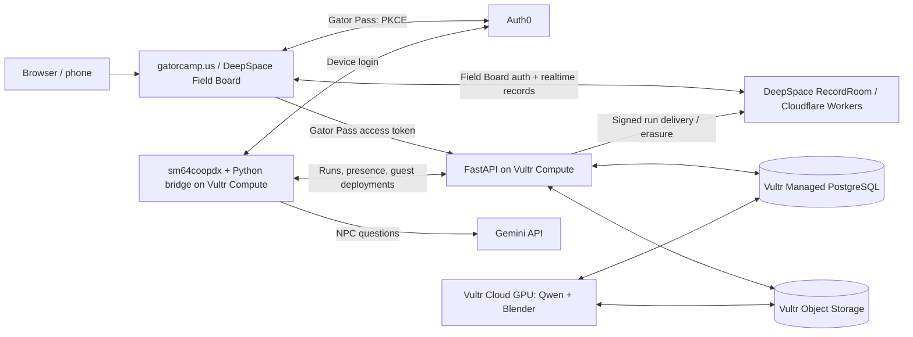

# Super Gatorlator 64

**The University of Florida campus as a co-op Super Mario 64 game, with our friends — and you —
as playable characters.** Built for SwampHacks XII on [sm64coopdx](https://github.com/coop-deluxe/sm64coopdx),
the open-source PC port of SM64 with online co-op. Real UF buildings rebuilt at true 1:1 scale from
OpenStreetMap data; 10 real friends turned into low-poly N64-style characters from their photos; a
hub and 5 stages with 15 missions, solo and co-op.

The game runs natively (it needs your own SM64 ROM — see [`docs/development.md`](docs/development.md)),
but the character pipeline and accounts run entirely in the browser, so judges without a ROM can
still see the full result.

## Integrations and sponsor tracks

The integrations below are implemented in this repository. Deployment and live acceptance
are tracked separately in [operations](docs/operations.md); a passing health check does not
prove a completed character build or leaderboard delivery.

| Integration / track | How we use it | Demo and implementation |
|---|---|---|
| **Vultr** | Cloud Compute runs the headless multiplayer game, Python bridge and FastAPI API. Managed PostgreSQL stores accounts, jobs, guest slots and runs; private S3-compatible Object Storage holds photos and generated artifacts. A Cloud GPU runs Qwen through vLLM and the Blender character pipeline. | Upload photos at [Gatorize Me](https://gatorcamp.us/gatorize), then inspect the model and guest deployment. [Worker](server/worker/README.md), [provisioning](server/deploy/provision_gpu.sh). |
| **Auth0 — Gator Pass** | The browser uses Universal Login with Authorization Code + PKCE. In-game `/login` uses Device Authorization: scan a QR code and approve on your phone. The API validates JWT issuer, audience, signature and scopes; the bridge uses a separate machine-to-machine identity. | Show phone approval linking a game connection to its account and generated character. [Browser client](companion/app/src/lib/gator-api.ts), [game login](server/bridge/README.md), [API auth](server/api/sgl_api/auth.py). |
| **DeepSpace — Gator Field Board** | SDK authentication, schema permissions and SQLite-backed `RecordRoom` storage power the companion. `RecordProvider`, `RecordScope` and `useQuery` subscribe to leaderboard changes over WebSockets. Server-verified runs arrive through signed ingestion; offline self-reported runs are stored separately. This uses DeepSpace for auth, data and realtime updates as well as deployment. | Open [the leaderboard](https://gatorcamp.us/leaderboard) in two browsers and complete a real hosted run. [Worker wiring](companion/app/worker.ts), [schemas](companion/app/src/schemas/verified-runs-schema.ts), [live queries](companion/app/src/pages/(app)/leaderboard.tsx), [signed ingest](companion/app/src/server/ingest-routes.ts). |
| **Google Gemini** | Albert and Alberta answer general questions in character through the Gemini API. Game questions first use a curated guide; close matches provide guide context to Gemini. The game talks to a host-side Python bridge, which owns the API key. | Ask `/albert how do I unlock Lake Alice`, then a general question. [Gemini bridge](tools/npc_bridge/bridge.py), [retrieval](tools/npc_bridge/guide.py), [guide](tools/npc_bridge/game_guide.md). |
| **GoDaddy Registry** | Our campus identity is **gatorcamp.us**. `.us` is a GoDaddy Registry TLD; the domain was registered through **Porkbun**, which also manages its DNS. The domain connects the web app, `api.gatorcamp.us` and `play.gatorcamp.us:7777`. This is a registry/domain integration, not a GoDaddy API integration. | Start at [gatorcamp.us](https://gatorcamp.us), upload a character and join the game using the same campus domain. [DNS design](docs/web_platform_spec.md#4-domain-and-dns-godaddy), [routing configuration](server/deploy/Caddyfile). Confirm the challenge's registration eligibility with organizers. |

The deployed image-model configuration documented in this repo is **Qwen2.5-VL-7B-Instruct-AWQ
on Vultr Cloud GPU**. Vultr Serverless Inference is an alternative configuration, not a service
we claim this path currently uses. Likewise, `login.gatorcamp.us` is a planned branded Auth0
hostname; the browser's [public configuration](companion/app/src/lib/gator-config.json) uses
the Auth0 tenant domain. A custom domain is not required for either login flow.

Auth0 Gator Pass and DeepSpace Field Board are distinct identities. Users can explicitly
link them while signed into both; we do not infer a match from email or display name.
[Account settings and linking](docs/backend_identity_linking.md) also explain revocation
and deletion while preserving both provider accounts.

### AI design and evidence

Qwen stays the **image model**; Gemini handles **NPC conversation**. Qwen selects structured
face, hair, body and outfit profiles from reference photos. Deterministic Blender builders
turn those selections into separate geometry components, textures, game exports and previews.
These are custom procedural character models, not newly trained neural networks.

The NPC guide uses IDF-weighted lexical retrieval: strong matches answer directly, related
entries ground Gemini, and other questions use the mascot persona. This keeps common game
answers fast and grounded in authored rules. Model failures have explicit fallback/error
paths rather than silently claiming a successful inference.

For the AI track, see the [appearance design, evaluations and limitations](docs/gatorize_likeness.md),
[reproducible Qwen validation tool](tools/likeness/validate_qwen.py), and
[NPC bridge regression tests](tools/npc_bridge/test_bridge.py). Likeness is stylized and imperfect;
our evaluation notes include failures and tradeoffs.

The game also fits **Entertainment & Creative Technology** and **Overall**. The
[track and backend review](docs/sponsor_track_review.md) maps the hacker guide to existing work,
eligibility checks and optional additions. It does not claim entry or selection by the judges.

## Try it

**In a browser, no ROM needed:**

1. Open [Gatorize Me](https://gatorcamp.us/gatorize) (also available on
   [app.space](https://gator-field-board-mlh.app.space/gatorize)) and sign into **Gator Pass**.
2. Upload 1–4 consented photos. Follow the queued build through appearance analysis, Blender
   generation, export, validation and previews. Generation takes time; the job continues if
   you close the page. Rotate the resulting 3D preview in your browser.
3. Open the [Field Board leaderboard](https://gatorcamp.us/leaderboard). Verified hosted-game
   results and unverified offline results are distinct. Field Board sign-in uses DeepSpace.

**In the game (expo laptops, or your own sm64coopdx + ROM):**

1. **Join → Direct Connect → `play.gatorcamp.us`, port `7777`.** The mod downloads automatically.
2. Type **`/login`**. Scan the QR code and approve on your phone. Your generated character can
   be selected after its guest-slot deployment completes; a ready preview alone does not mean
   it is installed on the game server.
3. Play a mission with a friend, then check the verified board. Ranked results require the
   hosted server and linked Gator Pass accounts; browser submissions cannot create ranked runs.

## What's in the game

- **10 playable friends**, each built from 1–4 photos: hand-drawn pixel-art faces (8 eye states + a
  mouth), a signature outfit, and every one of Mario's original moves.
- **A hub (Plaza of the Americas) and 5 stages**, true to UF's real scale: The Swamp (Ben Hill Griffin
  Stadium), Reitz Union + Engineering (an 8-floor enterable interior), Lake Alice, Marston Science
  Library (a full interior from real floor plans), Library West After Dark.
- **15 missions**, two solo and one co-op per stage — races, climbs, a rhythm minigame, crane
  operators who carry riders, stealth past patrolling librarians, a dusk bat census, nighttime
  hide-and-seek.
- **Albert and Alberta**, two roaming alligator mascots who answer game questions instantly from a
  written guide, and anything else via Gemini, in character.
- **Campus rivals**: every Goomba wears a USF Bull or FSU Seminole, and Library West's ghosts are UCF
  Knights.
- **Ride gators**: a saddled green gator replaces the Koopa shell — jump on to ride, Z to get off.

Full writeup, the build-time numbers, and how it was built with Claude Code's multi-agent workflows:
[`docs/project_overview.md`](docs/project_overview.md).

## How the online side fits together

PostgreSQL is authoritative for character jobs, account links and ranked game results.
DeepSpace stores the companion's realtime leaderboard mirror and app records. The bridge
pulls private build artifacts through signed URLs and installs them into game guest slots.

The backend includes worker leases, presence heartbeats, a durable bridge outbox,
idempotent event processing, retryable object cleanup and deploy revalidation. Account deletion
queues associated object/result erasure and retains provider accounts. These mechanisms and
remaining acceptance work are documented in [operations](docs/operations.md) and
[the current checklist](docs/next_steps.md).

The [platform specification](docs/web_platform_spec.md) contains the broader design;
planned domain and infrastructure options there are not proof of deployment.

## Repo layout

- `mods/sgl64/` — the game mod (Lua, character models, levels, textures).
- `tools/` — everything that builds the mod offline: campus generation from OpenStreetMap, the
  photo→character Blender pipeline, the NPC guide, and the offline test harness.
- `server/` — the online side: `api/` (FastAPI + Postgres), `worker/` (the Vultr GPU character
  pipeline), `bridge/` (the headless game host + Auth0 device flow), `web/` (the static site),
  `deploy/` (provisioning, systemd, Caddy).
- `companion/app/` — the Gator Field Board dashboard (the campus mission board, leaderboards, the
  Gatorize Me web upload flow).
- `docs/` — design and spec documents; start with `project_overview.md` and `web_platform_spec.md`.

Full file-by-file breakdown: [`docs/development.md`](docs/development.md) → Layout.

## Run it yourself / contribute

macOS setup, installing the mod locally, configuring NPC chat (Gemini), and the full manual test
script live in [`docs/development.md`](docs/development.md).

## Credits

Map data © [OpenStreetMap](https://www.openstreetmap.org/copyright) contributors (ODbL), which
requires attribution. Built on [sm64coopdx](https://github.com/coop-deluxe/sm64coopdx), the
[coopdx character template](https://github.com/coop-deluxe/character-template), [Fast64](https://github.com/Fast-64/fast64)
and [Fast64-Gart](https://github.com/ManIsCat2/Fast64-Gart). This project requires your own SM64 ROM
and does not distribute Nintendo assets.
