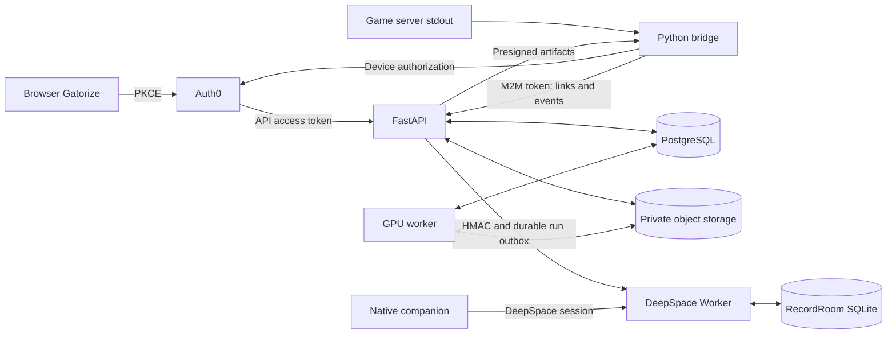

# Backend assessment

**Remediation status:** the six prioritized findings below are addressed on this
branch. Their descriptions preserve the pre-fix evidence. See
[backend remediation](backend_remediation.md) for the resulting behavior,
regression coverage, migration requirements, and remaining operational work.

Assessment branch: `audit/backend-review`, based on local `origin/main` at
the reviewed revision. The completed likeness branch is preserved separately. Pending
integration branches and deployed source were not included in this snapshot.

Scope: API, accounts, browser and game login, authorization, PostgreSQL, object
storage, worker recovery, bridge/server multiplayer lifecycle, dashboard server
routes, and leaderboard delivery. No mod files or production services were
changed. This is an assessment, not a remediation release or a live penetration
test. External Auth0/DeepSpace configuration and the separate study service were
not inspected.

## Findings, in priority order

### 1. High: cancelled link-code requests can restore a departed player's login

Source: `server/bridge/sglbridge/login.py:55`, `:118`, `:167`;
`server/bridge/bridge.py` leave/join handling.

`on_link_req` creates a cancellation event but does not pass it to
`run_link_code`. After an in-flight API call returns, that function always calls
`_verified`, even if the player left, cancelled, or started another attempt.
`_verified` writes the link and emits a command keyed only by global player index.
That index can now belong to a different connection. Device flow checks
cancellation, but its final check and publication are also separate operations.

Confirmed locally: cancel and forget the player inside the mocked redemption
call, then return a successful response. The departed player is restored in
`linked()` and a `verified` inbox message is emitted.

Fix: bind each attempt to a server session and connection generation. Check that
the attempt is still current when publishing success; make cancellation and
publication mutually exclusive. Apply this to both login paths and clear attempts
on join/reset/exit. A stale API link must also be excluded from score attribution.

### 2. High: delayed events can invalidate login or attribute a run to another account

Source: `server/api/sgl_api/app.py:466`,
`server/api/sgl_api/runs.py:83`, `server/bridge/bridge.py:_forward`,
`server/bridge/sglbridge/api.py:RetryQueue`.

Events go through a retry queue; login uses a separate immediate HTTP call.
The API stores an event's receipt time in `events.at`, leaving the bridge's
occurrence time inside JSON. Run attribution looks up the latest matching link
at processing time, without a server-session ID or a link-at-run-time constraint.

Two real-Postgres probes confirmed:

- Login completes before a delayed `hello` is delivered: the subsequent run is
  incorrectly rejected as `unlinked`.
- Alice produces a run; Bob links the same game index/name before the run reaches
  the API: the run is ranked under Bob's account.

Fix: attach a bridge-generated session ID, connection generation, and stable
event sequence to the server-side protocol. Preserve occurrence and receipt
times separately. Resolve identity as of the event's connection and sequence,
not whichever link is newest when the queue drains. These fields can be added
by the bridge without changing the mod's emitted messages.

### 3. High when configured: anonymous study routes use privileged upstream credentials

Source: `companion/app/src/server/study-routes.ts:48`, `:74`, `:102`.

Dispatcher, event submission, and analytics routes have no authentication or
request quota. They attach `VULTR_SERVICE_TOKEN` to requests made on behalf of
any caller. Mission validation limits the request shape, not who can submit it.
An anonymous caller can fabricate analytics and repeatedly request hints at the
service owner's expense if the upstream generates them. Upstream behavior and
spending controls are outside this repository.

Confirmed with a local Hono route and mocked upstream: an unauthenticated event
request returns `mirrored: true` and forwards the server credential. No external
service was called. Without the service bindings, forwarding is disabled.

Fix: establish the intended public-read policy, require verified identity for
writes and paid operations, enforce per-account/global budgets, and distinguish
self-reported study results from server-verified results. Do not forward a
privileged credential from an unlimited public write route.

### 4. Medium: deleting characters resets the global hourly generation limit

Source: `server/api/sgl_api/app.py:335`, `:384`; `server/api/schema.sql` jobs FK.

Hourly admission counts rows in `jobs`. Deleting a character cascades to its
jobs, erasing its admission from the count. An account can repeatedly generate
and delete characters without retaining the intended hourly usage history.
The total-character limit is deliberately a storage limit; the hourly execution
limit should survive deletion.

Confirmed with real Postgres and mocked storage: set the hourly limit to one;
first creation returns 201, second returns 429, delete the first character, and
another creation immediately returns 201.

Fix: record generation admissions in a separate bounded usage ledger whose
lifetime is independent of user-deletable jobs. Enforce quotas before expensive
image processing; reserve admission atomically with job creation.

### 5. Medium: character deletion and slot allocation acquire locks in opposite order

Source: `server/api/sgl_api/app.py:390`, `server/api/schema.sql:sgl_assign_slot`,
`server/api/schema.sql:sgl_release_slot`, `server/worker/db.py:finish_job`.

Deletion locks the character row and then requests the global slot advisory
lock. Assignment/reconciliation and successful worker completion take the slot
lock before the character row. Concurrent operations can each hold the lock the
other needs. PostgreSQL breaks the deadlock by aborting a transaction; the API
has no retry for this, so deletion can return 500. A worker chosen as the victim
can enter its failure/recovery path after completing an expensive build.

Confirmed using two real Postgres connections with these acquisition orders:
PostgreSQL raised `DeadlockDetected`.

Fix: apply one lock order across deletion, completion, failure, reconciliation,
and administrative redeploy. Serialize deploy queue changes consistently too.
Test deletion during completion and slot eviction with real concurrent clients.

### 6. Medium: bridge-to-API delivery has neither idempotency nor durable buffering

Source: `server/bridge/sglbridge/api.py:RetryQueue`,
`server/api/sgl_api/app.py:466`, `server/api/sgl_api/runs.py:113`.

If the API commits a run but its response is lost, the bridge retries the same
payload. Each request creates a new event, run UUID, and DeepSpace outbox entry.
DeepSpace's unique run ID cannot deduplicate two different UUIDs for the same
game event. The displayed best-per-player leaderboard may conceal the duplicates.
The bridge queue is also in memory and drops its oldest item after 2,000 entries;
restart or a long outage can lose runs and session boundary events altogether.

Confirmed with real Postgres: submit the same linked run twice and observe two
run rows and two outbox rows. Queue volatility and overflow are explicit in the
implementation.

Fix: generate event IDs once at the bridge, persist a bounded local outbox,
enforce event uniqueness transactionally at the API, and acknowledge duplicates
without new side effects. Preserve lifecycle events with their session IDs.

## Account and data flow



| Area | Current contract |
| --- | --- |
| Browser Gator Pass | Auth0 SPA SDK performs PKCE. Access tokens use the API audience and `create:character` / `read:own`; tokens are cached in local storage. |
| API identity | RS256, issuer, audience, expiry, issued-at, subject, and JWKS are checked. Scope and ownership checks guard private jobs and character deletion. M2M tokens are rejected on user-only paths. |
| Game login | Device flow validates an ID token for the native client. Fallback uses a six-character, expiring, single-use code redeemed under a database row lock. Bridge scope permits writing links/events and handling deploys. |
| Users | Auth0 subject is the PostgreSQL user key; nickname and UF flag are updated from verified claims. Historical links are retained. There is no account-deletion/unlink API. |
| Characters | Private photo intake, EXIF removal, queued jobs, worker build, eight shared guest slots, bridge staging/restart, deployment acknowledgement. Owners can delete their character and artifacts. |
| Multiplayer | Bridge owns the game child, tracks joins/leaves by index, forwards events, services login/NPC requests, and coordinates guest deploy restarts. This review did not assess client packets or engine anti-cheat. |
| Ranked results | API validates mission, timing bounds, player count, and linked accounts; only ranked runs enter its durable DeepSpace outbox. These are validation checks, not proof against a modified game client. |
| Dashboard/native identity | DeepSpace identity is separate from Auth0. Native sessions use macOS Keychain, loopback OAuth/PKCE, and server token refresh. No mapping joins DeepSpace users to Auth0 subjects. |
| Dashboard data | RecordRoom owns SQLite-backed collections. Verified runs require HMAC ingestion; unique run IDs/nonces and schema permissions protect that path. User actions bypass record RBAC and must authorize their own operations. Offline runs stay separate. |

## Additional operational follow-ups

- **Worker recovery is configuration-dependent.** Recovery finds unfinished jobs
  only for the same `WORKER_NAME`. The example config supplies a stable name,
  which avoids container-hostname churn. If omitted, container recreation can
  strand jobs; sharing a name across active workers can misidentify live work.
  Validate deployed names and add leases/heartbeats for multi-worker operation.
- **Presence needs an explicit heartbeat.** Staleness detection defaults off;
  an unreported bridge crash can leave `/status` online. Merely enabling a short
  timeout can mark a healthy idle game offline because activity is not a heartbeat.
- **Storage cleanup needs durable verification.** API deletion catches failures
  after deleting the DB row. Its S3 helper does not inspect per-key `Errors` in a
  successful `DeleteObjects` response. Lifecycle policies are assumed by comments
  but were not verified. Add retryable cleanup records and confirm photo TTLs.
- **Auth boundaries deserve deployment checks.** Confirm Auth0 grants bridge
  scope only to the intended service, callback/logout allowlists, refresh/session
  settings, and claim namespace consistency. The bridge hardcodes the UF claim
  namespace while the API makes it configurable. This badge gates no privileges.
- **Deploy staging can become stale.** There is no revalidation/lease between
  downloading a pending deploy, waiting for the restart, and installation. A
  deletion or superseding deploy during that interval can leave stale content
  installed until later reconciliation. Exercise that race before changing the
  deploy protocol. It was not included in the confirmed probes above.
- **Retention and recovery are not established by unit tests.** Confirm database
  backup/restore, object lifecycle rules, event/link retention, and service limits
  on the actual hosts. No production credentials or databases were read here.

## Evidence and next work

Existing suites: **96 API tests passed** with a disposable Postgres container;
**72 bridge tests passed**; **22 focused companion tests passed** (game actions,
HMAC ingestion, HTTP auth/proxies, and Gator API client). The initial sandbox API
run skipped database tests; the subsequent run outside the sandbox passed all
96. Fixtures used synthetic users, local test JWTs, and mocked S3.

```sh
/tmp/sglworker_venv/bin/python -m pytest -q -rs server/api/tests
/tmp/sglworker_venv/bin/python -m pytest -q server/bridge/tests
cd companion/app
npm run test:unit -- src/actions/game-runs.test.ts \
  src/server/ingest-routes.test.ts src/server/http-routes.test.ts \
  src/lib/gator-api.test.ts
```

Five additional temporary Postgres probes confirmed quota deletion, delayed
hello, delayed-run misattribution, event duplication, and deadlocking. Separate
local probes confirmed cancelled link-code publication and anonymous study
forwarding. These probes assert the observed faulty behavior; they are not fixes
or passing regression guarantees. Sources are locally available under
`/tmp/sgl_backend_audit/` for this session.

Recommended implementation order:

1. Fix cancellation/publication and gate/meter privileged study routes.
2. Introduce bridge session/connection/event identity with a durable outbox;
   update API linking and deduplication together.
3. Fix database lock order and generation admission accounting.
4. Add worker leases, heartbeat-based presence, durable cleanup, and deploy
   revalidation; then verify live configuration and recovery procedures.

All four work packages can stay in server/bridge/API/dashboard backend code.
No mod geometry, gameplay, assets, or Lua changes are required for the proposed
first remediation pass.
