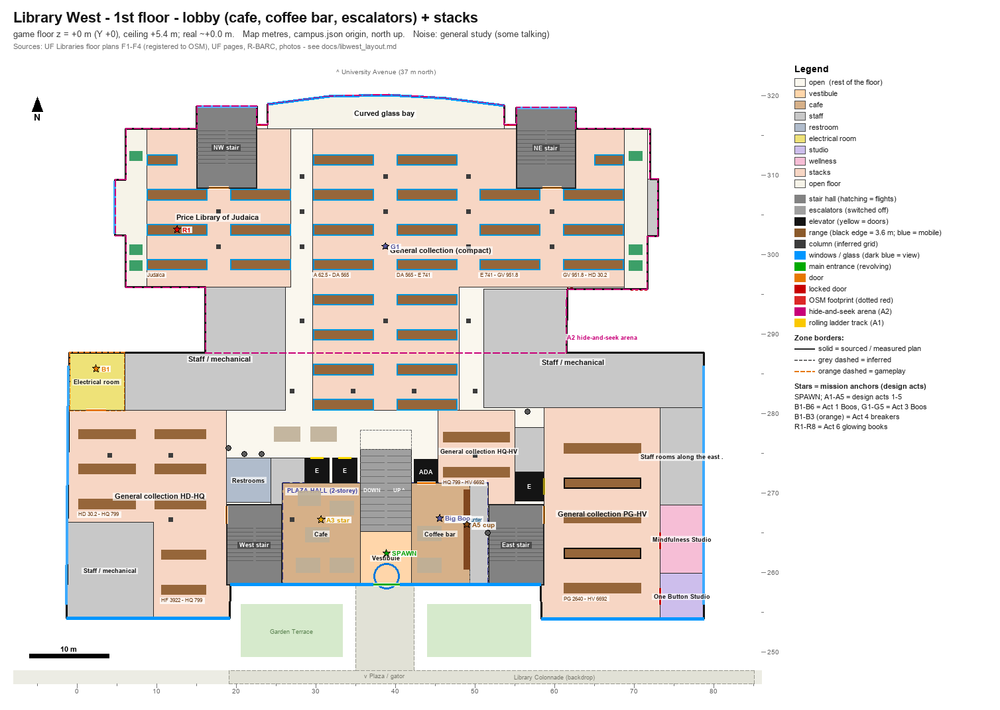
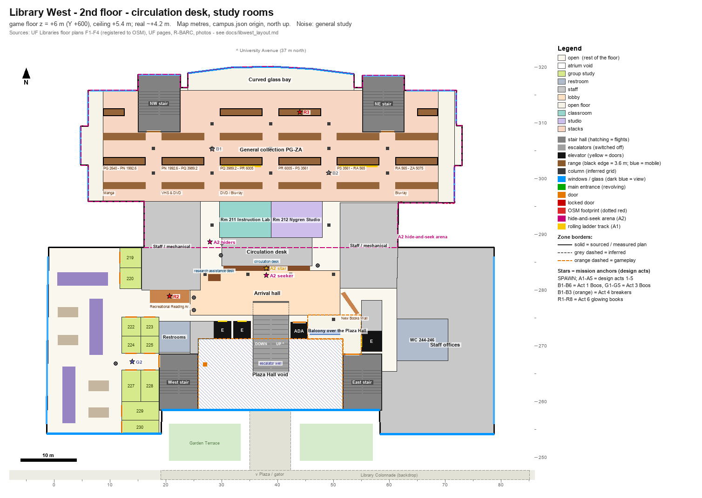
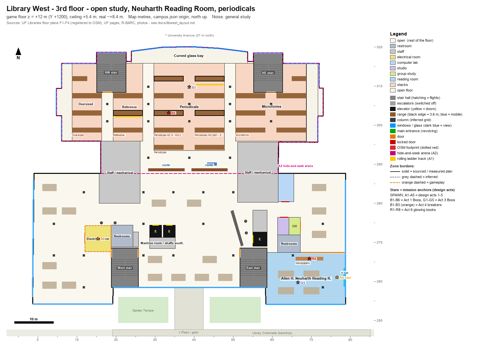
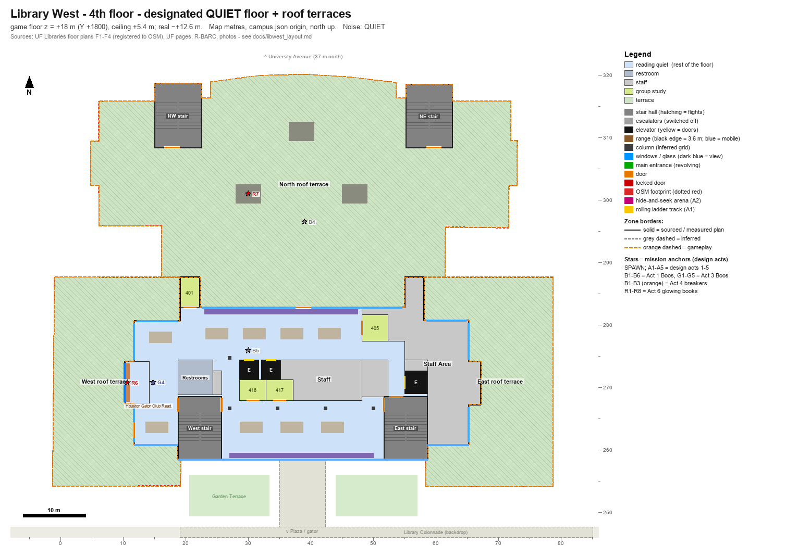
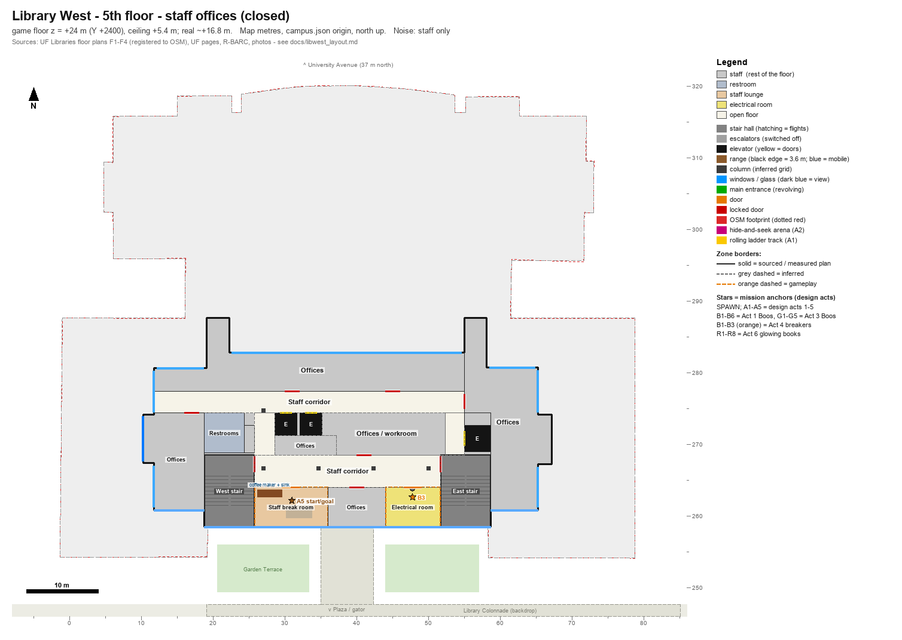
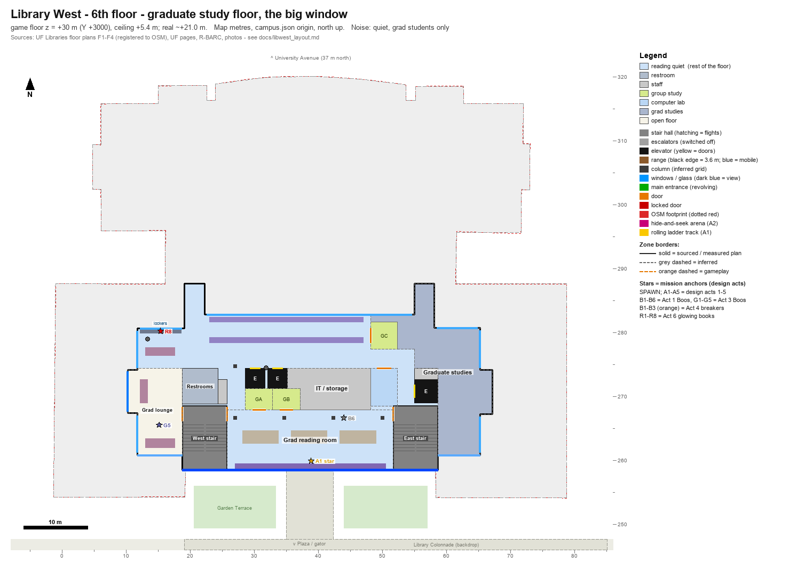
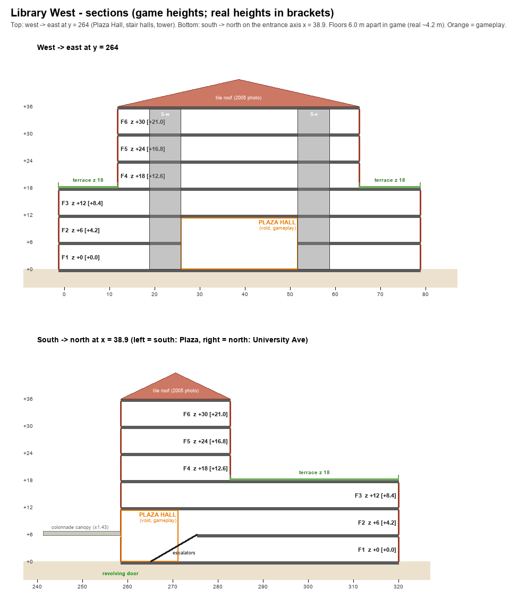

# Library West After Dark: interior layout (Course 5)

Status: layout research. Input for the Course 5 stage build (slot `bbh`, `LEVEL_BBH`, door 5, open from the start with 0 stars, docs/flow.md §2) and for the Course 5 mission author. `levels/bbh` is built from it (`tools/campus/interiors/libwest.py`, docs/flow.md §9.5).

Files:

| File | What |
|---|---|
| `data/uf/libwest_layout.json` | The layout as data, in the same schema as `data/uf/marston_layout.json` (`sgl64.marston_layout/1`; `schema_note` lists the additive keys): floors with z levels, outlines, zones, props, doors, windows, columns, vertical cores, the Plaza Hall void, roof terraces, entrance + spawn, mission anchors for game_design.md §7.5, backdrop, night lighting, deviations, sources. Map metres, same origin as `campus.json`. |
| `art/levels/libwest/layout_floor1.png` … `layout_floor6.png` | One sketch per floor, drawn from the JSON. |
| `art/levels/libwest/layout_section.png` | Two sections: west→east through the Plaza Hall and the stair halls, south→north on the entrance axis. |

How sure each item is. Every zone, prop, door and window in the JSON carries one of these labels, and the sketches draw zone borders differently:

- **sourced**: stated in a cited source (text or photo).
- **plan**: measured from the official UF floor-plan images, registered to the OSM footprint (±0.5 m on floors 1-3; floor 4 ±1 m in x, ±1.5 m in y).
- **inferred**: my reading of the sources, not stated anywhere (positions, sizes, the floor 5-6 layouts, colours).
- **gameplay**: invented or changed for fun, the camera or a mission. Section 11 lists all of these.

Coordinates: map metres, x east, y north, origin Century Tower (as `campus.json`). `z_game_m` is the height above the hub's grade, which is the 1st floor. The stage centre is (38.9, 285.6) (`stages.json`), so game `X = (x − 38.9)·100`, `Y = z·100`, `Z = −(y − 285.6)·100`. Yaw: 0 faces +Z (south), 0x4000 east, 0x8000 north.

---

## 1. Summary

1. **Library West is a six-storey tower on a three-storey base, not one six-storey block.** The 2024 plans of floors 1-3 fill the whole OSM footprint. The floor-4 plan is a much smaller plate: the 1967 tower, about x 11.8..65.3 by y 258.5..282.8 (53.5 × 24 m), centred on the entrance axis. A 2005 photo shows the same thing: a tall central block with low wings (S23). The roof of the base wraps round floor 4, and the game uses it as night-time **roof terraces**.
2. **The north part is the 2006 addition.** It is three storeys (S13), with a curved glass front on University Avenue between two stair towers. A 45 m wide "neck" joins it to the 1967 block. Its area over three floors comes to 60,117 sq ft, against the "three-story 60,000 sq ft addition" (S13).
3. **The main entrance is the revolving door at OSM n4741830154 (38.91, 258.53).** It sits in the middle of the recessed two-storey glass wall, under the colonnade's entrance canopy. Hub door 5 (38.91, 258.43) is on the same spot, so nothing in the hub has to move.
4. **The 1st floor is two separate places.** Inside the door is a lobby: café seating to the west, the Starbucks to the east, and two escalators rising north to the 2nd floor. The 1st-floor stacks behind it can only be reached from the 2nd floor (S11). This matches the plans: the main elevators open north into the study floors on every level.
5. **Floors:**
   - Floor 1: lobby and stacks. The Isser and Rae Price Library of Judaica and the compact-shelved collection are in the north wing. The Mindfulness Studio (Rm 140) and the One Button Studio are in the SE, and there is a wudu station and fitness bike desks.
   - Floor 2: circulation desk, ten study rooms, proctor booths, Rm 211 Instruction Lab, Rm 212 Nygren Studio, the New Books Wall, and manga, DVD and Blu-ray.
   - Floor 3: one big open study floor with the Neuharth news reading room, the Accessibility Studio, microforms, periodicals and the Bloomberg Terminal.
   - Floor 4: the designated quiet floor.
   - Floor 5: staff offices.
   - Floor 6: the graduate floor, entered with a card in the elevator.
   - Floors 1-3 are general study, floor 4 is quiet, and floor 6 is quiet and for graduate students only (S1, S6, S7, S9).
6. **Game scale:** plan dimensions are 1:1. Floors are 6.0 m apart in the game against about 4.2 m in reality, the same rule as Marston. The game floors are F1 0, F2 6, F3 12, F4 18 (which is also the roof of the base), F5 24 and F6 30, with the tower eaves at 36.
7. **The design's "rotunda" becomes the Plaza Hall.** This is a gameplay void over the lobby, 25.9 × 12.7 m and 11.4 m tall, behind the real two-storey glass wall. It is the Big Boo arena and the night showpiece.
8. **Area check:** the six registered plates add up to 182,664 sq ft, against 177,000 sq ft in total (S14), or +3 %. The 1967 building comes to 122,547 sq ft against 117,000-120,000 (S13, S15).

---

## 2. What the sources say

### 2.1 The building

- **History:**
  - Library West opened in 1967 as the "Graduate Research Library", with 600,000 volumes and 600 study spaces (S16).
  - It closed in December 2003 for a renovation of about $24-30M that doubled its capacity and added a Starbucks to the lobby.
  - It reopened in August 2006, was dedicated on January 26 2007, and is certified LEED Gold (S12, S14, S16).
- **The 2006 project:**
  - A three-storey addition of 60,000 sq ft, plus a renovation of the existing 117,000 sq ft on six floors (S13). Kawneer gives 60,000 GSF "4-story" and 120,000 GSF "6-story"; the 177,000 sq ft total is from S14.
  - Ross Barney Architects were the prime architect, with Long & Associates as engineer / architect of record (S13-S15).
- **Design statements:**
  - "a two-story transparent glass exterior wall at the main entrance" that connects to the Plaza of the Americas (S13)
  - a transparent north facade (S13)
  - a south facade "opened up dramatically on the lower two floors" (S13)
  - compact mobile shelving on most of the 1st floor and on floors 2-3 of the new structure (S13)
  - a concrete waffle slab that matches the existing floor elevations (S13)
- **Size and seats:** 1,400 seats (S12, S16), or about 1,600 in the program (S13). In 2007 the building had 20 group study rooms (18 today, S9, S12), 84 graduate studies, 36 faculty studies, 139 computers and 1.25-1.7 million volumes (S13, S16).
- **Hours ("After Dark"):**
  - It was open 24 hours, five days a week, from 2011 (S19).
  - Student Government approved 24/7 opening in 2018 (S12).
  - During finals it now opens until 4 a.m., and the Starbucks keeps the same hours (S18, S22).
- **Footprint:** OSM r12122775 covers 4,364 m², 80.1 × 66.0 m. OSM tags it `building:levels=5` and `level=1;2;3;4;5;6` (S24).

### 2.2 Floor by floor

| Floor | Use | What is there | Sources |
|---|---|---|---|
| 1 | general + café | **Lobby (outside the gates):** revolving door, café seating, Starbucks, two escalators, ADA elevator. **Study floor (reached from F2):** the Isser and Rae Price Library of Judaica (NW, compact shelving), the general collection A-HV (compact, through the north wing and in the east and west wings), fitness bike desks by the back and side walls, a wudu station, Mindfulness Studio Rm 140 and One Button Studio (SE), external book drop (east bay), scanner + printer | S2, S8, S11, S12, S13 |
| 2 | general | Escalator and ADA arrival; circulation desk with SelfCheck, AED and first aid; research assistance desk; Rm 211 Instruction Lab, Rm 212 Nygren Studio; study rooms 219, 220, 222-225, 227-230; 10 proctor booths (SW, a quiet corner); Recreational Reading Area; New Books Wall; iMacs; office-supplies vending; restrooms W and E (gender-inclusive 244/245, lactation 246); general collection PG-ZA, manga, VHS & DVD, Blu-ray; staff wing east | S3, S9, S10, S17 |
| 3 | general | One open study plate; Allen H. Neuharth Reading Room (SE corner: newspapers, live-news TV); Rm 335 Accessibility Studio; Rm 336; Rm 339 microform readers; Bloomberg Terminal; oversized, reference, periodicals, microform collections. The 9-ft bronze gator stood here in 2016 | S4, S11, S20, S21 |
| 4 | **quiet** | The 1967 tower's plate: study round a core (restrooms, two elevators, rooms 416-417, staff), rooms 401 and 405, Houston Gator Club Reading Nook (a west bay), staff space east; group study only inside the rooms; snacks only | S5, S6 |
| 5 | staff | "office space for library employees" (S1); staff only (S18). No plan published | S1, S18 |
| 6 | quiet, grad | Enrolled UF graduate students only, Gator 1 card at the elevator reader; individual desks with power, large reading tables, lounge seating; 3 group rooms (2 × 6, 1 × 4) with wall displays; media production and scanning station; lockers + print release in the NW corner. No plan published | S7, S9, S12 |

### 2.3 Where the main entrance is (OSM and hub door 5)

- **The door:** OSM entrance node n4741830154 is tagged `entrance=main`, `door=revolving`, `level=1` and `wheelchair=yes`. It sits at (38.91, 258.53), on the line of the recessed glass wall, which runs from x 19.3 to 58.3 at y 258.5.
- **The recess:** the wings' plaza faces are at y 254.1-254.2, so the door is 4.3 m back from them. The colonnade's entrance canopy (x 35.0..42.4, from the walk at y 247.6 to the door) leads straight to it.
- **On the plan:** the floor-1 plan (S2) draws the door as a circle in the same spot, with the "Front Entrance" arrows. It notes "Entrance/Exit accessible from Floor 2".
- **Hub door 5:** the hub door is at map (38.91, 258.43), facing south (flow.md §4.1). That is 0.1 m from the OSM node, on the real door. **No hub change is needed.**
- **North doors:** two more doors (OSM n10117492280 at (23.27, 316.30) and n10117492278 at (54.46, 316.29)) are in the notches beside the curved front. They open onto the University Avenue lawn. In the game they are locked.
- **Spawn:** the game spawn is just inside the revolving door at (38.9, 262.4), facing north toward the escalators. In game units that is (0, 0, 2320), yaw 0x8000.

### 2.4 The tower on the base

- **Two plan scales:** the floor 1-3 plans (2024) and the floor-4 plan (2023) are drawn at different scales. When each is registered on its own anchors (section 3), floor 4 turns out to be a 53.5 m plate centred on the entrance axis. The two stairs that flank the recess, the west restrooms, the elevator pair and the east elevator all land on the floor 1-3 positions within about 1 m.
- **The tower's shape on the floor-4 plan:**
  - its middle face stands on the recess line (y 258.5), and its side parts on y 260.8
  - it has small bays west (the reading nook) and east
  - two 3 × 5 m projections reach back to the base's north wall
- **The 2005 photo (S23):** taken during the renovation, it shows the same massing:
  - a central block with a two-storey base and four storeys of vertical brick piers with narrow window slots, under a red-tile hipped roof
  - low wings either side, behind the colonnade
- **Where the hub differs:** the hub currently models the whole 80 × 33.5 m block at six storeys (section 12).

### 2.5 Study rooms, quiet rules, hours

- **Group study rooms:**
  - There are 18 bookable group study rooms, six of them with large flat screens (S9, S12).
  - Bookings are 2-hour blocks, up to 10 days ahead, for groups of two or more, not for solo study or exams (S9).
  - The plans number 15 rooms (F2: 10, F3: 1, F4: 4), and S7 adds 3 graduate rooms on F6, which makes 18.
- **Quiet areas (S10):**
  - the 4th floor
  - the stack areas of floors 1-3, where the east and west walls are quietest
  - the 2nd-floor SW corner by the proctor booths
  - the 6th floor

  The library "cannot offer a completely silent study area" (S6). This is the "Quiet Hours" of Act 2.
- **Food:** on the quiet floor only simple snacks are allowed. Real food goes to the 1st-floor café or the colonnade (S6).

---

## 3. How the plans were mapped

The four plan images (Canva, 2000 × 1545 px; S2-S5) were used only for measuring and are not copied into the project.

- **Floors 1-3:** all three are drawn at the same 18.25 px/m with north up. One offset per image puts the OSM outline of r12122775 on the drawn walls to about ±0.5 m. The south face, the entrance recess, the side walls, the neck walls at x 16.1 and 61.5, the north wing's walls, its bays, the stair towers and the curved front all line up. The formulas are in `plan_fit.formulas`.
- **Floor 4:** this plan is schematic and drawn at about 29.6 px/m.
  - It was registered on the two recess stairwells (x 18.8 and 58.7 at y 258.5).
  - It was then checked on the restrooms, the elevator pair and the east elevator, all within about 1 m in x.
  - Positions in y drift by up to about 2.5 m (the elevator pair), so floors 4-6 are ±1.5 m.
- **What the mapping showed** (`plan_fit.findings`):
  - The north wing is x 6.1..72.0, y 295.9..315.8, with the curve to y 320.1. The neck is x 16.1..61.5, y 287.6..295.9.
  - The main elevators sit at x ~28.5..35.3, y ~271.2..274.4 on every floor, with their doors facing north.
  - The escalators run from about y 261 to 276. The down lane is west and the up lane is east (the EXIT and up arrows on S3).
  - The Starbucks drawn on S2 matches the OSM indoor room w891179063 (x 42.2..58.3, y 258.5..267.1).

---

## 4. Game rules for this interior (camera-friendly adaptations, as Marston)

| Rule | Value | Why |
|---|---|---|
| Plan dimensions | 1:1 map metres | project rule |
| Floor-to-floor | **6.0 m** game (real ≈ 4.2 m, estimated from the hub's 25.3 m roof over 6 floors) | SM64 camera headroom and air above the stacks; one backflip no longer clears a floor |
| Floor z (game / real) | F1 0 / 0, F2 6 / 4.2, F3 12 / 8.4, F4 18 / 12.6, F5 24 / 16.8, F6 30 / 21.0, tower eaves 36 / 25.2 | F1 = hub grade |
| Clear height | 5.4 m (0.6 m slab); the Plaza Hall 11.4 m | |
| Stair halls | west and east halls 7.0 × 10.0 m, NW and NE halls 7.5 × 10.2 m: switchbacks with 3.15-3.45 m lanes, 3.0 m rise and 5.2 m run per flight (30°) | the real stairwells are about 3.2 × 7.2 m; below SM64's 38° slide limit; use not-slippery stair surfaces |
| Escalators | two static 30° ramps, 6 m over 10.4 m | "switched off after hours"; no escalator surface in SM64 |
| Stacks | E-W ranges 1.2 m deep in the plans' six call-number columns; 3.2 m aisles between rows, 2.86 m aisles between columns; rows 2 and 4 are 3.6 m tall on F2-F3 (built 3.0 m, as at Marston), the rest 2.3 m; F1 north-wing ranges are flagged `mobile` (compact shelving) | running on range tops, the camera between ranges, lines of sight for hide-and-seek |
| Doors | ≥ 2.0 m (stair doors 2.15-2.4 m); study-room doors 2.0 m | co-op traffic |
| Corridors | ≥ 2.6 m (the F2 room corridor 3.0 m, the core's north corridor 3.0 m) | camera |
| Railings / parapets | 1.0 m round the Plaza Hall; 1.1 m on the roof terraces | |
| Fall damage | over 11.5 m; the only open drops are the Plaza Hall from the F2 balcony (6 m, safe) and range tops (at most 3.6 m) | low risk; terrace edges are out-of-bounds edges (no floor beyond), as at Marston |
| Budget | about 5,000 collision tris (hint 7,000) | box collision for ranges, rooms and props |

Checks run on the JSON when it was written:
- zones lie inside their outline and do not overlap
- cores do not hit zones or props
- range aisles are at least 2.3 m
- doors sit on wall lines and are at least 2.0 m wide (locked decals at least 1.2 m)
- mission points stand on walkable floor, outside cores
- stair slopes are 30°
- every coordinate fits in an s16

A raster check also confirmed that every floor's anchors (stair doors, elevator doors, room doors, mission points) form one connected area, even with 0.8 m of clearance. The exception is F1, which is two areas on purpose: the lobby and the study floor.

---

## 5. Floor plans (game layout)

Each sketch draws:
- zones, with borders solid for sourced or plan items, grey dashed for inferred, orange dashed for gameplay
- stair halls (hatching = flights), escalators, elevators (yellow = doors)
- ranges: a black edge means 3.6 m, a blue edge means mobile compact shelving
- columns from the inferred grid
- windows in blue (dark blue = view window) and doors in orange; locked doors are red and the revolving door is green
- the hide-and-seek arena as a magenta dashed line, and the rolling-ladder tracks in yellow
- mission anchors as stars
- the OSM footprint as a dotted red line

### Floor 1: lobby + stacks (z 0)



- **Lobby** (a separate pocket; its walls are in `entrance.lobby_boundary_m`):
  - **Vestibule** behind the revolving door, x 35.6..42.0, y 258.5..265.1. Spawn here. [plan]
  - **Café** seating to the west, x 25.8..35.6. [plan; shifted east of the wide stair hall]
  - **Coffee bar** to the east, x 42.0..49.4, with the N-S counter and a back bar to 51.7. The Act 5 cup sits on the counter. The real Starbucks room runs to x 58.3; the game version is unbranded and narrower. [sourced: OSM room, S12]
  - **Escalators** rise north out of the vestibule, and the ADA elevator opens off the coffee bar's NE corner. [sourced; ADA position inferred]
  - **Plaza Hall** above it all: the 2nd floor is cut away (section 6). [gameplay]
- **Study floor** (reached from F2 by the stair halls or the main elevators, which open north):
  - **West wing:** HD-HQ ranges, a staff block in the SW, and the electrical room in the NW, which is breaker 1 of Act 4. [plan; electrical room gameplay]
  - **Middle:** an open band north of the restrooms and elevators (scanner, printer, tables). The compact A-E runs start there and go up through the neck into the north wing. [plan]
  - **East wing:** PG-HV ranges, the HQ-HV block behind the coffee bar, and the wudu station. The Mindfulness Studio Rm 140 and One Button Studio are in the SE. [plan + S8]
  - **North wing:** the **Price Library of Judaica** (NW) and the general collection, all on compact mobile shelving. Window seats and **fitness bike desks** line the west and east walls, and the curved glass bay faces University Avenue. The NW and NE stair halls are here. [S2, S11, S13; bike positions inferred]
- **Windows:** the lower half of the **two-storey glass wall**; the glazed wing fronts toward the Plaza; the three-storey curved curtain wall to the north.

### Floor 2: circulation desk, study rooms (z 6)



- **Plaza Hall void** over the lobby, x 25.8..51.7, y 258.5..271.2. The escalator well continues north to y 275.5. [gameplay]
- **Arrival hall** at the top of the escalators, with security gates (inferred). The ADA elevator arrives here. [plan]
- **North side of the hall:**
  - the **circulation desk**, a 15 m counter with the staff side behind it [plan]
  - the research assistance desk, AED and first aid, and the self-checkout [plan]
  - behind the desk, Rm 211 Instruction Lab and Rm 212 Nygren Studio, with corridors either side leading into the stacks [plan; narrowed]
- **Balcony** east of the escalators, with the iMacs looking down into the hall. [gameplay]
- **West wing** (the quiet SW corner, S10):
  - study rooms 227-230 south of the stair door, and 222-225 north of it (moved 1 m north) [plan]
  - rooms 219-220 by the neck, the 10 **proctor booths** on the west wall, study carrels, and the Recreational Reading Area shelf [plan]
- **East side:**
  - the **New Books Wall**, drawn on the diagonal [plan]
  - the restroom cluster with gender-inclusive 244/245 and lactation 246 [plan + S10]
  - staff offices filling the east wing [plan]
- **North wing:** the PG-ZA columns. Row 1 holds the manga / VHS & DVD / Blu-ray shelves. Rows 2 and 4 are 3.6 m and carry the Act 1 rolling-ladder tracks. This is the Act 2 arena. [plan; heights gameplay]

### Floor 3: open study, Neuharth Reading Room, periodicals (z 12)



- **The open floor:** one big open study floor over the whole base, with tables throughout. [plan; tables inferred]
- **Allen H. Neuharth Reading Room** (SE corner): newspapers, a live-news TV wall and tables, open to the north. The Act 4 star is in front of the TV. [sourced S20 + plan]
- **East core:** Rm 335 Accessibility Studio (locked), Rm 336, the east restrooms, Rm 339 microform readers, a diagonal feature wall, printers and a scanner. [plan]
- **West side:** the restrooms, and the **electrical room**, which is breaker 2 of Act 4. [plan; room use gameplay]
- **The neck:** two reading counters, the **Bloomberg Terminal**, and the first periodicals run. [plan]
- **North wing:** oversized (1.8 m), reference, periodicals (3.6 m rows) and microform cabinets (1.5 m). [plan; heights inferred]
- **Windows:** ribbon windows above the two-storey glass and on the wings, plus the top storey of the curved curtain wall. [inferred]

### Floor 4: designated quiet floor + roof terraces (z 18)



- **The tower plate:** quiet study in a U round the core. There is a south band behind the slot windows, the west part with the **Houston Gator Club Reading Nook** bay, and a north band of window desks. [plan]
- **The core:**
  - restrooms, the elevator pair, rooms **416-417**, and staff space [plan]
  - room **401** in the NW projection [plan]
  - room **405** (moved 1.9 m north so the corridor is 3 m) [plan]
  - the east part, which is staff [plan]
- **Roof terraces** at z 18 (the roof of the three-storey base): [gameplay]
  - west and east of the tower, and a large **north terrace** over the north wing with rooftop units
  - reached by doors from F4 (west wall and north wall) and by the NW and NE stair halls, which come up as bulkheads with roof doors
  - 1.1 m parapets; the outside edge is an out-of-bounds edge, as at Marston

### Floor 5: staff offices (z 24)



- **Offices:** offices fill the plate and are closed (solid). [sourced: S1; layout inferred]
- **What is walkable:** a corridor ring round the core, the **staff break room** (start and goal of Act 5, with a Plaza view), and the **electrical room** (breaker 3 of Act 4). [gameplay]
- **Stair doors:** both stair-hall doors are **locked** ("STAFF ONLY") except in Acts 4-5. The elevators open onto the corridor. [inferred]

### Floor 6: graduate study floor, the big window (z 30)



- **Grad reading room** across the south band, with the large reading tables (green-shaded lamps). [S7; position inferred]
  - The plaza-face slots open into **THE big window**, 0.8-4.4 m high, looking at the Plaza of the Americas and the lit Century Tower (188°, 289 m). [gameplay]
  - The **Act 1 star** is over the window counter.
- **North band:** individual desks with power. [S7; positions inferred]
- **NW corner:** lockers and the print release station. [sourced S7]
- **West bay:** grad lounge with lounge seating. [S7; position inferred]
- **Group rooms:** grad group rooms A and B (6 seats each) and C (4 seats) take the floor-4 room slots. [S7; positions inferred]
- **Other rooms:** the media production and scanning station sits in the floor-4 "Staff Area" slot. The east part is a block of locked **graduate studies** (84 of them in 2007, S16). [inferred]
- **Access:** a Gator 1 card reader in the elevator (S7). The stair doors are open in the game.

---

## 6. Vertical circulation

| Id | Where (map m) | Floors | Real | Game |
|---|---|---|---|---|
| `stair_w` | x 18.8..25.8, y 258.5..268.5 | F1-F6 | stairwell at the recess's west corner, ~3.2 × 7.2 m (S2-S5) | switchback, N-S flights, lanes 3.15 m, floor landing north, turn landing against the glass (Plaza views at z 3, 9, 15…). Doors: F1 west (stacks only), F2 west, F3 W + E, F4 W + E, F5 E (locked), F6 W + E |
| `stair_e` | x 51.7..58.7, y 258.5..268.5 | F1-F6 | stairwell at the recess's east corner (S2-S5) | mirror of `stair_w`. Doors: F1 east (stacks), F2 north, F3 W, F4 W + N, F5 W (locked), F6 W |
| `stair_nw` | x 15.0..22.6, y 308.4..318.6 | F1-F3 + roof (z 18) | stair icon in the NW tower box (S2-S4) | switchback reaching 7 m into the stacks (inferred); door south on each floor; roof door onto the north terrace (gameplay) |
| `stair_ne` | x 55.2..62.7, y 308.4..318.5 | F1-F3 + roof | NE tower box (S2-S4) | as `stair_nw` |
| `elevators_main` | x 28.6..35.2, y 271.2..274.4 | F1-F6 | "the main library elevators" (S8): two cars, doors north on every plan; card reader for F6 (S7) | car A: a working lift or a wall-kick shaft (mission author's call); car B: closed |
| `elevator_east` | x 55.0..58.7, y 269.0..272.6 | F1-F6 | one car on every plan (S2-S5) | moved 1.6 m north; doors west (F1: east); closed or a lift |
| `elevator_ada` | x 42.4..45.4, y 271.2..274.2 | F1-F2 | "accessible via escalators and ADA elevator" (S3); icon inside the escalator band | through car: lobby door south, F2 door north (position inferred) |
| `escalators` | x 35.6..42.0, y 265.1 → 275.5 | F1→F2 | two escalators rising north, down = west, up = east (S2, S3, S17) | static 30° ramps, top landing y 275.5..277.9 on F2 |
| `plaza_hall` | x 25.8..51.7, y 258.5..271.2 | F1 floor, open through F2 | two-storey glass wall at the entrance (S13); F2 floor runs to it on S3 | 11.4 m tall void; railing on the F2 balcony edges; one free column (27.08, 266.6) |

---

## 7. Sections



The same stacking in text (south on the left, north on the right, on the entrance axis):

```
 z (game) Plaza south block (1967) neck north wing (2006) University Ave
  +36 +---- tile roof (2005 photo) ----+
  +30 | F6 grad floor, BIG WINDOW |
  +24 | F5 staff offices |
  +18 | F4 quiet floor (tower) |========= north roof terrace (z 18) ========|
  +12 canopy | F3 open study, Neuharth...................................... curved glass |
   +6 ====== | PLAZA HALL | F2 desk, rooms................ stacks (PG-ZA)......... front |
    0 (colonnade)| (void) ^esc F1 lobby | stacks behind (Judaica, compact)......... (F1-F3) |
       revolving door at y 258.5
```

---

## 8. Mission anchors (game_design.md §7.5)

The design act numbers are listed here; the course act order is the mission author's call (flow.md §5.1: playable acts first, solo first, co-op last, no gaps, star id = act − 1). A suggested order:

1. ALL-NIGHTER (design act 1)
2. THE GHOST OF FINALS PAST (design act 3)
3. QUIET HOURS HIDE-AND-SEEK - 2P (design act 2)
4. then COMING SOON - LIGHTS OUT / COFFEE RUN / GLOWING BOOKS

Heights are the floor (Mario's feet) plus the offset shown. All anchors are in the JSON under `missions`, with `game_xyz`.

| Anchor | Floor | Map (x, y) | z game | Game (X, Y, Z) | Note |
|---|---|---|---|---|---|
| spawn (0x0A) | F1 | (38.9, 262.4) | 0 | (0, 0, 2320) | vestibule, facing the escalators (yaw 0x8000) |
| A1 star | F6 | (38.9, 259.9) | 31.6 | (0, 3160, 2570) | the big window over the Plaza |
| A2 seeker start | F2 | (38.0, 282.6) | 6 | (−90, 600, 300) | night librarian counts at the circulation desk |
| A2 hider release | F2 | (27.9, 288.6) | 6 | (−1100, 600, −300) | west corridor into the stacks |
| A2 star | F2 | (38.0, 283.9) | 7.25 | (−90, 725, 170) | on the circulation desk counter (design) |
| A3 Boos G1-G5 | F1, F2, F3, F4, F6 | see JSON | | | compact stacks, room corridor, Neuharth, reading nook, grad lounge |
| A3 Big Boo | F1 | (45.6, 266.8) | 3 | (670, 300, 1880) | Plaza Hall (the "rotunda") |
| A3 star (GhostHuntBooStarPos) | F1 | (30.7, 266.6) | 1.6 | (−820, 160, 1900) | café, under the hall; BalconyBooStarPos option on the F2 balcony (970, 740, 1180) |
| A4 breakers B1-B3 | F1, F3, F5 | (2.4, 285.6) / (15.4, 270.9) / (47.8, 262.6) | 0 / 12 / 24 | (−3650, 0, 0) / (−2350, 1200, 1470) / (890, 2400, 2300) | the three electrical rooms |
| A4 star | F3 | (76.6, 261.0) | 13.2 | (3770, 1320, 2460) | Neuharth, by the news TV |
| A5 start / goal | F5 | (31.0, 262.1) / (27.9, 263.1) | 24 / 25 | (−790, 2400, 2350) / (−1100, 2500, 2250) | staff break room / its coffee maker |
| A5 cup | F1 | (49.0, 266.0) | 1.1 | (1010, 110, 1960) | on the coffee counter |
| A6 R1-R8 | F1, F2, F2, F3, F3, F4, F4, F6 | see JSON | | | Judaica range top, RRA shelf, 3.6 m range, newspaper racks, periodicals range, reading-nook shelf, rooftop unit on the north terrace, grad lockers |

Act notes:

- **Act 1, All-Nighter.**
  - The JSON route: vestibule → stopped escalator → F2 stacks (Boos; **rolling library ladders** on four tracks along the 3.6 m ranges) → NW stair → its roof door → across the dark north terrace → F4 north door → quiet floor → east stair hall → F6 (its F5 door is locked) → the big window.
  - Act-masked "CLOSED FOR CLEANING" barriers on the F1-F3 doors of the west and east stair halls force this route. The night custodial crew is a gameplay device.
- **Act 2, Quiet Hours Hide-and-Seek (2P+).**
  - The arena is the north wing + neck on floors 1-3, linked by the NW and NE stairs (the real "quiet" stack areas, S10). The south block is out of bounds during a round.
  - Eight hiding spots are suggested.
  - The seeker starts at the desk, and the star appears on the desk counter (design).
  - The results board is a wall sign on the desk enclosure.
- **Act 3, The Ghost of Finals Past.** Five small Boos, one each on F1, F2, F3, F4 and F6, then Big Boo in the Plaza Hall. Clear the café tables with act masks.
- **Act 4, Lights Out.** Breakers sit on F1, F3 and F5, three separate stair trips. F5's stair doors open in this act.
- **Act 5, Coffee Run.** The design starts "on the 5th floor", and the real 5th floor is staff offices, so its break room opens for this act. The route goes down the stair hall to F2, down the escalator, to the counter and back up, with par 60 s. Boos block three stair turn-landings.
- **Act 6, Re-shelve the Glowing Books.** Eight glowing books, spread over five floors and one terrace.

---

## 9. Outside the windows

Bearing and distance are from the stage centre. Scale near items vertically by ×1.43 to match the game floors; keep far ones at true height. At night the far ring is mostly lit windows and lamps.

| Item | Bearing | Distance | Height | Tier |
|---|---|---|---|---|
| Library Colonnade + entrance canopy (rebuilt 2024-25, solar roof) | 162° | 43 m | 4.6 m | near |
| Garden Terrace + the bronze gator "Focused Attention" (S25) | 180° | 47 m | 2.7 m | near |
| Plaza of the Americas (lamps, oaks, walks) | 173° | 104 m | 0 | near |
| Smathers Library | 121° | 125 m | 18 m | near |
| Anderson Hall (flanks the site east, S13) | 79° | 105 m | 11.5 m | near |
| Keene-Flint Hall (flanks the site west, S13) | 273° | 103 m | 11.5 m | near |
| West University Avenue (streetlights, traffic) | 10° | 72 m | 0 | near |
| Episcopal Chapel of the Incarnation / Institute of Black Culture / La Casita / Baptist Collegiate Ministries / a corner store (unbranded) | 19° / 35° / 39° / 334° / 321° | 122-144 m | 6-10 m | near |
| **Century Tower** (lit; the F6 view) | 188° | 289 m | 47.9 m | far |
| University Auditorium | 180° | 269 m | 18 m | far |
| Peabody, Criser, Griffin-Floyd, Leigh, Chemistry Lab, Matherly, The Seasons at Midtown | 82°-243° | 127-188 m | 11.5-15 m | far |

---

## 10. Night look: materials and light

- **Setting:** about 3 a.m. in finals week. The library is open until 4 a.m. (S18, S22); it was open 24/5 in 2011-13 (S19).
- **Sky and fog:** dark blue (16, 22, 48). Campus lamps are warm points.
- **Floors:**
  - Lobby, escalators and elevator lobbies: the real **mustard terrazzo** of recycled marble and granite chips (S17).
  - Everywhere else: carpet tinted per floor (game accents taken from the plan key): F1 Judaica orange, F2 new-books violet, F3 periodicals coral, F4 sage, F5 grey, F6 navy.
- **Vertex-colour light** (factors in `materials_and_light`):
  - Most ceiling lights are off: the interior is dim warm (0.55, 0.50, 0.44).
  - **Desk lamps** make warm pools (1.10, 0.92, 0.66) on every table, carrel and window desk.
  - Within 3 m of the glass the light is cool blue (0.36, 0.42, 0.62).
  - Stack aisles are dark (0.32) with lighter range tops.
  - The **Plaza Hall** is blue from the glass and warm under the café and the coffee counter.
  - F6 has green-shaded banker's lamps.
  - The staff floor is dark except its two open rooms.
  - The terraces are moonlit, with the tower's lit windows behind.
- **Emissive:** computers, iMacs, the self-checkout, the Bloomberg Terminal and the Neuharth news TV are cyan-white. Red EXIT signs hang over every stair door, and the coffee bar has a lit menu board.
- **Readability rule:** keep every walkable surface at a factor of 0.30 or more.
- **Act 4 (Lights Out):** `le_set_mode(LE_MODE_AFFECT_ALL_SHADED_AND_COLORED)`, ambient (20, 20, 30), and a light on every Mario (design).

---

## 11. Deviations from 1:1

| What | Real | Game | Why |
|---|---|---|---|
| Floor-to-floor | ≈ 4.2 m | 6.0 m, 5.4 m clear | camera, stacks, jumps |
| Plaza Hall | F2 floor runs up to the 2-storey glass | 25.9 × 12.7 m void, 11.4 m tall | Big Boo "rotunda", the night showpiece |
| West / east stair halls | 3.2 × 7.2 m | 7.0 × 10.0 m, 30°; the restrooms and east elevator shift 1.0-1.6 m north | camera-friendly stairs |
| NW / NE stair halls | only the tower boxes are drawn | 7.5 × 10.2 m halls + roof doors | hide-and-seek links, the Act 1 roof route |
| Escalators | moving, 4.2 m rise | static 30° ramps, bottom 2.6 m further in | no escalator in SM64; spawn room |
| ADA elevator | icon in the escalator band | through car east of the escalators | needs a shaft |
| Stacks | compact shelving, ~0.6 m deep ranges, no fixed aisles | 1.2 m deep, 3.2 / 2.86 m aisles, 3.6 m rows on F2-F3 | range-top running, camera |
| Rooms nudged | 222-225, 405, 211/212, iMacs, the F3 diagonal bar, the F4 SE staff block | moved 1-2 m / narrowed / onto the balcony / folded into study | clearances by the wide stairs and the void |
| Roof terraces | roofs of the 3-storey base, access unknown | walkable decks at z 18 | outdoor night level |
| 5th floor | offices (no plan) | closed except a corridor ring, the break room and the electrical room | Acts 4-5 |
| 6th floor | no plan; amenities sourced | F4's core and room slots reused; the slot windows become one big view window | Act 1's "big window" |
| Entrance | revolving door onto the Plaza | locked after hours, no walkable outside; leave by the pause menu | interior stage at night |
| Coffee counter | Starbucks, x 42.2..58.3 | unbranded, x 42.0..51.7 | no brands; the wide stair hall |
| Invented | none | rolling ladders, Boos and Big Boo, breakers, the coffee cup, glowing books, results board (security gates are likely real but inferred) | mission devices (§7.5) |

---

## 12. For the hub owner (not done here)

- **Massing:** floors 4-6 are a central tower about x 11.8..65.3, y 258.5..282.8, on a **three-storey base** that fills the OSM south block (S2-S5, photo S23). The hub models the whole 80 × 33.5 m block at six storeys (roof 25.3 m, parapet 26.0 m). The base roof would be about 12.6-13.5 m.
- **The tower in 2005:** the photo (S23) shows a **red-tile hipped roof** on the tower, and vertical brick piers with narrow window slots on its upper plaza face. The hub has continuous window bands with eyebrow ledges instead. Whether the tile roof survived the 2006 work is unverified.
- **The north wing:** its University Avenue side has brick **gabled pavilions** with tile roofs and a tall arched window either side of the long glass front (photo S23). The hub uses flat roofs and metal fascias there.
- **Door 5:** no change needed; it sits on the real revolving door.

---

## 13. Open questions

- The real floor-to-floor height (4.2 m assumed).
- The exact tower outline: the floor-4 plan is schematic, and floors 5-6 are assumed to match it.
- Whether the tower still has its tile roof.
- Where the ADA elevator really is.
- What the floor-3 plan's dotted bands and its diagonal bar by the east core mark.
- How far the NW and NE stairwells reach into the north wing.
- Floor 5 and 6 layouts (no plans published).
- Where lactation room 246 is: the inclusive-spaces page says "near the southwest corner stairwell", while the plan puts it in the east cluster behind the New Books Wall.
- Whether the Starbucks got its extra exit (planned in 2016, S21).

---

## 14. JSON quick reference

- **Top-level:** `floors[]` (F1-F6), `roof` (tower roof + `base_roof`), `vertical[]`, `missions`, `exterior`, `entrance` (incl. `lobby_boundary_m`), `building`, `footprint` (OSM + `south_block_poly_m`, `north_wing_poly_m`, `tower_poly_m`), `scale`, `plan_fit`, `materials_and_light`, `budgets`, `deviations`, `hub_followups`, `open_questions`, `sources`, `columns_note`, `validation_warnings` (empty).
- **Each floor:** the same keys as Marston: `z_game_m`, `z_real_est_m`, `outline_m`, `default_zone` (F5's default is closed `staff`), `zones[]`, `props[]`, `openings[]`, `windows[]`, `columns_m[]`, `sketch`.
- **Zone types:**
  - From Marston: `open_floor`, `lobby`, `vestibule`, `group_study`, `classroom`, `computer_lab`, `wellness`, `stacks`, `reading_quiet`, `staff`, `restroom`, `atrium_void`, `terrace`.
  - New: `cafe`, `studio` (closed), `reading_room`, `electrical_room`, `staff_lounge`, `grad_studies` (closed), `roof_tile`.
  - Rooms carry an optional `label` (sketch text) and `door_facing_deg`.
- **Prop types:**
  - From Marston: `range` (`mobile: true` on F1's compact shelving), `shelf_low`, `counter`, `table_cluster`, `computer_row`, `carrel_row`, `window_desk`, `printer`, `vending_machine`, `wall_sign`, `drinking_fountain`.
  - New: `revolving_door`, `bike_desk`, `wudu_station`, `scanner`, `self_checkout`, `security_gates`, `partition`, `tv_wall`, `lockers`, `sofa`, `rooftop_unit`, `breaker_panel`.
- **Vertical types:** `stair` (with `game.doors` keyed by floor, plus suffixes like `_east`, `_north`, `_roof`, `_locked`), `elevator_bank`, `elevator` (with `doors`), `escalator`, `atrium_void`.

---

## Sources

- **S1** UF Libraries, Library West Floor Plans:https://librarywest.uflib.ufl.edu/spaces/floorplans
- **S2** Floor 1 plan image (Canva, 2024-07-18): https://librarywest.uflib.ufl.edu/wordpress/files/2024/07/LW-Floorplans_Floor-1_2024.png
- **S3** Floor 2 plan image (2024-07-18): https://librarywest.uflib.ufl.edu/wordpress/files/2024/07/LW-Floorplans_Floor-2_2024.png
- **S4** Floor 3 plan image (2024-07-18): https://librarywest.uflib.ufl.edu/wordpress/files/2024/07/LW-Floorplans_Floor-3_2024.png
- **S5** Floor 4 plan image (2023-10-10): https://librarywest.uflib.ufl.edu/wordpress/files/2023/10/LWFloorplan_Floor-4.png
- **S6** Library West, Quiet Study Floor: https://librarywest.uflib.ufl.edu/spaces/quiet-study-floor
- **S7** Library West, Graduate Study Floor: https://librarywest.uflib.ufl.edu/spaces/graduate-study-floor
- **S8** Library West, Locating the Mindfulness Studio: https://librarywest.uflib.ufl.edu/spaces/mindfulness-studio/locating-the-mindfulness-studio/
- **S9** UF Libraries, Reserve Study Rooms with LibCal: https://uflib.ufl.edu/using-the-libraries/studyareas
- **S10** UF Libraries, Inclusive Spaces: https://uflib.ufl.edu/using-the-libraries/inclusive-spaces
- **S11** UF student guide "Visiting the George A. Smathers Libraries: Library West", read through search-result summaries (the page returned HTTP 403): https://ufl.pb.unizin.org/ulaguide/chapter/library-west/
- **S12** Wikipedia, University of Florida Library West: https://en.wikipedia.org/wiki/University_of_Florida_Library_West
- **S13** Ross Barney Architects, University of Florida Library West: https://r-barc.com/work/university-of-florida-library-west
- **S14** SchoolDesigns, UF Library West Addition/Renovation: https://schooldesigns.com/Projects/university-of-florida-library-west-addition-renovation
- **S15** Kawneer, University of Florida Library West: https://www.kawneer.com/projects/leed/university-of-florida-library-west/
- **S16** UF News (2007-01), University of Florida to dedicate Library West on Jan. 26: https://archive.news.ufl.edu/articles/2007/01/university-of-florida-to-dedicate-library-west-on-jan-26.html
- **S17** The Independent Florida Alligator (2008-06-30), flooring and circulation desk: https://www.alligator.org/r/16b7156e2e
- **S18** The Independent Florida Alligator (2011-11-28), finals hours and floor access: https://www.alligator.org/r/9a2203e10e
- **S19** UF News (2012-08-21), Overnight hours at Library West will continue: https://archive.news.ufl.edu/articles/2012/08/overnight-hours-at-library-west-will-continue-during-fall-semester.html
- **S20** The Independent Florida Alligator, the Allen H. Neuharth Reading Room (+ Library West collections page), read through search-result summaries: https://www.alligator.org/r/3c8d098e65
- **S21** The Independent Florida Alligator (2016-08-01), the colonnade and the alligator statue: https://www.alligator.org/r/95418516c0
- **S22** The Independent Florida Alligator (2025-26), finals hours, read through search-result summaries: https://www.alligator.org/r/4f00d6bbd8
- **S23** Wikimedia Commons, Category:Library West (Dsg_UF_Library_West.jpg and Dsg_UF_Plaza_of_the_Americas_20050507.jpg, 2005; UF-LibraryWest.JPG): https://commons.wikimedia.org/wiki/Category:Library_West
- **S24** OpenStreetMap via `data/uf/campus.json` and `data/uf/tiles/t6.osm` (r12122775, w196848215, w891179070, n4741830154, n10117492280, n10117492278, w891179063, n8282911630/31, n2351681380, w859953340, w481248853): https://www.openstreetmap.org/relation/12122775
- **S25** UF Libraries Communications (2025-08-15), the alligator on the new garden terrace: https://communications.uflib.ufl.edu/2025/08/15/longtime-library-donors-alligator-is-released-on-new-garden-terrace/
- **S26** Project data: `tools/campus/landmarks/library_west_smathers_plaza.py`, `data/uf/stages.json`, `docs/flow.md` §4.1, `docs/game_design.md` §7.5.
