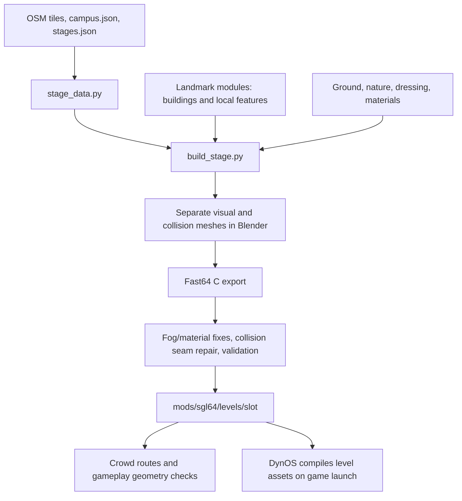

# Campus mesh integration notes

Investigation baseline: checkout `2565132` (`fix/npc-warp-follow`), compared with
locally known `origin/main` at `a0b9753`. This is a preparation guide for incoming
map PRs, not a review of teammates' unpublished work. No map or production files
were changed. Inspection includes the newer ground-surface implementation on
`origin/main`; a future batch must fetch main again before integration.

## Build and ownership

The editable map is primarily procedural Python plus map/layout data. A Blender
scene is assembled during the build; exported C is generated output.



| Region | Primary authored sources | Export affected | Coupled behavior |
|---|---|---|---|
| Plaza of the Americas | `tools/campus/landmarks/library_west_smathers_plaza.py`; shared ground, nature, and dressing modules | `mods/sgl64/levels/castle_grounds/` | Hub arrival, Library West/Smathers approaches, mascot positions, climbable trees, crowd paths |
| Turlington / Marston exterior | `tools/campus/landmarks/marston_turlington.py`; `stage_dressing.py` | Same `castle_grounds/` export | Breezeway, arcade, stairs, Potato/bench ring, Marston entrance, crowd paths |
| Malachowsky / Campus Green | `tools/campus/landmarks/reitz_malachowsky.py`; shared Reitz dressing and pickups | `mods/sgl64/levels/wf/`, primarily area 1 | Glass-stair token, rooftop route, atrium crane lanes/consoles, mission markers |

Marston's detailed interior is a separate `ccm` build. Reitz Union's interior is
area 2 of `wf`, built as part of a normal `reitz_eng` export. Malachowsky's current
atrium belongs to the outdoor landmark in area 1; do not confuse it with Reitz's
separate interior. Plaza and Turlington edits overlap at the export level even
when their Python files do not conflict.

Landmark entries declare `osm_ids`, `replaces_ways`, `replaces_areas`, and
`removes_points` to suppress generic duplicates. They return parts with explicit
`visual` and `collision` flags. The contract and shared palette are in
`tools/campus/landmarks/_common.py`; loading and transformation are in
`tools/campus/stage_landmarks.py`. New assets need unique slugs and deliberate
ownership of their source footprints, roads, trees, and collision.

## Coordinates and terrain constraints

Map coordinates are metres from Century Tower: east X, north Y, height Z.
Each stage subtracts its own center before export. SM64 coordinates are:

`game X = 100 * (map x - center x)`

`game Y = 100 * height`

`game Z = -100 * (map y - center y)`

The hub center is `(-45, 98)`; Reitz/Engineering is `(-470, -293)`.
One metre equals 100 game units. Export vertices must fit signed 16-bit
coordinates, roughly +/-327.67 m from the stage origin. Extending a map or
moving its center requires auditing every dependent gameplay coordinate.

The current ground system is not a general heightfield:

- `stage_ground.py` creates separate visual layers and flat collision at height
  zero, with holes for ponds and landmark-owned terrain.
- Landmark context still supplies `ground_z(x, y) -> 0.0`.
- `stage_landmarks.py` can lower paving/decal vertices to the assumed ground
  plane. `stage_dressing.py` rejects placements more than 5 cm off height zero.
- Hub crowd routes accept floor heights only from -0.6 to +1.2 m, limit steps
  to 0.25 m, and reject slopes beyond about 20 degrees. Other-area crowd routes
  use even stricter flat-floor checks. Rebuilding alone does not make these
  algorithms support newly sloping terrain.

For a local terrain feature, the existing `ground_holes_m` contract lets a
landmark own the replacement floors. It must also handle paving, collision,
seams, and neighboring placement constraints. Broad terrain changes should
establish a shared elevation/placement contract before independent regional
features rely on it. Raising only the visible mesh can bury players; lowering
only it can leave players walking in the air. Old flat collision under a new
depression can make that depression inaccessible.

## Preserve the newer main-branch ground fix

Commit `c7c60b2`, present on locally known main, adds
`tools/campus/ground_surfaces.py` and calls it from `stage_ground.py`.
It partitions overlapping flat opaque ground into disjoint faces, preserves
interpolated UVs, and places eligible output at -0.03 m. Priority goes from
grass/lawn through paving to asphalt, paint, and crossings. Eligibility is
restricted to nearly horizontal visual faces between -0.125 and -0.009 m;
collision, water, and raised geometry are excluded.

Main also explicitly treats Plaza areas `w595674176`, `w595674178`,
`w595959873`, and `w595959877` as lawn in `stage_data.py`.

An incoming branch can merge cleanly yet undo this behavior through stale
exports. Terrain and new paving must deliberately coexist with this pass:
slopes are excluded, while qualifying horizontal faces are flattened to its
fixed elevation. Do not restore the old overlapping surfaces by selecting a
branch's complete generated files.

## Validation baseline

Executed against the current checkout:

| Export | Static collision triangles | Result |
|---|---:|---|
| Hub area 1 | 8,935 | No validator errors or warnings |
| Reitz/Engineering area 1 | 9,545 | No area-specific budget warning |
| Reitz interior area 2 | 13,100 | Existing collision-budget warning |

The collision pool is 16,384 triangles for the active area, including dynamic
objects. The validator warns above 75% static use; it does not sum both Reitz
areas for the live pool. More decorative visual detail need not imply detailed
collision. Prefer simple intentional collision for props and architecture.

`check_reitz_points.py` passed 21 anchor comparisons and its 28 collision checks;
`check_npc_spots.py` passed 18 mascot placements. Both crowd route generators
passed `--check`. Collision files are unchanged between this checkout and the
locally known main; main has newer visual exports. The saved Reitz build report
lists 13,093 interior triangles, while the actual export has 13,100: reports
alone are not sufficient validation evidence.

Export rounding can create floor cracks at T-junctions. `stage_collision.py`
splits and welds integer exported vertices; this is enabled for hub and
Reitz/Engineering builds. It repairs rounding seams, not arbitrary modeling
gaps. Preserve fog and geometry-mode postprocessing too: losing depth-buffer
state has previously made characters visible through walls.

## Integration procedure for the next batch

1. Fetch main and inventory each PR's authored changes, generated outputs,
   terrain assumptions, affected stages, and shared helpers. Review features
   independently; serialize final export ownership for each stage.
2. Integrate shared terrain/material/placement changes first, then regional
   geometry and props. Check spatial overlap even when Git finds no conflict.
   Preserve intentional changes to hand-edited exports by moving them back
   into their generators before regenerating; do not silently discard them.
3. Rebuild each affected stage from the combined source with
   `--strict-landmarks`. The default can fall back to a generic building when
   a landmark fails, producing a technically successful but visibly wrong map.
   Use `--levels-dir`, `--report-dir`, and `--previews-dir` for isolated scratch
   builds. Final Reitz builds must include area 2; `--no-interior` leaves door
   hookups pointing at an absent area and is for scratch work only.
4. Review the complete regenerated export, build report, previews, and mission
   anchor JSON together. Rebuild crowd routes after the final collision and
   object placement. Update Lua anchors where changed geometry requires it.
5. Run export validators, applicable mission/mascot geometry checks, crowd
   freshness checks, and `tools/luatest/run.sh`. Treat skipped required checks
   as incomplete validation, and compare collision warnings with the baseline.
6. Playtest the combined build: Plaza arrival and paths, Turlington breezeway
   and steps, Marston door, Malachowsky entrance/glass stair/atrium crane lanes,
   terrain transitions, shadows, crowd spawning, camera occlusion, and frame
   rate. Static checks cannot establish traversal or visual quality.
7. Deploy the validated committed artifact through the normal release process.
   Verify DynOS compilation and the visible loaded level, not only source
   hashes or UDP liveness. The release updater does not explicitly invalidate
   `.lvl` caches; confirm the runtime's rebuild behavior before relying on it.

Build examples once dependencies are available:

```sh
BLENDER=tools/vendor/blender/blender tools/blender/run_blender.sh tools/campus/build_stage.py -- hub --strict-landmarks --previews
BLENDER=tools/vendor/blender/blender tools/blender/run_blender.sh tools/campus/build_stage.py -- reitz_eng --strict-landmarks --previews
python3 -I tools/npcs/campus_routes.py
python3 -I tools/npcs/area_routes.py
```

The builder requires `tools/.venv/bin/python` (including Pillow), the template,
and Fast64. The template, Blender directory, and Fast64 are present here, but
`tools/.venv/bin/python` is missing; no Blender rebuild was attempted in this
investigation. Prepare a reproducible toolchain before the batch arrives.

The most useful automation is an affected-stage rebuild/check command that
records source/toolchain versions, regenerates each stage once, refreshes
dependent routes, and emits a report of changed budgets and checks. It should
be a prerequisite to deployment for map batches, with visual acceptance kept
explicit.

## Preemptive NPC placement design

Current runtime behavior has two different gaps:

- Students use routes generated from exported collision, but interpolate saved
  node heights while walking. Indoor routes have occasional forward obstruction
  rays and component selection; there is no general live floor/body clearance
  check for every proposed position. Outdoor placement also depends on the old
  near-zero route-height restrictions described above.
- Albert/Alberta use hard-coded `SGL_NPC_SPOTS`. `mascot_loop` moves X/Z toward
  deterministic wander targets without checking collision; `npc_loop` restores
  Y from `npc.spot.y` every frame. Offline validation catches existing static
  conflicts, but does not make movement adapt to changed geometry.

Use a shared placement contract with two layers:

1. **Generated placement from final geometry.** Author semantic anchors such as
   `hub.arrival` and `malachowsky.robotics_console`, including level/area, intended
   floor or region, preferred offset, bounded search distance, NPC dimensions,
   allowed slope/step, and exclusion zones. Resolve safe positions and routes
   against the final repaired collision and object placements. Export a Lua
   placement table alongside the map. Preserve designer intent and stable
   identifiers; remove duplicated absolute coordinates. A required mission
   guide with no safe location should fail validation rather than disappear
   silently or be moved to an unrelated floor.
2. **Runtime guard against the loaded map.** At spawn and before committing a
   movement step, check support beneath the footprint, traversable height change,
   body clearance, and the swept path. Sample floor height relative to the last
   valid surface with bounded vertical tolerance; a downward ray from the sky
   can incorrectly select a roof or an upper floor. Query walls/ceilings using
   body dimensions; a single centerline ray is insufficient. Use bounded work
   and a measured update budget, not whole-map pathfinding each frame.

When a step is unsafe, keep the previous validated position and replan within
the intended region. If that position also becomes unsafe, suppress the prop
and retry a bounded placement search; remote mascot chat must remain usable.
Fallback locations should be deterministic across clients for shared mascot
posts. Dynamic obstacle responses may be local, as current mascot animations
already are. Collision-free visual props still need authored exclusion volumes
if NPCs should avoid them; collision data cannot reveal absent colliders.

Preemptive work order:

1. Add a shared, tested runtime placement/movement guard for mascots and crowds.
2. Generate mascot placements from named map anchors; make route generation
   terrain-aware within explicitly allowed regions, retaining intentional indoor
   floor identity instead of guessing floors from all horizontal triangles.
3. Automatically rebuild placement/routes after collision export. Record a hash
   of collision, relevant level objects, placement settings, and generator
   version so stale derived data blocks release. Existing `--check` regeneration
   comparisons remain useful; hashes add traceability, not geometric proof.
4. Use the same anchors for mission starts, signs, pickups, and return spawns.
   Raise explicit integration errors when entrances or required anchors cannot
   be resolved safely. Automatically update all consumers of a moved anchor.
5. Provide a developer overlay for anchors, NPC footprints, selected floors,
   route links, and rejected placement reasons. Compare route coverage and
   reachable components by region so a build cannot quietly remove the crowd.

Regression scenarios should include raised/lowered ground, gentle slopes,
cliffs, thin walls, low ceilings, a new planter at a post, moving obstacles,
stacked floors, area warps, stale generated routes, and an entirely blocked
mission anchor. This section is a proposed implementation plan; runtime code
has not been changed by the investigation.
