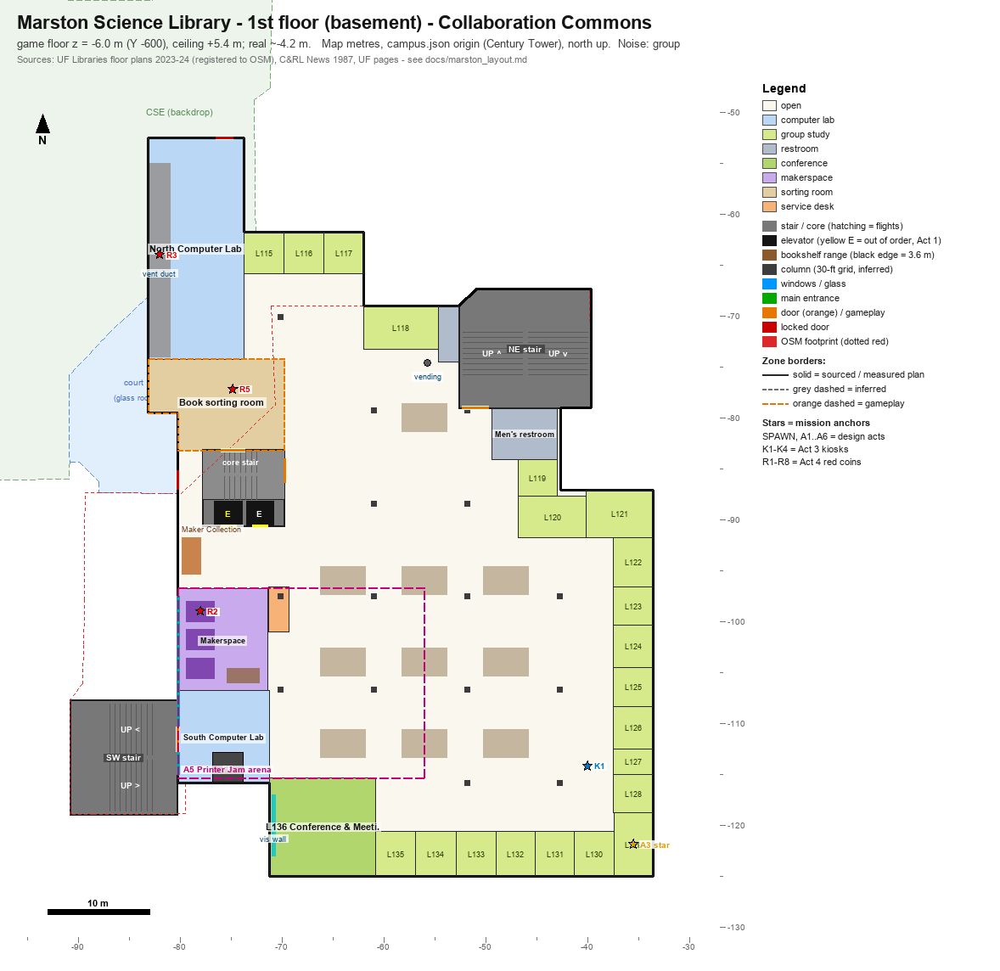
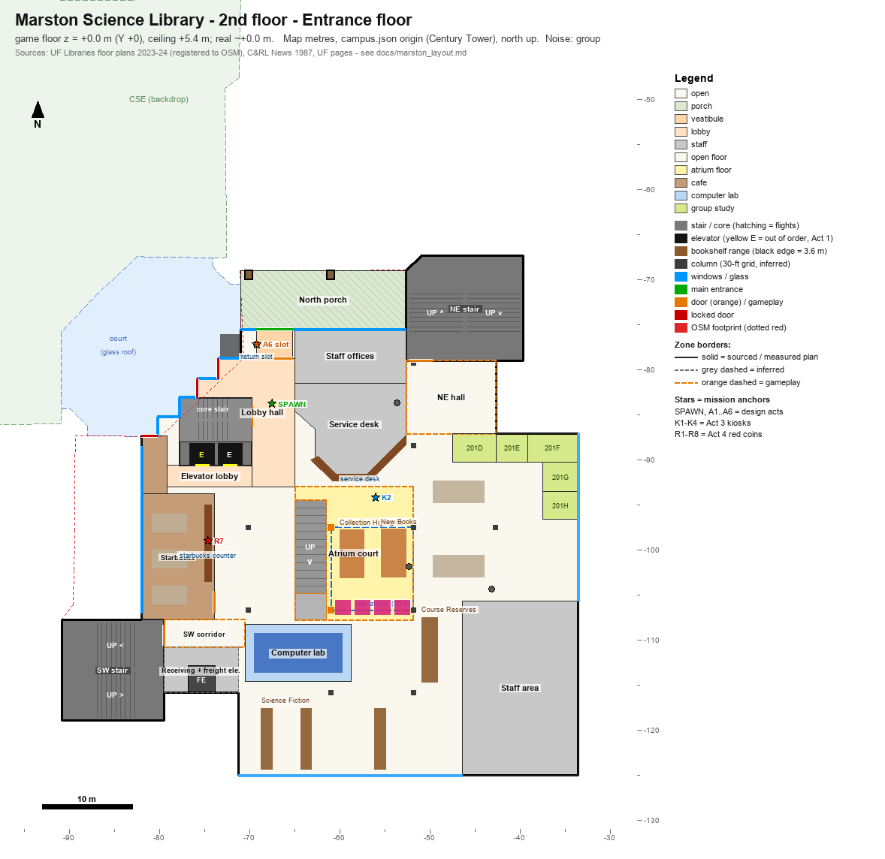
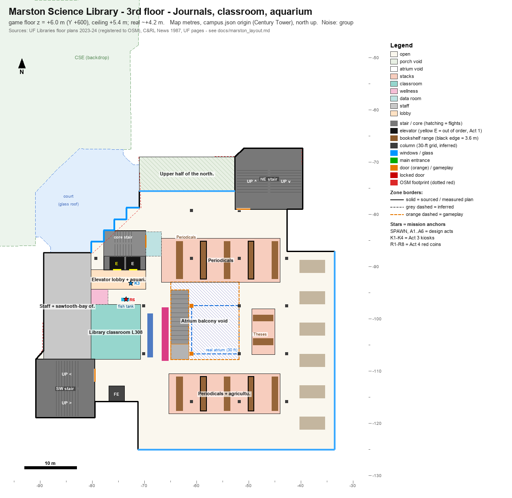
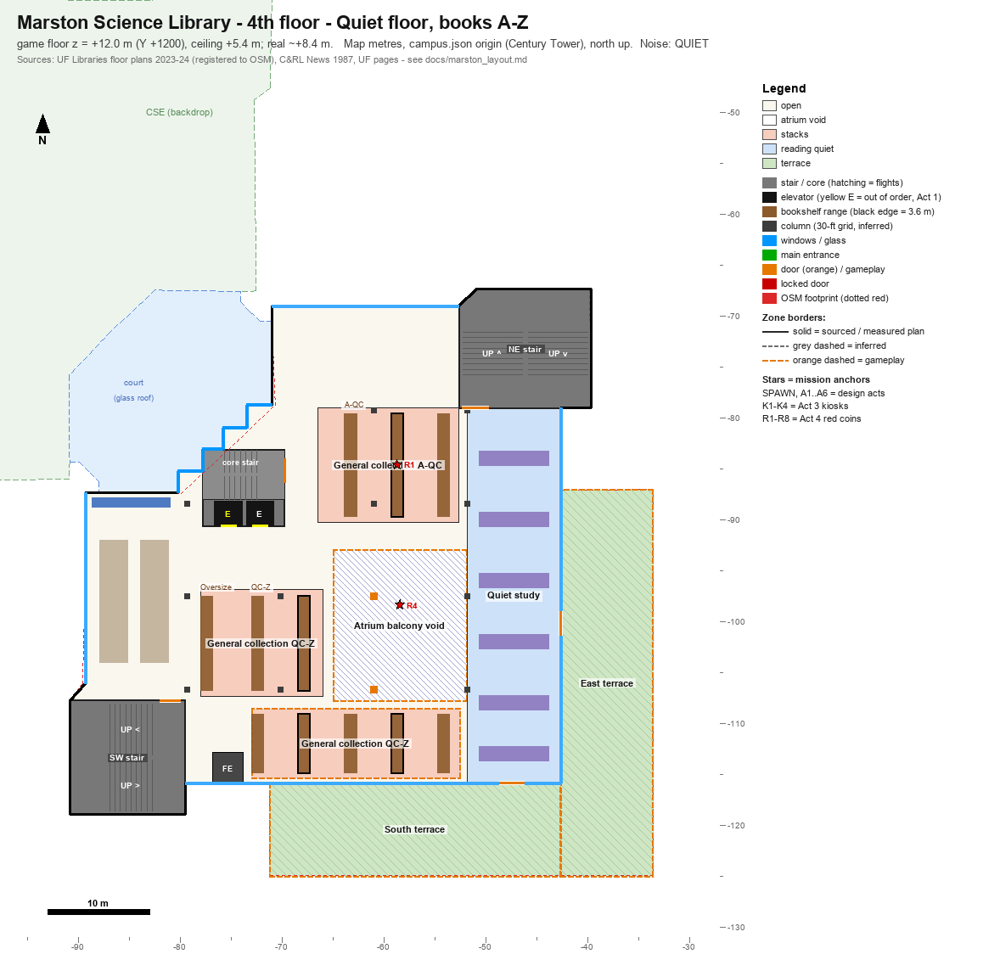
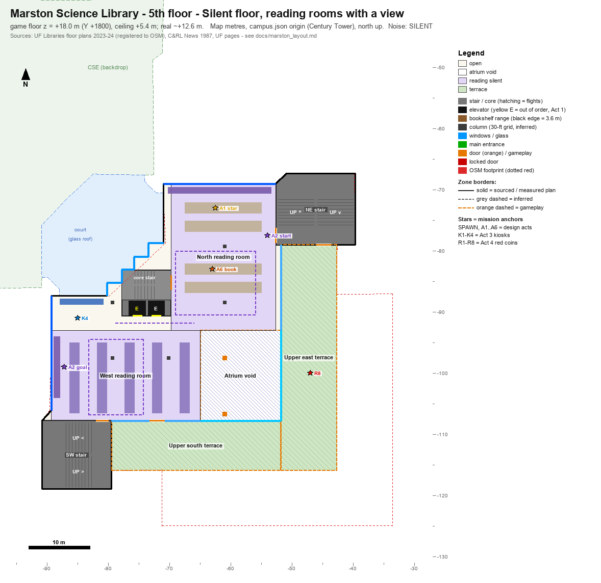
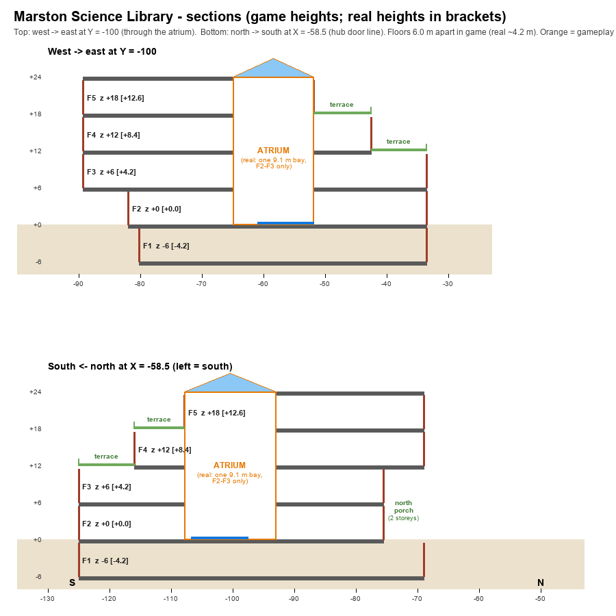

# Marston Science Library: interior layout (Course 4)

Status: layout research. This is input for the Course 4 stage build (slot `ccm`, `LEVEL_CCM`, door 4, 8 stars) and for the Marston mission author. Nothing in the game uses it yet.

Files:

| File | What |
|---|---|
| `data/uf/marston_layout.json` | The layout as data (schema `sgl64.marston_layout/1`): floors with z levels, outlines, zones, props, doors, windows, columns, stair/elevator cores, atrium, terraces, mission anchors, backdrop, deviations, sources. Map metres, same origin as `campus.json`. |
| `art/levels/marston/layout_floor1.png` … `layout_floor5.png` | One sketch per floor, drawn from the JSON. |
| `art/levels/marston/layout_section.png` | Two sections (west→east through the atrium, north→south on the hub-door line). |

How confident each item is. Every zone, prop and door in the JSON carries one of these labels, and the sketches draw them differently:

- **sourced**: stated in a cited source (text or photo).
- **plan**: measured from the official UF floor-plan images, which I registered to the OSM footprint (±1 m; ±2 m on the west half of floor 3).
- **inferred**: my reading of the sources, not stated anywhere (positions, sizes, colours).
- **gameplay**: invented or changed for fun, the camera or a mission. Section 11 lists all of these.

Coordinates: map metres, x east, y north, origin Century Tower (as `campus.json`). `z_game_m` is the height above the hub's grade. The stage centre is (−59.6, −98.9) (`stages.json`), so game `X = (x + 59.6)·100`, `Y = z·100`, `Z = −(y + 98.9)·100`. Yaw: 0 faces +Z (south), 0x4000 east, 0x8000 north.

---

## 1. Summary

1. **The 2nd floor is the entrance floor and the 1st floor is a basement.** The official plans are titled "1st Floor (Basement)" and "2nd Floor (Entrance Floor)", and the 1987 article puts the entrance on Level 2 (S2, S3, S10). The hub door at z 0 therefore opens onto **floor 2**, and floor 1 is at z −6 in the game.
2. **The main doors are at the north-west corner of the north wing**, at X −69.2..−65.2, in a glass wall recessed to **Y −75.5**. That is 6.5 m behind the OSM north edge (−69.0) and 8.7 m west of the hub door (−58.5, −69.0). A second set of doors opens into the glass-roofed court between Marston and the CSE building, and Starbucks has its own court door (S3, photo S20).
3. **The terraces step down to the south-east, and each setback is exactly one 30-ft module.** Floor 4 is set back one module on the east and south sides; floor 5 is set back two modules on the east and to the SW tower's line on the south (S5, S6). The 1987 article confirms the 30-ft planning module (S10).
4. **The atrium is real but small.** It is a two-storey, 30-ft-square void above the old reference desk (S10). On the floor-3 plan it measures exactly one module cell: X −60.97..−51.83, Y −106.71..−97.57. The architect wanted three storeys with a central stair, and staff removed the stair. The game enlarges the atrium to 13.2 × 14.8 m and opens it through floors 3-5 to a roof skylight.
5. **Floors:**
   - Floor 1: Collaboration Commons: 21 glass group-study rooms, makerspace, two computer labs, L136 conference/visualization room.
   - Floor 2: entrance, service desk, Starbucks, group rooms 201D-H, computer lab, new books, collection highlights, sci-fi.
   - Floor 3: journals, theses, classroom L308, wellness room, the 150-gallon fish tank across from the elevators.
   - Floor 4: quiet floor, books A-Z.
   - Floor 5: silent floor with the best views.
   - Floors 1-3 are group-study floors, floor 4 quiet, floor 5 silent (S1, S7, S8).
6. **Cores.** On every floor there is a stair + restrooms in the NE tower, a stair in the SW tower, and a west core (stair + elevators, doors facing south) at the court corner. The 1987 article says stairs, restrooms and offices sit on the perimeter and the middle is open (S10).
7. **Game scale.** Plan dimensions stay 1:1. Floors are **6.0 m apart in the game** against about 4.2 m in reality, which leaves 5.4 m of clear height for the camera.
8. **Stacks.** Ranges are 1.2 m deep and 2.3 m tall (every second one is 3.6 m in this layout; the build caps those at 3.0 m so a jump on top still fits under the 5.4 m ceiling, and adds book-cart bridges across the aisles at the climbing ends), two per 30-ft bay, so the inferred columns stand in about 3.4 m aisles.
9. **Wide stairs.** The NE and SW towers become wide 30° stair halls with 5-6 m lanes. The west core keeps a steep (35°) secondary stair and two elevators. Elevator 1 is the "out of order" wall-kick shaft for Act 1.
10. **Area check.** The five registered plan outlines add up to 10,944 m² (117,800 sq ft). The 1987 article gives 112,000 sq ft gross over five floors, so the mapping is within 5 %.

---

## 2. What the sources say

### 2.1 The building

- **History:** Robert Q. Marston Science Library, 444 Newell Drive. It opened in February 1987 and merged the agriculture, biology, physical/earth science and mathematics branch libraries (S10, S11).
- **Architect:** VOA Associates of Orlando, which also designed the Computer and Information Science (CSE) building it is connected to (S18).
- **Size and seats:** 112,000 sq ft gross (91,000 assignable) on five floors, with 1,295 seats in 1987 (S10). Today there are over 2,000 seats (S7).
- **Layout principle (1987):** stairwells, restrooms and offices sit on the perimeter so the middle stays open and modular. Each floor had its own accent colour. Compact shelving was installed on floors 1 and 5, and a receiving room led to a freight elevator (S10).
- **First-floor renovation (2014):** the floor that held journals, government documents and the map library became the Collaboration Commons, about 26,000 sq ft and $5.7M. It added group rooms, a conference room, 3D printing, a multi-touch visualization wall and the MADE@UF lab (S11, S12).
- **2022 renovation:** floors 3-5 got new furniture and power and were closed for months. The first-floor "Makery" lost part of a wall, with the goal of a new entrance (S13).
- **Footprint (OSM w150860048):** 2,589 m², 57.3 × 57.6 m. Its parts:
  - a main block (X −89.3..−33.5, Y −87..−125)
  - a north wing (X −71..−39.6, Y −69..−87)
  - two chamfered brick towers, NE (stairs + restrooms) and SW
  - a zig-zag north-west face toward the CSE court
  - a loading-dock notch on the south (X −79.5..−71.2, Y −115.9..−125)
- **The court:** the glass-roofed court (OSM w859919297, roof from 10 m) runs diagonally between Marston and CSE. The yellow "French Fries" (*Alachua*, John Henry, 1987, 9.75 m) stands at its south-west mouth in the Marston Courtyard (S18, S19, S20).

### 2.2 Floor by floor

| Floor | Use | What is there | Sources |
|---|---|---|---|
| 1 (basement) | group | Collaboration Commons: 700+ seats, 21 group study rooms (L115-L135), L136 conference/visualization room, makerspace, North Lab (50 PCs) and South Lab (30 PCs), printing help desk, gender-inclusive/family restroom in the NE corner, supply vending | S1, S2, S7, S15, S16 |
| 2 (entrance) | group | Entrance & exit (north and court doors), book return, service desk (books, textbooks, tools and tech lending), Starbucks (own court door), group rooms 201D-H, 40+ computers incl. Macs, course reserves, new books, collection highlights, science fiction, exhibit cases, most staff offices | S1, S3, S10, S19 |
| 3 | group | Journals (north and south blocks), theses & dissertations, state agricultural documents, classroom L308 in front of the elevators, wellness room L307 (prayer, meditation, lactation), data consultation room, 6-ft fish tank across from the elevators, the real atrium opening; 320 seats after 2022 | S1, S4, S7, S13, S14 |
| 4 | quiet | General collection A-QC (north block) and QC-Z (south block), oversize, computers along the west wing, new quiet-study furniture | S1, S5, S13 |
| 5 | silent | Open silent-study plate, computers along the west wing, upper floors billed as having some of the best views on campus | S1, S6, S7 |

The fish tank holds 150 gallons and is home to rainbowfish, tiger barbs, corydoras and snails. A student club, the Florida Aquaculture and Aquarium Club, keeps it (S14). The Starbucks sits directly above the makerspace: construction at the Starbucks closed the makerspace for summer 2025 (S17).

### 2.3 Where the north main entrance is

- **North doors:** the 2nd-floor plan (S3) shows two "Entrance & Exit" door sets. One faces north at X −69.2..−65.2, with a vestibule to Y −78.8 and a book-return box beside it at the court corner.
- **Court doors:** the other set faces north-west into the court, on the zig-zag face.
- **Starbucks door:** Starbucks has its own door from the court.
- **Recessed north wall:** registered to OSM, the 2nd- and 3rd-floor north wall sits at Y −75.5 (measured −75.9 and −74.4), while floors 4-5 reach the OSM line at −69.0. The doors therefore open onto a **two-storey covered porch** about 6.5 m deep under the upper floors. OSM also maps covered picnic tables there.
- **Night photo (S20):** the 2022 photo captioned "Center of Marston" shows the court side. It shows the glass storefront doors, the zig-zag glazed bays stacked above them, the Starbucks sign beside them and the glass space-frame roof over the court.
- **Hub door:** the hub's door 4 sits 8.7 m further east, on the OSM line. That does no harm, because the warp is a teleport. Section 12 suggests an optional move.

### 2.4 The stepped exterior, the towers and the atrium

- **Terraces:** the terraces are on the **south-east**. Floor 4's east wall is the NE tower's notch line (X −42.6) and its south wall is the loading-dock line (Y −115.9); both are one module in from the outer walls. Floor 5's east wall is at X −51.83 (two modules in), and its south wall lines up with the SW tower's north face (Y −107.8). A 2011 photo shows the building stepping down in terraces (S20).
- **North-west face:** this face is a zig-zag of glass bays on floors 3-5, stacked over the court doors (S4-S6, S20).
- **Towers:** blank chamfered brick with bronze bands, rising about 5.7 m above the roof (S20; 22.5 m hub model).
- **Atrium:** see summary item 4. Floor 3 shows the opening as an empty square; the floor-4 plan has stacks over it.
- **No skylight is sourced over the atrium.** The hub model's "hipped glass skylight in the middle" happens to sit over the game atrium, so the game keeps one.

### 2.5 Group study rooms and how they are booked

- **Room count:** 21 rooms on floor 1 and 4 bookable rooms on floor 2, 25 in total. The floor-2 plan draws five (201D-H) (S1, S9).
- **Booking rules:** rooms are booked online in LibCal with a GatorLink login. Each booking runs 30-120 minutes, with up to two bookings (two hours) a day, one room at a time, and up to two weeks ahead. Groups need at least two people. The service desk helps with bookings (S7, S8, S9).
- **Room sizes (plan):** mostly about 3.9 × 4 m (10-19 m²). Corner rooms L118, L120 and L121 are about 30 m², and L136 is about 100 m².
- **There are no physical booking kiosks.** The Act 3 kiosks are a game device.

---

## 3. How the plans were mapped

The five plan images (Canva drawings, 2023-24) are schematic but drawn roughly to scale. I scanned each one for long dark wall lines. Then I fitted a piecewise-linear x and y mapping through the walls that match OSM edges:

- the NE tower's top, right and bottom
- the NE notch
- the east and south walls
- the SW tower
- the loading-dock notch
- the west wing

An overlay of the OSM outline on every plan agreed to about ±1 m. Floor 3's drawing squeezes its west half, so the error there is about ±2 m. The anchors are stored in `plan_fit` in the JSON. The plan images themselves were only used for measuring and are not copied into the project.

What the mapping showed:

- **Setbacks:** they are whole 30-ft modules (9.144 m). With the module grid running from the SE corner (east wall X −33.54, south wall Y −125.0), the grid lines are:
  - X: −33.54, −42.68, −51.83, −60.97, −70.12, −79.26, −88.40
  - Y: −125.0, −115.86, −106.71, −97.57, −88.42, −79.28, −70.14

  These also line up with the SW tower, the loading dock and the NE tower. The columns in the JSON (`columns_m`) sit on this grid inside the open floor. That placement is inferred.
- **Atrium:** the floor-3 atrium is exactly one cell of that grid.
- **North Lab:** the basement's North Computer Lab runs about 17 m north of the OSM outline (to Y −52.5), under the court and the south end of CSE. OSM gives CSE one underground level, and S18 says the two buildings are connected. Nothing else confirms it, but the layout follows the plan.
- **Elevators:** they sit at about (−72.6, −89.7) on every floor, doors facing south.

---

## 4. Game rules for this interior

| Rule | Value | Why |
|---|---|---|
| Plan dimensions | 1:1 map metres | project rule |
| Floor-to-floor | **6.0 m** game (real ≈ 4.2 m, estimate) | SM64 camera headroom; air above 2.3 m stacks. One backflip (4.8-6 m peak) no longer clears a floor, so routes go through stairs, shelves and the atrium. |
| Floor z (game / real) | F1 −6 / −4.2, F2 0 / 0, F3 +6 / +4.2, F4 +12 / +8.4, F5 +18 / +12.6, roof +24 / +16.8 | F2 = hub grade |
| Clear height | 5.4 m (0.6 m slab) | |
| Stack ranges | 1.2 m deep, 2.3 m tall (real 90 in); every 2nd range 3.6 m (built 3.0 m); two per 30-ft bay; aisles about 3.4 m with a column in every other aisle | single jump + ledge grab onto 2.3 m; from the 2.29 m step onto the 3.0 m top; tops wide enough to run on; book-cart bridges join the tops of a row |
| Low shelves / display cases | 1.2 m | step-ups |
| Doors | ≥ 2.0 m wide (real reading-room halls were 3 ft in 1987) | co-op traffic |
| Stairs | 30° stair halls (rise 3 m, run 5.2 m per flight); the core stair is 35° (run 4.3 m) | keep ramps under SM64's 38° slide limit; give stair ramps a not-slippery surface |
| Railings | 1.0 m on atrium balconies and terraces (1.1 m parapets) | |
| Fall damage | > 11.5 m: dropping from F4 or F5 into the atrium hurts | intended risk |
| Budgets | about 4,000 collision tris estimated (hint 7,000) | box collision for ranges and rooms |

---

## 5. Floor plans (game layout)

Each sketch draws the zones, the 30-ft column grid, ranges, stair halls (hatching = flights), elevators (a yellow E marks the out-of-order car), windows (blue), doors (orange; red = locked; green = main entrance) and mission anchors (stars). The dotted red line is the OSM footprint. Zone borders are solid for sourced/plan items, grey dashed for inferred ones and orange dashed for gameplay additions.

### Floor 1, basement: Collaboration Commons (z −6)



- **Commons:** a big open hall with the 21 glass group rooms around it.
  - L115-L117 sit north, in the stretch under the porch.
  - L118-L121 sit NE.
  - L122-L129 run down the east wall.
  - L130-L135 run along the south wall.
  - L136 (conference, with the visualization wall) is in the SW. [plan]
- **Study-room fronts (#38, #36):** clear glass in aluminium frames with a pale blue film band at 1.05-1.40 m, up to 2.9 m. Above that a white drywall bulkhead runs to the 5.4 m game ceiling, over the doors too, and brings the tall glass back to the photo's proportions. Each room's name is lettered on the bulkhead over its door in dark grey serif. Heisenberg, Carson and Jemison are photographed; Franklin, Curie, Darwin, Hopper and Newton fill the cycle [inferred]. White piers stand between the rooms, a small dark 'L1xx' plaque sits on the glass beside each door at about 1.5 m, and the open door leaves are honey maple. [photo]
- **Inside the rooms (#44-#46):** they alternate between lounge rooms and high-table rooms. A lounge room has the teal-blue accent across a whole side wall, a low round maple coffee table, two taupe metallic shell chairs on thin splayed legs and a slim maple side table. A high-table room has plain white walls, a counter-height maple table with a rounded end, and black Caper stools. Every room has a wall TV with its white input plate. [photo] Fix round 2 (fidelity pass, #44 #46): the shell chairs are bulky padded tub shells (a 0.13 m seat cushion and a 9 cm upholstered shell wrapped from wing tip to wing tip, its top falling from 0.90 m at the back to 0.54 m at the wings), not thin planes. The coffee table is a 0.90 m round maple disc (0.80 m in narrow rooms) on a short steel column and a round foot plate (`coffee_disc`), and the chairs sit as far apart as the room allows. The teal is a muted slate teal (`T_TEAL_ROOM`, #44 RGB 80/105/124). In the east window rooms (L122-L128) the teal is the wall that carries the window, painted round the opening, as in #44; the side walls stay white. Interior lounge rooms keep it on a side wall.
- **L136 (#47):** looking west at the twin screens (about 3.0 × 1.7 m, 0.2 m apart, bottoms at 1.0 m), the lectern with dual monitors is on the left (south) and the whiteboard is on the right (north) wall, west of the door. The projectors hang on rods of about 2 m. The 2014 tiled visualization wall (#48) is kept on the unphotographed east wall as 3 × 2 displays, about 3.0 × 1.5 m [inferred; S15 still calls the room a visualization space]. [photo] Fix round 2: the wall is on, as in #48. One bright GIS aerial image (`int_ms_gis_map`) spans the 3 × 2 grid of thin-bezel displays (2.5 cm bezels, 3.3 × 1.7 m, bottom at 0.85 m so a standing user reaches it). It used to be six dark TVs. Fix round 2 (fidelity pass, #47): the projected slide (`int_ms_projector`) is a bright pale periwinkle with a soft hot spot (about RGB 135/170/243; it was a deep royal blue that read as a sign) and a small centred white wordmark, a bold 'UF' and 'FLORIDA' in small capitals, instead of letters across the whole screen. The north whiteboard is wiped clean, as in #47.
- **Elevator lobby (#69):** on the brick west of elevator 1 (1.2 m in the plan; the photo shows about 2 m) are the white service door with its red sign and a wall clock above it. There is no big '1' over elevator 2, only the small blue sign beside its door. The wave ribbons are 1.25-1.35 m wide, have a white edge and hang in two overlapping layers of pale, unstreaked blue acrylic. [photo] Fix round 2: the core's darker bake band (negative lights) is no longer used on F1. Its south face is the lobby's wall-washed red brick, and five warm wall-washers 0.5 m off the brick at 2.8 m, plus a softer fill row, light it about as bright as in #69. The other floors keep the band. Fix round 2 (fidelity pass, #69 #39): each ribbon's cross-section is rolled 18 degrees about its length. The low edge stays at its old height and the ribbons alternately rise north and south. From the game camera, which sits at about the ribbons' own height, they now show a broad face instead of reading as thin strands. The upper layer is 0.10 m higher, so the layers never touch (minimum gap 0.11 m). The bi-level drinking fountain on the lobby's west wall is white enamel with a stainless basin and bubbler, on a white back plate; the stainless boxes did not read. A brushed stainless recycling / waste pair (blue and grey stream labels) stands right of the stanchions with its back 0.2 m off the brick at the core's SE corner, clear of elevator 2's keep-out.
- **Commons centre (#37, #36):** eight more round maple tables, each with four grey Sayl chairs (grey Y spine, as photographed), fill the gaps between the core, the lounge, the layout's table clusters and the coin lines. Four of the six centre clusters (01, 05, 06 and 09) are the grey upholstered pods of #36, and a fifth pod stands in the gap between clusters 02 and 06. The big rings use 24 segments. The blue ring by L120 sits at (−48.0, −93.8), 1 m south-west of its plan spot, to clear L120's bulkhead. [photo] Fix round 2 (fidelity pass, matched view of #37 4243): two more round tables stand in the foreground gap at (−55.2, −92.3) and (−60.5, −90.5), outside the coin ring round (−56.4, −88.0) and its keep-outs, so the ~2.5-3 m grid of the photo runs right up to the lounge. Round table tops are 16-sided (they read as decagons up close); their collision keeps its octagon. The Sayl backs are a mid grey (mesh tint 0.66, Y frame 0.38; they read nearly black from a distance, lum 31-67 against 62-111 in 4243). The ring over the bar tables (−47.25, −111.3) has a blue inner face, as in #41; it was purple.
- **West side:** the makerspace (the Act 5 Printer Jam bay, its east wall open onto the Commons) and the South Computer Lab. [plan] A full-height wall with no door separates them at Y −106.8 (X −80.2..−71.3): red brick on the makerspace face with the TV on it, white drywall on the lab face (plan_f1_2024; #51, #56). The makerspace's west wall has a light-well clerestory (2.4-3.4 m, lit day glass) over a sunken planted court (iteration 4: it was full-height glazing; #60 shows the wall lined with spool shelving). [inferred/gameplay]
- **Makerspace (#51-#60):**
  - The storefront on the elevator lobby has dark-grey frames with mullions about 1.75 m apart and a transom bar at 2.4 m. The glass runs to a 3.4 m head under a white drywall bulkhead, with warm string lights along the head. Fidelity-2 fix 2 (#51 #52): the string is tied up at each mullion and at the door gap's jamb and hangs in catenary swags bay by bay (0.30 m in a 1.75 m bay, scaled with the span; `string_lights(knots=...)`).
  - The two-line yellow neon is centred on the 8.9 m front (X −75.7), over the butcher-block counter right behind the glass. Iteration 4 (fidelity-2, #51): the bay just east of the neon (X −74.47..−73.85) holds the 'maker collection' display behind the glass, a maple cabinet with two ledges of face-out books and three books on top (`maker_book_display`). The one wire rack of small 3D printers left stands on the east wall by the pegboard (#53).
  - The 2.4 m door gap is at the east end of the front (#53 shows the door east of the neon). The hexagon pinboards hang on a brick pier at the front's west end (#51: from the lobby the photo's right is west).
  - The east wall to the Commons is white drywall with a black-framed clerestory band at 2.4-3.4 m (clear glass). Below it are the pegboard tool wall and a wire rack of 3D printers (#53, #58). The documented 4.8 m gameplay opening stays.
  - Fix round 2 (#51 #52 #53 #60): the storefront and the clerestory use clear glass (`int_ms_glass_clear`), so the neon and the warm room read through it. The mullions are placed (`MAKER_POSTS_X` -78.4, -76.65, -74.75) so the neon sits alone in a 1.9 m bay. The bay next to the pier holds a black-framed glass door with a push bar and a red OPEN sign, the second entrance of #51 (drawn closed; the east door gap of #53 stays the opening). The thread and ribbon spool wall and the long butcher-block sewing table with two machines stand on the west wall's north end facing east, so they show through the west bays from the lobby (#51) and run toward the glass (#60). The small 3D printers stand east of the neon counter (one wire rack between it and the door gap, one on the east wall), not in the west bays.
  - Brick is only on the south wall, with the TV and a perimeter work bench. Fidelity-2 fix 2 (#56): the TV is the bigger set of the photo, 1.8 × 1.0 m (iteration 4: centred at X −74.45, 1.3 m east of the wall's middle, with its bottom at 2.5 m, `MAKER_TV_X` / `MAKER_TV_Z`, so from the lobby it sits up behind 'MARSTON' as in #51 instead of between the two neon lines), switched on: a bright light-blue slide (`int_ms_tv_maker`, unshaded; the old 1.4 m set's dark navy wallpaper read as switched off).
  - Six butcher-block islands on grey steel frames, with bin shelves and Sayl chairs on both sides, stand in two north-south rows (#54, #56).
  - The ceiling is 2' × 4' lay-in tile with 2 × 4 lensed troffers and hanging EXIT signs. The Commons' linear LED slots stop at the room (the labs have their own, see below).
  - West wall (iteration 4, #60): three 2.4 m units of thread / ribbon spool shelving over the long butcher-block sewing table run 7.2 m down the wall (Y −97.4..−104.6, `SPOOL_WALL_Y`), with four sewing machines, under the light-well clerestory.
  - The layout's inferred printer benches, sewing bench and maker-books shelf are not built. The Act 4 red coin stands on the NW island (top 0.92 m). [photo]
- **South Computer Lab (#63):** two double rows of two 4-seat blocks (32 seats; the SW stair hall takes the room's west 0.7 m), grey fabric screens with frosted-glass tops, large monitors showing a blue desktop wallpaper, and dark charcoal carpet. The olive south wall is plain. [photo]
- **Computer labs, fidelity-2 fix 2 (r2_g2 review; #61-#64):**
  - **LED slots.** Three or four long, bright linear LED slots per lab are the labs' main ceiling feature in the photos, but the Commons grid never fitted a whole run inside a lab, so both labs had bare tile. Each lab now has its own parallel lines (`LAB_LED_LINES`): in the North Lab three N-S lines at X −80.55, −78.40 and −76.25 (#61 and #62 look north along them), six 6.1 m runs; in the South Lab two E-W 4.6 m runs on the Commons grid's rows Y −108.24 and −114.33 (#63 looks west), stopping 0.9 m short of the Commons runs that reach into the lab's east side. The olive rings keep their radius + 0.4 m clearance, so the middle lines break round them. A Commons run whose midpoint lies in a lab is now left to the lab lines (two such straddling runs went).
  - **Dividers.** The North Lab's screens are grey fabric only, up to 1.24 m under the aluminium cap, with no glass band (#61 and #62 show none; `lab_cubicles(band=False)`). In the South Lab the top band (and the Commons / F2 benching dividers and the 120-degree benching) is pale white-grey frosted glass (`int_ms_glass_frost`, alpha 0.72), as in #63 and #64; the streaky blue `int_glass` gave a cyan stripe on every row.
  - **Chairs.** The lab Sayls are light grey mesh on a light grey frame (`MP.LAB_CHAIR`: mesh 0.90, frame 0.70, seat 0.86), as in #61 and #63. The Commons keeps the design review's mid-grey chairs.
- **East study rooms L122-L128:** each room has an exterior window in the east wall (X −33.54, sill 0.95 m, head 2.9 m, a pier at every partition). The windows look onto a sunken planted court: lawn, three live oaks, a campus lamppost and a planted bank up to grade, open to the sky (#38 photo 4272, #44). The court's depth and planting are inferred. In these rooms the wall TV hangs on the north side wall. [photo; court inferred] Fix round 2: the panes are a pale daylit glass (`int_ms_glass_day`, alpha 0.55, drawn unshaded), so from inside a room they read about 0.76 of the white wall as in #44 and the room backs glow from the Commons as in #38. The court has its own kit group (`court`), lit with outdoor daylight rather than the basement bake. Its bank is a short steep slope at the very back (foot 2.2 m from the top), and the top moved back to X −23.6. Newell Drive's west curb (about X −22.35) stops it going deeper.
- **Ring pendants and wave ribbons:** these hang at the photographed heights on long cables from the raised 5.4 m ceiling. The ring bands are 0.28 m deep (fix round 2; #38 shows about 0.25-0.3 m on a ring of about 4.6 m, and the 0.42 m band read as a big grey drum across a third of the game camera's view) and sit 3.08-3.36 m above F1. The lower ribbon layer's low points are 3.06-3.22 m, and the upper layer now hangs 0.10 m higher than before, and each ribbon is rolled 18 degrees (see the elevator lobby). The photos show these at about 2.4-2.7 m under a ceiling of about 3 m. [photo; heights raised with the ceiling]
- **North Computer Lab:** a long room under the court with a walk-in vent duct along its west wall at z −3.4..−1.4. The duct is open at its south end through the lab / sorting-room wall (Y −74.6..−74.4). From the sorting table step (top 1.2 m) you climb 1.4 m up to the duct floor. Both long walls of the lab are white drywall (#61, #64), including the west wall of L115, and so is the lab's south end. Outside, the duct is clad as a white drywall bulkhead up to the ceiling, so the west wall reads white as in #61. Four double rows have large blue-wallpaper monitors, on dark charcoal carpet. At the south end there are two white 120° benching pods with frosted dividers (#64, iteration 4). EXIT signs on F1 are white with red letters (#54, #61, #64). [plan; duct gameplay]
- **Book sorting room:** in reality a staff room. In the game the book chute from the 2nd-floor vestibule lands here. [gameplay]
- **Restrooms and vending:** the gender-inclusive restroom is in the NE corner and the men's room is south of the NE tower; supply vending stands beside them. [plan] Each block is closed but has a door on its Commons side: a wood-veneer leaf in a grey hollow-metal frame, with the dark grey ADA pictogram plaque and the blue accessibility plaque beside the latch at about 1.5 m. That wall is white; purple is the accent on the other walls (#70-#72). The gender-inclusive door is on the south face and the men's door on the west face. Fidelity-2 fix 2 (#71, view wc_gi): the leaf is the honey maple of the F1 study-room doors (it rendered dark cherry), the blue accessibility sign is a round disc on the leaf at 1.5 m (the pictogram plaque stays on the wall by the latch), two small lights in front of each door lift the white wall out of the bake's mid grey, and a 1.5 m apron of grey plank tile (`WC_TILE_PATCHES`, `int_ms_plank` tinted grey) lies in front of each door.
- **Stairs:** the NE stair hall, the west core (stair + elevators) and the SW stair (door in the west wall).

### Floor 2, entrance floor (z 0)



- **Porch:** a two-storey covered north porch (X −71..−52.6, Y −69..−75.5). It is outdoors and walkable, closed off by an invisible wall at −69. [plan]
- **Entrance:** the north doors lead into the vestibule and then the lobby hall. **Spawn** is in the lobby at (−67.5, −83.8), facing south toward the atrium. The return slot for Act 6 is in the vestibule's west wall; a hatch below it opens the book chute. [plan; slot gameplay]
- **Service desk:** east of the lobby, with the counter along its SW edge. Staff offices fill the north. [plan]
- **Atrium court:** the floor of the game atrium (X −65..−51.83, Y −93..−107.8). It holds:
  - the grand stair up to floor 3 along its west edge [gameplay]
  - collection highlights and new-books shelves at 1.2 m [plan]
  - four exhibit cases along its south edge [plan; moved]
  - two free-standing module columns
- **Starbucks:** on the west, with its court door (locked) and an interior door from the west aisle. [plan; the interior door is real: the Alligator (2015) says the court doors are used by day and the interior doors after sundown and on weekends]
- **Other rooms and shelves:**
  - computer lab [plan]
  - three sci-fi ranges by the south windows [plan]
  - course reserves [plan]
  - group rooms 201D-H on the east [plan]
  - the SE staff block (closed) [plan]
  - the NE hall, opened from staff space so the NE stair hall meets the floor [gameplay]
  - the SW corridor from the SW stair hall to the computer lab [gameplay]
  - receiving + the freight elevator (closed) [inferred]
- **Windows:** the north storefront and the court-side glass (both full height), the Starbucks west glass onto the arcade, and ribbon windows on the east and south walls.
- **Fidelity-3 details (photo pass):**
  - Porch (#1 #2): the storefront bays east of the doors (offices behind) are near-black glass (`int_ms_glass_black`, about RGB 28,32,36, one soft diagonal sheen per 1.25 m bay) with dark-grey mullions standing proud of the glass. The bronze box over them and the cladding above the storefront use smooth dark bronze panels with fine horizontal seams 0.6 m apart (`int_ms_copper`, redrawn; the faces tinted dark, the soffit underside left lighter, four round downlights). Black door leaves stand pinned open, square to the storefront, at each jamb of the wide door gap, with the white name vinyl (`int_ms_door_vinyl`) on the face toward the doorway [photo; the real leaves close inside the gap]. Fix round 2: the leaf glass sits 2 cm proud of the 6 cm leaf, with the vinyl 2 cm in front of it; the old 0.5 cm offsets rounded to 0 game units and z-fought. The OPEN 24 HOURS neon is centred in the transom's east bay (X −66.53..−65.2, over the east leaf as in #3), so no mullion crosses it. The backdrop ground grid is also cut on the porch's and the F2 footprint's edges. A cell is dropped whole when its centre falls inside them, and the court's split lines had shifted cells, which opened holes north of the porch, at the NE re-entrant corner and under the SW F3 overhang.
  - Lounge (#23 #24 #26 #28, fix round 2): all the lounge photos look EAST (the golden-yellow stretch beyond is the x -33.54 window wall), so the S lies across their view. Its lobes are stacked north-south on x -57 (inner radius 1.15 m, outer 1.77 m, centres 2.98 m apart, filling the 6.5 m between the Highlights / New Books shelves and the atrium's south edge). The north lobe opens west, so its orange seats face the lobby, the grand stair and the photo viewpoints; the south lobe opens east. There is a yellow ottoman in each lobe. Five orange tub chairs on the group's west side face the lobby, two more close the south lobe's east side, and there are two end tables with plants. The backs are a charcoal upholstery with a small grey diamond repeat (`int_ms_fab_dark`, redrawn).
  - Copper soffit lantern (fix round 2, #23 #24 #26 #30): it hangs low, on longer cables. The band runs 3.2-3.7 m above F2 (it was 4.3-4.8 m, out of every eye-level frame), so it fills the top of the lounge view as in the photos. Its walkable no-camera frame top (3.7 m), the `lantern_top` anchor and the coin ring moved down with it. It is reached by dropping from the F3 balcony (2.3 m down). It moved 5 cm east, so its NW copper corner box sits wholly inside the atrium pillar it meets; its face had been coplanar with the pillar's, a copper/white z-fight. Also on F3, the slab edge face under the grand stair's top riser (Y −104.9) is left to the riser, because the two were coplanar.
  - East floor (#29): the south face of the R201G/H block (Y −96.6, X −37.5..−33.5) is a solid teal wall with a 3.4 × 1.4 m wall whiteboard, meeting the golden-yellow window wall at the window band. Facing the windows from the lounge, teal is now on the left and the yellow runs south from that corner; the staff block keeps teal only in its printer bay (#28; fix round 2 below).
  - Service desk (#23): a light-grey solid-surface top (it was charcoal) with a raised transaction ledge 0.28 m deep and 0.10 m high all round the L.
- **Fidelity-3 fix round 2 (matched east views of the lounge, porch, desk, cafe):**
  - F2 ribbon windows (#25 #29): `f2_east` and `f2_south` run 1.2-4.9 m (`F2_RIBBON`; the layout's 1.0-3.6 m band left a 1.8 m golden band over the heads). The sill is over the seated heads at the round tables, as in #29, and the head meets the ceiling: the 0.5 m of wall above it is ceiling white (`F2_HEAD_WHITE`, the outline walls' `head_tint` on F2, no dark trim). The golden yellow now shows only under the glass and on the full-height corner pier at Y −105.7. [photo; the glass is taller than the real band because the game ceiling is raised]
  - Staff block (#24 #25 #28): its west face (X −46.4, square to the lounge's east views; it was the large teal plane right of the yellow wall) is white, and so is its north face (Y −105.7) except the printer bay, X −44.9..−40.6 (`STAFF_TEAL_X`), where the printer / scanner station and the How-to-Print poster stand on teal, as in #28. From the lounge the only teal is the R201G/H face, LEFT of the yellow, as in #24.
  - Porch storefront (#1 #2 #3 #4): every fixed pane on both sides of the door gap and the transom over it is the near-black `int_ms_glass_black`, one-sided toward the porch, with a clear inner pane (`int_ms_glass_clear`) 0.2 m further in, so the lobby still looks out through glass. The OPEN 24 HOURS neon stands on the porch face of the transom glass (2 cm proud), a square 0.76 m sign in the east bay, its blue now saturated (`int_ms_neon_open`, #3F6EFF). The 444 / NEWELL DRIVE vinyl sits at the top of the pane next to the brick pier, at transom level (3.22-3.77 m), on the porch face of the glass.
  - Service desk (#23): the base is the mid-grey laminate of the photo (`DESK_FRONT`, 0.64; it read white). The ring (`SERVICE_RING`) is a slimmer 0.30 m band of radius 1.55 m hung lower, 2.6-2.9 m (it was 0.46 m at 3.55-4.01 m), under the lounge lantern's 3.2-3.7 m band. `int_ms_sign_service` reads title-case "Service Desk" in black on yellow, repeated four times round (lowercase glyphs drawn on the capitals' 5 × 7 grid, so the words keep their texture widths).
  - Starbucks counter (#34 #35): it stood 0.3 m inside the storefront glass along 8.5 m and walled the cafe off from the library side. It now runs east-west in front of the slat / menu wall (X −78.0..−74.6, Y −96.0..−95.25, `PROP_MOVES`), customers on the south, its pickup end by the Order Status screen; a short counter lays its pastry case, espresso machine and pickup plate out end to end (`cafe_counter_ms`). The cove-lit soffit and its three downlights follow it. The first table pair stepped 0.6 m south. From the library (#34) the view through the door crosses open cafe floor to the court glazing. The Act 4 red coin (R7) sits over the pickup end (−77.53, −95.62); the customer point is at (−75.5, −96.92), facing north. [inferred orientation]
  - Starbucks (#34 #35): the storefront is clear glass (`int_ms_glass_clear`) with slim black mullions every ~1.5 m. The round decal is a 24-sided disc with a generic emblem. The slat wall's wood soffit runs up to the ceiling, and a warm cove-lit wood soffit with four recessed downlights hangs over the counter.
  - Science fiction stacks: mid-grey steel (0.6 grey uprights, shelves and ends), fiction spines (`int_ms_fiction`: darker mixed colours, white labels, red genre stickers), three face-out covers per range face and a SCIENCE FICTION end-panel sign (`int_ms_sign_scifi`).
  - Coffers (#23 #29, F3 computers): on F2 and F3 every other coffer carries a 2' × 4' lay-in troffer (two 2' × 2' lens panels) in one facet; F4-F5 keep the 2' × 2' panels.

### Floor 3, journals, classroom, aquarium (z +6)



- **Atrium balcony:** a ring with railings round the void; the top of the grand stair lands on its west side. The real 30-ft atrium cell is marked in blue on the sketch.
- **Stacks:** five periodical ranges north of the atrium and five south of it (the agriculture documents are the west end). Two theses ranges run east-west east of the atrium. [plan; ranges gameplay-spaced]
- **Around the elevators:** classroom L308 sits in front of the elevators, with the wellness room L307 beside it. The **fish tank** is across from the elevator doors (red coin R6). A data consultation room stands next to the core. [plan / inferred]
- **Wellness room L307 (#73-#75), fidelity-2 fix 2:** warm cream walls (a visual skin 1.2 cm in front of the room's own wall faces, `T_WELLNESS_CREAM`; the partitions' outer faces stay white) over the wood-look plank floor. The white sink counter (1.5 m, a solid-surface top with an inset stainless sink and gooseneck faucet on a white base cabinet, `sink_counter`) stands on the south wall with a dark navy paper-towel dispenser and a blue soap dispenser above it (#74). The tan glider with upholstered arms under wooden arm rails, on a wooden glider base (`glider_chair`), stands against the west wall facing the door, with the round white side table on dark X legs (`x_side_table`) beside it (#75). The rug is a patterned blue (`int_ms_rug_blue`: navy border, mid-blue field, light-blue trellis). Only the counter has collision.
- **Other:** a computer row and display cases west of the atrium, reading tables along the east windows, and staff space plus the zig-zag bay offices along the west (closed).
- **Windows:** north windows look over the porch roof void; the zig-zag bays face the court roof; ribbon windows run along the east and south.
- **Fidelity-4 (#76-#80):**
  - The east open study's guitar-pick tables are 1.8 m wide maple slabs on solid maple end panels, with 10 seats each (#76).
  - L308 (#78) has a dropped 2' x 4' tile ceiling at 3.5 m with lensed troffers. Its three displays fill the west wall at head height (bottoms 1.2 m; north to south 2.1, 1.6 and 1.6 m wide, `L308_DISPLAYS`: the big one is the right-hand one seen from the NE corner, iteration 4). The training tables stand on chunky grey pedestals, and its wood door stands open into the room.
  - The data room (#77) has a maple desk with a big monitor and a Sayl chair on each side of the east door, set against the door wall and facing into the room (before, there was one desk on the south wall). The door has a grey hollow-metal casing (`thin_partition(casing=...)`), and its white leaf, with a tall narrow vision panel, stands open into the room. The passage from the core stair's west door to the east door stays open between the desks.
  - The fish tank (#79 #80) is built in depth behind clear glass: a densely planted back, two layers of plant fronds, black rock, driftwood, gravel and three large rainbowfish per side, plus a frosted engraved plaque. Its lid (red coin R6) is unchanged.
  - The bound journals (int_ms_bound) are deep red, maroon, teal, tan, navy and black with gilt bands and lettering (#83 #87).
- **Fidelity-4 fix round 2 (r2_g4 review):**
  - L308's tile ceiling now reads white (#78). It was one big quad, shaded only at the room corners and darkened by the underside AO (0.72), so it read mid-grey: ceiling/wall 0.52 in g4_L308, against 0.78 in the photo. It is now a grid of about 1.2 m cells with full AO. The lensed troffers' lights, 0.6 m below, light it, and the tint `L308_CEIL_TINT` (0.73, 0.74, 0.77) brings the ratio to 0.80.
  - L308's chairs are a muted plum-grey, `T_PLUM` (0.42, 0.31, 0.37); the photo measures 92/68/78. The old value read raspberry.
  - The theses ranges have light-grey steel end panels (0.94, 0.95, 1.0); the photo measures 179/177/183. The coral belongs to the periodicals only. `int_ms_theses` is now near-black slate/navy-green bindings (the photos' dark pixels measure about 42-55, 44-57, 46-58) with a 2-texel white call-number label on each spine and no gilt band.
  - The fish tank is dark and dense, as in #79 #80 (the plaque photo averages lum ~28):
    - `int_ms_aquarium` has darker water and plants. The glowing back, the water tint on the glass, the gravel, the rock (black, 0.17) and the fronds (deep greens) are all darker. In g4_fish the tank's centre went from lum 86 to 50.
    - Two of the three rainbowfish on each side are orange-red with yellow-orange tails; one is blue-and-yellow. All three have a taller, rounded hexagon body.
    - The frosted plaque carries four dark engraved lines.
    - A tall potted floor plant (`floor_plant`, a charcoal planter, collision on the pot only) stands on the tank's east side. The west one is refused by the keep-out round the point at (-75.8, -95.85), so there is one plant.

### Floor 4, quiet floor, books A-Z (z +12)



- **Stacks:** three A-QC ranges north of the atrium, with every second one 3.6 m tall (red coin R1 on top). West of the atrium are two QC-Z ranges plus the oversize range. [plan]
- **Moved stacks:** the QC-Z ranges the game atrium displaces move to a new band of five ranges on the south. [gameplay]
- **Quiet study:** carrel rows along the east band, using the 2022 furniture with power. [plan / inferred]
  - Fidelity-4 (#97 #98): the perforated panels are 1.5 m between every carrel, and every other carrel has an overhead perforated shelf. The rows stop 1.2 m short of the east glass. A counter-height maple window bar with black stools on the room side runs along the glass in ten segments of about 3 m, in two runs either side of the east terrace door. No hanging QUIET signs (no F4 photo shows one).
- **Computers:** along the west wing's north wall. [plan]
- **Terraces:** doors open onto the east terrace (X −42.6..−33.54) and the south terrace (Y −115.9..−125), both at z 12. They are walkable outdoor decks with 1.1 m parapets. [gameplay; the setbacks are plan]
  - Fidelity-4 fix round 2 (g4_f4_carrels_b, lakitu_f4): the terrace doors read as unglazed 2.4 m holes in the ribbon glazing, which #97 #98 show continuous. Every terrace door (F4 east and south, F5 south; `terrace_doors`) now sits in the glazing:
    - a black mullion of 0.08 m (`TERRACE_DOOR_MULLION`; it was 0.3 m of white wall) on each side;
    - a black 0.10 m transom bar (`TERRACE_TRANSOM_BAR`) with glass above it, up to the band's head;
    - a pair of black-framed glass leaves (`storefront_leaf`: stiles, rails, a push bar on each face), swung 170 degrees outward so they lie almost flat against the outside glazing.
    - The leaves are visual only. The gameplay gap and its collision are unchanged.
- **Atrium chandelier:** a ring light hangs in the atrium with its top at z 15 (a glowing blue rim and top); reach it by long jump from this balcony. [gameplay]

### Floor 5, silent floor, reading rooms with a view (z +18)



- **Reading rooms:** an L-shaped silent floor round the atrium's top storey: the north reading room and the west reading room with carrel rows. The atrium's east and south sides here are the building's own exterior glass, which looks down the terraces.
- **North view windows:** these face Century Tower (bearing 31°, 114 m), the Auditorium and Turlington. The Act 1 star sits over the reading tables there, and the window counter runs along the glass. [plan / inferred]
- **West window desk:** the Act 2 goal; Shusher loops run between the carrel rows. [gameplay]
- **Lounge (fidelity-4, #100 #102):** in the north room's south strip, three clusters of three grey geometric cubes are angled round a maple side block between the two felt pods. The slate blue-grey seats (fix round 2) face the room (S, SW, SE), with their backs to the carrels and windows. All of it stays clear of the Shushers' loop (y −90.5).
- **Ribbon windows (fidelity-4, F3-F5, #76 #97 #100 #104):** the bands run from the sill (0.9-1.0 m) to a 2.6 m head. They have black mullions every 1.25 m and the deep white sill. The Century Tower view still reads through them. Fix round 2: the wide photos (#97, #104, f3_open_study_windows) show the heads right under a white ceiling soffit, so the 2.8 m dark grey band is gone. Only a 0.28 m dark head trim remains, the wall above it is ceiling white, and a white down-facing soffit (`int_ms_coffer`, visual only) runs 1.3 m deep at 3.0 m along every windowed F3-F5 wall. The piers keep their grey and the mullions stay black. A camera above 3 m sees the white wall, because the soffit is back-face culled.
- **Lounge cushions (fidelity-4 fix round 2):** `T_BLUE_CUSHION` is a dusty slate blue-grey (0.36, 0.45, 0.50). The photos (#100 #102) measure 64-74, 82-90, 86-94; the old 0.22/0.55/0.68 read saturated teal (43/97/109 in cu_cube2).
- **Upper terraces:** at z 18, reached from the NE stair hall (east) and through a south door. Red coin R8 is on the east terrace. [gameplay]

### Roof (z +24, gameplay)

The roof is a flat deck with a 1.0 m parapet and the atrium skylight (hipped glass, ridge z 27) in its SE corner. The NE and SW towers rise 5.7 m above it. The NE stair hall reaches the roof.

Design fix round 2 (s3_roof): the deck and the tower tops are a grey single-ply membrane, `int_ms_roof_membrane` (2 m tile, 16 texels/m, a welded lap seam with its shadow line and staggered end laps; `roof_gravel`'s 32 px over 4 m read as a blurry flat plate from Mario's camera). Between the roof coin ring (−61, −82; r 3 m) and the NE AC steps there are three low climbable pieces, all at least 3.6 m from the ring's centre and camera-transparent (COL_NOCAM): an exhaust-fan curb (X −62.2..−61.0, Y −77.6..−76.4, 0.45 m) carrying a louvred fan housing (to 0.95 m), a roof-hatch curb (X −58.6..−57.2, Y −78.6..−77.4, 0.40 m) and a 0.70 m duct run with standing seams (X −61.8..−59.4, Y −74.0..−73.2) 0.6 m short of the first 1.4 m AC step, so the climb to the NE tower starts 0.7 → 1.4 → 2.8 → 4.2 m.

---

## 6. Vertical circulation

| Id | Where (map m) | Floors | Real | Game |
|---|---|---|---|---|
| `stair_ne` | NE tower X −52.6..−39.6, Y −67.4..−79.0 | F1-F5 (+roof) | stairwell + exit + restrooms on every floor (S2-S7) | switchback, flights run N-S. Two 5.85 m lanes (X −52.25..−46.4 and −45.8..−39.95). Floor landing on the south, turn landing on the north, 30°. Doors on the south face at X −52.3..−49.7 (F1-F4); on F5 the door is in the west face, plus a terrace door; roof door. Restrooms dropped. |
| `stair_sw` | SW tower X −90.82..−79.46, Y −107.8..−118.95 | F1-F5 | stairwell + exit on every floor (S2-S6) | switchback, flights run E-W. Two 4.95 m lanes, floor landing on the east, 30°. Doors: east face (F1-F3), north face (F4-F5). |
| `core` | X −77.8..−69.7, Y −83.2..−90.6 | F1-F5 | stair + exit + elevators at the court corner (S2-S6) | steep secondary stair, 35°, with 2.2 m lanes and its door to the east. Elevators 1 and 2 are 2.7 × 2.4 m with doors on the south. Elevator 1 is OUT OF ORDER in Act 1: doors stuck open, no car, a wall-kick shaft F2→F5. |
| `freight_elevator` | X −76.8..−73.8, Y −115.9..−112.9 | F2-F4 | a receiving room led to a freight elevator (S10); loading dock at the south notch (S19) | closed shaft; position inferred. It does not reach F1: plan_f1_2024 and #63 show the South Computer Lab as a clear rectangle there |
| `atrium` | game X −65.0..−51.83, Y −107.8..−93.0; real cell X −60.97..−51.83, Y −106.71..−97.57 | floor F2, open through F3-F5 | two storeys, 30 ft (S10) | 13.2 × 14.8 m, 24 m tall, skylight. Two free-standing module columns inside. |
| `grand_stair` | X −65.0..−61.5, Y −94.5 → −104.9, landing to −107.8 | F2→F3 | the central stair drawn by the architect and cut in 1987 (S10) | straight 3.5 m stair, 30° |
| `book_chute` | from the vestibule (−69.6, −77.2, z 0.8) to the sorting room (−80.0, −77.2, z −6.0) | F2→F1 | none | slide, 1.6 m wide, 33°; red coin R5 (as built: a 1.2 × 1.6 m hatch in the F2 floor at (−71.0..−69.8, −78.0..−76.4) over a 24° slide from z −2.0 at x −69.85 to z −6.0 at x −78.8, so it clears the F2 slab's underside by 1.9 m; see `tools/campus/interiors/marston.py` `CHUTE`) |


**Floor identity (design fix round 2; g6-g8 and s1_ne_stair read alike from the game camera).** Each floor has a wayfinding colour, `FLOOR_STRIPE` in marston.py: F1 olive (the Commons accent), F2 teal (the accent walls, #24 #29), F3 coral and F4 steel blue (the stack end panels, #83 #91 / #84-#86), F5 purple (the floor's accent). The tower walls keep the pastel `wall_tint`.
- NE stair hall: on each floor's landing wall (Y −79.0, X −43.3..−41.5, the east lane the arriving flight walks down, 0.3 m clear of the F5 door) a full-height stripe in the floor's colour with a 1.1 m floor number (`K.floor_sign`) at 1.5-2.6 m; the old 0.7 m sign at X −45 hung half over the F5 doorway. On the north wall over each half landing (Y −67.4, X −50.4..−48.6, the west lane the climbing flight faces) a stripe from the half landing to the next slab. Since iteration 4 (design r3 #2) it shows where the flight goes: the NEXT floor's colour and its 1.0 m number at 3.95-4.95 m above the floor, under a 0.6 m up arrow (5.05-5.65 m); the F5 flight to the roof has the arrow alone (1.1 m) on a pale daylight stripe (`ROOF_STRIPE`). It used to show the floor below, so from a landing the biggest number in view (across the well, 1.7 m down) was the previous floor's.
- SW stair hall: the same stripe behind a 0.9 m number on the landing's south wall (X −82.2..−80.6), and on F1-F4 the stripe and number on the west wall over the half landing (X −90.82, Y −117.2..−115.4, the south lane the climbing flight faces); like the NE hall, since iteration 4 the half-landing sign is the next floor's number and colour under an up arrow (`half_landing_signs`).
- Core, F2-F5: a 0.9 m floor number beside the core stair door (east outer face X −69.39, Y −87.75..−86.85, 1.45-2.35 m) and one on the elevator block's brick toward the atrium (the east filler, X −70.70..−69.80 at Y −90.61, 1.5-2.4 m). Not on F1: #37 (4243) shows its brick core with no sign, and the lobby face has only the small blue sign by elevator 2 (#69).
- The F4 end panels stay the photographed steel blue (T_STEEL_BLUE 0.60/0.70/0.82): the blue pixels of #84-#86 measure (145, 162, 181), (158, 173, 188) and (129, 147, 166), already less saturated than the game's, so a bluer panel would contradict the photos. The F3 coral reads from the balconies (f3 renders).

---

## 7. Sections



The same stacking in text, for a terminal (north is right; the atrium sits roughly in the middle):

```
 z (game) south north
  +27 /\ skylight
  +24 +--(roof)---+---------+ +----------------------+..
  +18 | terrace | F5 |AT| F5 silent reading |
  +12 |terr.| F4 quiet / stacks |RI| F4 A-QC stacks | <- F4/F5 overhang
   +6 | F3 journals, aquarium |UM| F3 | porch | the porch
    0 | F2 sci-fi, comp lab | | desk, lobby | doors -> north porch
   -6 | F1 Collaboration Commons (basement) |
```

---

## 8. Mission anchors

These are anchors for docs/game_design.md §7.3. The design act numbers are listed; the course act order (solo acts first, co-op last, no gaps) is the mission author's call. Heights are the floor (Mario's feet) plus the offset shown, and all are in the JSON under `missions`.

| Anchor | Floor | Map (x, y) | z game | Game (X, Y, Z) | Note |
|---|---|---|---|---|---|
| spawn (0x0A) | F2 | (−67.5, −83.8) | 0 | (−790, 0, −1510) | lobby, facing south (yaw 0x0000) |
| A1 star | F5 | (−62.5, −73.0) | 19.2 | (−290, 1920, −2590) | over the north reading tables |
| A2 start / goal | F5 | (−54.0, −77.5) / (−87.2, −99.0) | 18 | (560, 1800, −2140) / (−2760, 1800, 10) | NE stair door → west window desk |
| A3 K1 | F1 | (−40.0, −114.2) | −6 | (1960, −600, 1530) | outside star room L129 |
| A3 K2 | F2 | (−56.0, −94.2) | 0 | (360, 0, −470) | atrium court, tip of the service desk |
| A3 K3 | F3 | (−72.6, −93.2) | 6 | (−1300, 600, −570) | elevator lobby, by the fish tank |
| A3 K4 | F5 | (−85.0, −91.0) | 18 | (−2540, 1800, −790) | west wing, by the computers |
| A3 star | F1 | (−35.5, −121.9) | −5 | (2410, −500, 2300) | inside glass room L129 |
| A4 R1-R8 | F4, F1, F1, F4, F1, F3, F2, F5 | see JSON | | | range top, 3D printer (now on the NW makerspace island, top 0.92 m), vent duct, chandelier, book chute, fish tank lid, Starbucks counter, upper terrace |
| A5 arena | F1 | X −80.2..−56.0, Y −115.4..−96.8 | −6 | | makerspace + west Commons; gantry rail at z −1.4. The makerspace / South Lab wall at Y −106.8 (X −80.2..−71.3) now closes the arena's SW corner (the South Lab is reached through the Commons). The ring at (−56.4, −102.15) hangs 3.08-3.36 m up, below the rail; its west band edge (X −58.7) sits under the rail's east end (X −58.0), so keep a print head's travel at X ≤ −59.2 |
| A6 book / slot | F5 / F2 | (−63.0, −83.0) / (−69.2, −77.2) | 18.8 / 1.0 | (−340, 1880, −1590) / (−960, 100, −2170) | throw it down the atrium |

Act notes:

- **Act 1 (Out-of-Order Elevator):**
  - The JSON lists three book-cart tracks (F2 floor, F3 N-S across the void, F4 W-E across the void), the chandelier and two falling-encyclopedia spots.
  - Block the stair doors on F2/F3 with act-masked barriers marked "closed for renovation"; floors 3-5 really were closed for months in 2022 (S13).
- **Act 2 (Quiet Floor):** floor 5 is the real silent floor. The carrel rows and the core give cover, and the JSON has three patrol loops.
- **Act 3 (Group Study Room Booking):**
  - Kiosk sets by player count: K1+K4 for 2 players, K1+K3+K4 for 3, all four for 4.
  - Every kiosk pair is at least two floors apart, or at least 30 m of running plus a stair.

---

## 9. Outside the windows

Window bands per floor are in the JSON (`windows`: endpoints, sill/head height, facing, view). The interior shell needs a simple backdrop at these places (bearing from the stage centre):

| Near (scale vertically ×1.43 with the floors) | Far (true height) |
|---|---|
| CSE building (313°, wraps the court on the NW, 22 m) | Century Tower (31°, 114 m, 47.9 m tall), the 5th-floor view |
| court glass space-frame roof (315°, from 10 m) | University Auditorium (37°, 160 m) |
| the French Fries sculpture (275°, 39 m) | Music Building (72°, 102 m) |
| Marston Courtyard planters and oaks (260°) | Turlington Hall (342°, 126 m), Rolfs Hall, Newell Hall |
| the north entry plaza with brick planters (hub planters at (−53.5, −64.2), (−63.5, −64.2)) | Rinker Hall (146°), FSHN (201°), Aquatic Food Pilot Plant (188°), Dairy Pond (232°, water), The Hub (284°) |
| the terraces themselves (z 12 and 18) | |

The hub already models most of these. A low-poly ring baked from the hub (the finale's approach in stages.json) would also work.

Fidelity-4 fix round 2 (f3_open_study_windows_2020): in the photo, the F3 east windows look into tree canopy at eye level. The render instead looked down on a lawn and brick buildings beyond. The changes:
- The OSM oak row along Newell Drive's east side (`EAST_OAKS`, x −17..−9, y −128..−82) is drawn as mature live oaks (scale 1.75-2.05: canopy 5.3-13 m up, about 7 m radius, reaching over the drive). They draw from their own rng, so every other tree is unchanged.
- Two more such oaks stand at (−14.2, −134) and (−14.0, −143).
- Two lines of trunkless canopy masses, 5.2-12.8 m up at x ≈ −17 and −12 from y −146 to −84, fill the gap between the oaks' tiers. They stay at least 2 m east of the east court's bank top.
- In g4_open_study3, the left (east) window band went from brick and lawn to canopy: 0 brick-red pixels.

Fidelity-4 (#99 #104): from the F4/F5 north windows, the plaza reads as one lumpy, dark-green oak canopy. Trunkless canopy masses 7-14 m high on a 6 m grid fill the gaps between the oaks, over the walks too, so only a few slivers of walk show. They stay clear of the tower, the other buildings, the library and the entry plaza. Their positions are inferred.

---

## 10. Materials and light

- **Shell:**
  - brick_red / brick_dark on the exterior, towers and interior feature walls
  - bronze fascias and piers (photos)
  - window_glass, white_trim, concrete
  - *New textures needed:* carpet (tinted per floor), wood shelving, ceiling tile (`make_textures.py`, not done here).
- **Floor accents:** each floor had its own accent colour in 1987 (S10). The photos show some of today's: floor 2 is teal-blue and golden yellow (photos #24, #29; not UF orange), floor 3's stack ends are coral (#83, #91) and floor 4's steel blue (#84-#86). The original game picks (F1 lime, F2 UF orange, F3 coral, F4 sky blue, F5 violet, from the plan legends) were corrected to the photos in the Marston upgrade (`marston.py` NOTES `sourced_now`). [sourced for F2-F4; F1 and F5 gameplay]
- **Vertex-colour lighting:**
  - cool daylight within 3 m of windows
  - warm interior
  - darker stack aisles with lighter range tops
  - a bright atrium fading down from the skylight
  - a cooler basement with warmly lit glass study rooms
  - full daylight on the terraces

  The JSON gives RGB factors for each (`materials_and_light`).

  Design fix round 1 (the bake read flat edge to edge): about 5 % less ambient; a stronger, shorter daylight band at the windows (bake lights 1.2 m in, every 2.5 m, radius 4.6 m); a warm pool on the floor under each F1 ring pendant; a darker band round the brick core on every floor (negative bake lights 1.2 m off its faces); a brighter atrium shaft.
- **Copper (design fix round 1):** `int_ms_copper` is now flat copper panels, one 1.2 m panel per tile with a thin two-pixel joint, no grain (the 0.6 m seams read as stained boards). The F2 atrium bulkhead, the lantern's corner and mid-side blocks, the F2 column caps and the bulkhead over the service desk use it untinted (#24); the porch box and soffit tint it back to the darker fidelity-3 bronze (`PORCH_BRONZE`, `PORCH_SOFFIT`).
- **Stack end panels (design fix round 1):** one slim 0.30 × 0.08 m label strip near the top (0.88 h) of each end of a range's tall section, none on the climbing steps (#83-#86); the two 0.24 m squares per end read as pairs of eyes.
- **Design fix round 2 (gameplay camera):**
  - Chairs: the default Sayl mesh is 0.92 (0.66 before; texel mean 0.57, so it read near-black under the vertex shade in p_f4_carrels and the commons) and the Y spine 0.64, about 0.1 darker in the render (#97 shows mid-grey mesh). The lab chairs (`LAB_CHAIR`) are unchanged.
  - No-mip shimmer: `int_ms_pegboard` holes on a 4 px pitch at half the contrast (1 px every 2 px before); `int_ms_fab_dark` diamonds, dots and weave at about half the contrast; `int_ms_mesh` lattice at half the contrast about the same mean (146).
  - F1 ring pendants: the top face of each band is the ring's inner colour, lit, inside a 2.5 cm aluminium lip. A readability cheat: Lakitu sits at about 3.6 m, just over the 3.08-3.36 m band, and saw a plain metal tray with the purple / blue / olive only as a thin far-side line. The height stays the photographed one (a ring hid Mario in 3.1 % of 2,528 camera samples near the rings).
  - Z-fighting (stats.coplanar_overlap 2.85 m² / 133 pairs → 2.34 m² / 131): no teal accent on a glass room's glazed wall (R201D's west wall at X −47.45 had an opaque teal face 3 cm inside the glass, see-through from the west and coplanar with the mullions, 0.38 m²); the F2 staff-room clock face 1 cm off its rim (0.14 m²); the porch newspaper box's window and label 1.2 cm off its front (0.11 m²).
  - Vent-duct breadcrumb (s2_duct_find, where the camera pulls in to 1.5 m): one coin on the sorting-table step top and one in the duct mouth, so the route reads from the North Lab doorway (coins 188 → 190).
- **Chairs (design fix round 1):** the Sayl task chairs have a charcoal mesh back (0.42) with a dark grey Y (0.22), as in #36 and #100; the Starbucks tables have wood-and-black-steel cafe chairs. (Fix round 2 lifted them to 0.66 / 0.38. Fidelity-2 fix 2: the computer labs' chairs are light grey, `MP.LAB_CHAIR`, as in #61 and #63.)

---

## 11. Deviations from 1:1

| What | Real | Game | Why |
|---|---|---|---|
| Floor-to-floor | ≈ 4.2 m (estimate) | 6.0 m, 5.4 m clear | camera, stacks, jump heights |
| Atrium | one 9.14 m cell, floors 2-3 | 13.2 × 14.8 m, F2 → roof skylight (24 m) | central void, castle-hall moment, Act 1/6 routes; echoes the architect's three-storey design |
| Grand stair | drawn in 1987, removed before building | straight stair F2→F3 on the atrium's west edge | readable main route; sourced intent |
| F4 QC-Z stacks | one block X −77.8..−50.2 | west part kept, the rest moved south | the atrium takes the block's middle |
| Ranges and aisles | ~0.6 m deep, ~1 m aisles | 1.2 m deep, ~3.4 m aisles, two per bay; zones on F3/F4 stretched up to 2.6 m east | running on tops, camera |
| Doors, halls | 3-ft halls and doors (1987) | ≥ 2.0 m doors, ≥ 3 m halls (2.2 m core stair lanes) | co-op, camera |
| NE / SW towers | stair + restrooms / stair + staff | whole towers become stair halls | 6 m storeys need room |
| Terraces, roof | roofs, access unknown | walkable decks at z 12 and 18; roof deck at z 24 | outdoor views, coins |
| Staff spaces | NE offices, SW receiving corridor, F1 NW staff room | NE hall, SW corridor, book sorting room | connect the stairs; chute gag |
| Exhibit cases, highlights shelf | 2×2 cases in the lobby; shelf 3.3 m further west | cases along the atrium's south edge; shelf moved east | clear the lobby and the grand stair |
| Basement windows | photographed in the east study rooms (#38, #44) | light-well windows on the west; east windows in L122-L128 onto a sunken planted court (court inferred) | daylight on F1 |
| F1 ring pendants, wave ribbons | about 2.4-2.7 m up under a ~3 m ceiling | ring bands 3.08-3.36 m and ribbon low points from 3.06 m up under the 5.4 m game ceiling, on long cables | keep them in view with the raised ceiling |
| Window bands | narrow ribbons under a white ceiling soffit | F3-F5: sill 0.9-1.0 m, head 2.6 m, a 0.28 m dark head trim, white wall above and a white soffit 1.3 m deep at 3.0 m (fix round 2; the layout JSON keeps the old 3.6-4.4 m heads, WINDOW_OVERRIDES). F2 east / south: sill 1.2 m, head 4.9 m, ceiling white above (fidelity-3 fix round 2, #25 #29: the head meets the ceiling, the yellow is under the glass) | photo proportions; the 5.4 m game ceiling is kept for the camera |
| Terrace doors | no door photographed; the ribbon glazing is continuous (#97 #98) | 2.4 m door gaps in the glazing with a black transom bar, glass transom and 0.08 m mullions, and two glass leaves pinned open outward against the glazing (fix round 2 fidelity-4) | walkable terraces (gameplay) |
| L308 ceiling | 2' x 4' tile at ~2.9 m | dropped tile ceiling at 3.5 m inside L308 only (visual, no collision) | displays at head height read as in #78; the camera still fits |
| F1 study-room fronts | glass to a ~2.9 m bulkhead under a ~3 m ceiling | glass to 2.9 m, white bulkhead to the 5.4 m game ceiling | photo proportions under the raised ceiling |
| Makerspace storefront and east wall | glass and clerestory up to a ~3 m tile ceiling; one door leaf | glass to 3.4 m (transom 2.4 m) and a clerestory at 2.4-3.4 m under white drywall up to 5.4 m; 2.4 m door gap; 4.8 m east opening | photo proportions under the raised ceiling; co-op, Act 5 |
| North entrance door leaves | four black leaves that close inside the storefront line | two leaves pinned open, square to the storefront, at the jambs of the wide (documented) door gap, with the name vinyl | keeps the co-op doorway open while showing the black leaves and vinyl (#1) |
| Invented objects | none of these exist | book chute, vent duct, chandelier, book carts, kiosks, Shushers, printer gantry, falling encyclopedias | mission devices (§7.3) |
| Book-cart bridges | none (#83-#93) | 0.45 m deep open steel grates (`int_rail_bars` deck) between the tops at the climbing ends of F3 / F4 rows (design fix round 1; were 0.8 m dark-wood boards) | a walkable route over the tops that does not hide Mario entering an aisle |
| Camera cutaways | n/a | the vent duct has no outer top face, and the wall over its mouth has only its lab-side face and lets the camera through (sorting-room side, not photographed) | the camera following Mario into the duct sees in (N64 cutaway) |
| Floor colours in the stair halls and on the core | not photographed | a full-height floor-colour stripe and a big floor number on the landing and half-landing walls of both stair halls; floor numbers by the core stair door and on the elevator block toward the atrium (F2-F5) | floor identity from the game camera (F3-F5 look alike) |
| F1 ring pendant tops | plain aluminium, never seen | the inner colour, lit, inside a 2.5 cm metal lip | the game camera looks down on the band |
| Roof | not photographed | grey seamed membrane, three low curbs / a duct between the coin ring and the AC steps | texel density and a stepping route |
| Wayfinding | EXIT signs over the stair doors | EXIT signs also over the SW tower door on F1-F5 and both F5 NE hall doors; a hanging 'STAIRS 4 5' sign over the top of the grand stair (F3), arrow west to the SW tower door 16 m away (the NE hall is ~35 m round the void) | the grand stair ends at F3; F4 / F5 are only reached by the towers and the core |
| F2 lantern top, roof steps, F5 | n/a | the lantern's frame top is walkable (a drop from the F3 balcony, 2.3 m down since fix round 2) with a hidden ring of 8 coins; a coin on each rooftop AC step and a 1-up on the SW tower top; F5 gains a coin line east of the void and a Goomba west of it | secrets, a climb on the bare roof, a less empty silent floor |

---

## 12. For the hub owner (not done here)

- **Door position:** the real main doors are at X −69.2..−65.2, in a wall recessed to Y −75.5 under a two-storey porch. Hub door 4 is at (−58.5, −69.0). Moving it 8.7 m west and recessing it is optional and would change flow.md §4.1.
- **Terraces:** the plans put the terraces on the **south-east**. The hub model instead steps the north wing back 1.2 m per floor and keeps a flat 16.8 m roof over the SE.
- **Recessed ground floors:** floors 2-3 are recessed about 6.5 m on the north wing, making a two-storey porch. The hub only has a one-storey colonnade on the west.
- **Zig-zag bays:** the zig-zag glass bays face the court, stacked over the court doors (photo S20).

---

## 13. Open questions

- **Floor-to-floor height:** the real height is unknown. 4.2 m is assumed, but 4.5 m is also common for 1980s libraries with compact shelving.
- **West grade:** is the basement at grade on the west? Evidence:
  - the floor-1 plan shows three west exits
  - OSM tags vending machines at level −1 near the French Fries
  - the Marston Courtyard's radial steps lead down toward the building
- **Terraces:** do the SE terraces carry planting or sloped glass, and can anyone walk on them?
- **Elevators:** the plans draw one elevator symbol per floor. Floor 1 is confirmed: its lobby has two stainless cars in a red brick wall (photo #69); two cars are assumed on the other floors.
- **Unplaced items:** the data consultation room on floor 3 and the real accent colours.
- **North Lab:** does the North Computer Lab really run under CSE? Only the floor-1 plan shows it.
- **Makerspace corridor carpet (#57):** the corridor beside the makerspace glass in #57 has a dark charcoal carpet with light flecks and no hexagon ottomans, where the model's lobby and west passage use the purple Commons carpet. Where #57 was taken is uncertain (it could be the light-well side), so the carpet is unchanged (r2_g2 review, low confidence).

### Review round 3 blocking items: fixed in iteration 4

Six reviewers scored round 3 (out of 10): fidelity-1 7, fidelity-2 7.5, fidelity-3 6.5, fidelity-4 7, design 7.5, technical 8. Every blocking item is now fixed in `tools/campus/interiors/marston.py` / `marston_props.py` and the level is re-exported:

- **F1 lounge group (#38 4272, #41):** one cluster under one blue ring. The ring moved from (−47.25, −111.3) to (−45.3, −105.3), r 2.2 (its rim clears the module column at (−42.68, −106.71)). The S lobes are at (−41.3, −101.6) and (−45.0, −105.0), the west lobe under the ring. Two maple bar tables (long axis E-W) stand south-east of the S at (−40.5, −108.7) and (−43.0, −111.2), and two white shell chairs by the west lobe. The `commons_tables_09` pod is not built (`PROP_MOVES`: open carpet). The third bent-ply chair moved off the "F1 east study rooms" coin line (x −39.2).
- **F1 elevator lobby, west side (#69 4317):** the passage to the locked S2 exit closes at y −91.0 with a storefront: clear glass, black mullions about 1.2 m apart, a white bulkhead from 2.75 m, a closed black-framed glass leaf (visual, 6 cm proud on the lobby side) and an EXIT sign on the bulkhead. The passage's west wall (around the exit door) and its north end are faced in brick 2 cm proud of the wall faces. Collision: the partition is a camera-transparent glass slab, so the passage is closed to play (it was a dead end).
- **North Lab benching (#64):** the southmost double row (y −70.4) is now two white 120° pods (`MP.white_benching_120`, arm 1.3 m, frosted dividers, monitors, the lab's light grey Sayls). They are at (−79.6, −71.6) and (−75.1, −71.6) (fidelity-2 pass: no monitors on them, as in #64), and the aisle x −77.85..−76.15 and its coins stay clear. The west pod is queued with `dress()` because `furnish()` counts the overhead vent duct as a floor prop. #64 is matched from the lab's south end (loc (−74.3, −73.9), looking NW); the older `lab_bench` view stands north of the pods.
- **Copper soffit lantern (#24-#26):** the S group swapped with the Collection Highlights pair. The S lobes are now at (−57.5, −99.32) and (−57.5, −102.30), under the lantern (centre (−58.17, −100.4)). The Highlights pair is south of it (x −60.0..−57.3, y −107.4..−104.4), outside the lantern, as at the right edge of #24. New Books moved 0.5 m east, and the tub chairs, end tables and easel follow. The lantern, its walkable frame top, the `lantern_top` anchor and the coin ring are unchanged. The `atrium_court_centre` landmark moved to (−55.2, −100.4).
- **F3 open-study east / south windows (#75):** `WINDOW_GLASS` gives `f3_east` and `f3_south` the lit day glass (`int_ms_glass_day`, glow). The east canopy masses behind them are unshaded sunlit green (`EAST_CANOPY_TINT`), with tops lowered from 11.5-12.8 m to 8.8-9.8 m (`EAST_CANOPY_TOP`), so sky shows above them. In g4_open_study3, window / wall is about 0.87 (was 0.42), and the trees read as darker shapes.
- **Terrace door bays (F4 east and south, F5 south):** `terrace_doors()` now takes the window head from `WINDOW_OVERRIDES` (2.6). In a ribbon band whose head is the door head, the door gap is flagged `ribbon`, and `thick_wall()` paints the wall over it like the window heads (0.28 m dark trim, then `RIBBON_ABOVE` white). The white soffit already runs across the bay, and there is no transom bar.
- **F2 drinking fountain:** `fountain_f2` is mounted on the white staff block's west face (x −46.4, y −107.3, facing the lounge). `MP.drinking_fountain_pair()` has a NO_CAM block (1.24 × 0.42 × 1.15 m, no back face), and so does the F1 lobby fountain.
- **Act gating:** the F5 Goomba west of the atrium is an `OBJECT_WITH_ACTS` for acts 1, 3-6. Act 2 (the silent-floor stealth act) has only the Shushers. Coins are unchanged (190, and 195 with the Goombas), so the 100-coin star stays reachable in every act.

Technical improvements from the same round:
- The Service Desk ring's bottom went from 2.6 to 2.8 m, so Mario standing on the 1.10 m desk top clears it.
- The shell chair's lighter cushion top sits 1.5 cm proud (it was 4 mm, which rounded onto the seat top in game units and z-fought).
- The locked glass doors on F2 (−76.0, −82.1) and (−73.7, −79.95) lost their centre post when the pane loop already puts a mullion at mid-span. The 9 cm and 10 cm posts 1 cm apart flickered. Partition door-jamb posts are now also drawn once per mesh.
- The F4 south QC-Z ranges `qcz_s_01..05` end at y −114.5 (was −114.9), clear of the window soffit edge (y −114.6).
- **Vent duct camera (accepted):** the duct's inner ceiling and east-wall collision are camera-colliding, so the design-r1 cutaway (no outer top face) does not take effect. The romhack-camera model gives 488-525 u along the duct axis, is pressed to 62-102 u at the side yaws, and never hides Mario. This is accepted as is.
- **Not changed:** the staff partition split (`STAFF_TEAL_X`) keeps two internal collision end caps inside the wall (harmless).

### Design review round 3 improvements (iteration 4)

The design reviewer (7.5) asked for wayfinding, landmark and secret-signposting work. Done, all in `marston.py` / `marston_props.py` unless noted, and re-exported:
- **Stair-hall half landings (#2):** destination number plus up arrow in the destination floor's colour (see §stair halls above), both halls.
- **Atrium chandelier (#4):** from the F4 balcony the game camera sits at the ring's height, so the 0.18 m band was a hairline. The band is 0.32 m now (`CHANDELIER["band"]`; the walkable top stays at z 15.0, the lit, hangable underside is at 14.68), the rim faces are a brighter metal, and the walkable top is a lit blue halo (`CHANDELIER["halo"]`), like the F1 ring pendants' tops. `K.light_ring` gained optional `top_tint` / `band_tint` arguments (defaults unchanged, so Library West rebuilds byte-identical).
- **F2 lantern secret (#5):** `MP.soffit_lantern(top_copper=True)` makes the frame's walkable top copper veneer with eight green LED dots (6 mm proud) under the hidden coin ring, so the top reads from the F3 balcony. This is a readability cheat: the real top is never seen.
- **F1 vent duct (#6):** a coin line now runs north up the aisle east of the core toward the sorting-room door (`F1 to the sorting-room door`, x −67.6, y −87.8..−81.4), from the elevator lobby and the Commons. Inside, the duct's floor, ceiling and east wall use the new galvanised-panel texture `int_ms_duct` (1.2 m panels, 27 texels/m, two-pixel seams, soft spangle).
- **Terraces (#7):** eight low brick planters (`TERRACE_PLANTERS`, 2.4 × 1.0 × 0.6 m, concrete coping, ground-cover bed, NO_CAM collision) stand on the F4 and F5 terraces, on the coin-line axes, with one coin on each top. Their language is the Marston Courtyard's planters (#14-#16); the terrace tops themselves are not photographed. They stay clear of the terrace doors, the Act 4 red coin R8 (−47.0, −100.0) and the terrace points. [gameplay]
- **Not done:** #3, a Lua camera rule for the F3 periodicals and F4 stacks: the camera settings live in `levels.lua` (outside this pass) and need in-game tuning.
- **Makerspace neon (#8), no change:** a close render from inside the makerspace (y −101.5) shows the back face already mirrored, as in #53, and the lobby face reads correctly. A test flip made the inside read the right way round, so it was reverted. (The duct's west side also got the galvanised lining, 1.2 cm in front of the lab wall, visual only.)

Fidelity-1 improvements from the same round (F1 Commons and elevator lobby; all visual only):
- **Wave ribbons (#69 4317, #39 4356):** the two layers had tiled the ceiling almost solid, reading as one lavender canopy. The bands are now 0.95 m (lower) and 0.90 m (upper) wide (`RIBBON_W`, was 1.35 / 1.25). The lower three sit at y −91.75 / −93.75 / −95.75 (2.0 m apart, white ceiling between). The upper two run 7° off them in plan (`RIBBON_UPPER_YAW`), so each crosses a gap diagonally and overlaps a lower band only at its ends. Heights are unchanged, and the minimum gap between the layers where they cross is 0.25 m. In the matched renders, blue covers 27% of the top region from the game camera (`lobby_gc`; photo 26%) and 44% in `elevator_lobby`.
- **Commons pods (#36 4212):** the felt panel tint is (1.35, 1.38, 1.60), a lighter blue-grey (was a neutral (1.25, 1.27, 1.32)).
- **Lobby drinking fountain (#69):** `drinking_fountain_pair(stainless=True)` gives brushed stainless bodies and back plate. It is on the west wall at (−80.2, `LOBBY_FOUNTAIN_Y` −95.0), 2.4 m further south. The F2 pair stays white.
- **Service door sign (#69):** brighter red (0.90, 0.16, 0.13), drawn unshaded (it rendered dark maroon).
- **Lounge chairs (#38 4272):** the bent-plywood chairs have light grey cushions (0.80, 0.81, 0.83) and a mid-walnut shell (0.60, 0.40, 0.25). The back's outer face is shaded 0.9 (it read near-black from behind). The two white shell chairs were added in the blocking pass.
- **Bar tables (#41, #38):** the north row is two maple bar tables end to end, at (−40.5, −108.7) and (−43.3, −108.7). The south row keeps one table at (−43.0, −111.2), because a pickup at (−40.0, −112.0) and the layout's `commons_tables_10` take its ends.
- **Commons Sayls (#37 4243):** the round tables' chairs on F1 use `COMMONS_SAYL`: mesh (1.10, 1.10, 1.14) and seat (0.88, 0.89, 0.92). They read 20-30 luminance darker than the photo. The benching rows and the other floors keep the design-round chair.

Fidelity-2 improvements from the same round (F1 makerspace, labs, restrooms / vending / wellness; all visual only):
- **Makerspace west wall (#60):** the light-well glazing `f1_lightwell_w` is cut back from full height (0.10-3.40 m, it read mid grey) to a 2.4-3.4 m clerestory in lit day glass (`WINDOW_OVERRIDES` / `WINDOW_GLASS`), matching the east wall's band. Below it, the spool shelving and the sewing table run 7.2 m down the wall (three 2.4 m units, `SPOOL_WALL_Y`).
- **Supply vending (#73):** the machine moved 0.78 m north to (−55.7, −73.82) (`VENDING_POS`), flush against a white panel on L118's south glass (`vending_backing`: 1.5 m wide, to 2.88 m, unshaded), so it no longer stands alone in front of the study room's TV and table.
- **Makerspace OPEN sign (#51):** red with white OPEN letters (`int_ms_open_sign`, 64 × 32); it rendered dark maroon (int_plastic times red).
- **Makerspace TV (#51 #56):** moved east and up (see the makerspace list above).
- **Storefront east bay (#51):** the 'maker collection' book display replaced the wire printer rack pressed against the glass.
- **Men's room plaque:** the men's door shows a men's pictogram plaque (the bottom-right cell of `int_ms_wc_plaques`), not the all-gender one.
- **Wellness sink (#74):** `sink_counter(ada=True)`: a wall-hung white counter on a 0.17 m apron with open knee space and a small pipe shroud (it was a closed base cabinet). The collision block is unchanged.
- **Gender-inclusive door return (#71):** a white skin covers the NE tower's brick west face (X −52.9) for 1.2 m south of the restroom wall, with a grey base strip (`WC_GI_RETURN_X`). Both F1 restroom doors' hollow-metal frames are painted near white (0.84), as in #71 (they were mid grey 0.60).


Fidelity-3 improvements from the same round (F2 lounge, service desk, Starbucks; visual, except the Starbucks door leaves' collision):
- **Lantern closed from below (#24, #25):** `MP.soffit_lantern(closed=True)` adds a down-facing white panel at the band top inside the frame, with a 0.16 m glowing cove strip round its edge. Both are one-sided. From the F3 balcony or the walkable frame top the camera still sees through, and the frame's hidden coin ring stays visible and reachable. From the lounge you see a white lantern ceiling, as in the photos, not the 24 m atrium.
- **East ribbon (#25, #24, #29):** `WINDOW_PIERS` cuts a solid 2.6 m section (Y −99.5..−102.1) out of `f2_east`. North to south the wall is now: a short window group, the full-height golden-yellow section, then the long group, as in #25. The F2 east and south ribbon sill is 2.1 m (`F2_RIBBON`, was 1.2; head still 4.9). The glass is now the upper part of the wall, with the yellow under it and above the seated heads (#29). Both ribbons use the lit day glass (`WINDOW_GLASS`), because every lounge photo shows them blown-out white.
- **Starbucks library-side doors (#34):** the 2.4 m opening `door_sbux_inside` now has black-framed clear-glass double doors (`MP.storefront_leaf`, 1.12 m each). They are pinned open square to the storefront, into the cafe, at each jamb. Each has a 0.16 m NO_CAM collision block, so you cannot walk through them. The round decal is centred on the glass over the doors (centre z 3.47 m); it used to be on a side pane.
- **Service desk back room (#23):** the MARSTON logo panel is 2.3 × 1.15 m from 1.45 m up (was 1.6 × 0.8 m at 1.9 m). The shelving bays either side of it (X −59.8 and −54.2) are 2.1 m tall and hold rows of red and orange bins (`MP.wire_shelving(bins=True)`), so they show over the counter.
- **Porch planter (#2): checked, not moved.** The low brick planter with clipped shrubs in #2 matches the hub module's plaza planters at (−63.5, −64.2) and (−53.5, −64.2), 3.6 m north of the porch edge. The round-3 matched view stood south of them. A view from (−60.5, −59.0) has the planter in front of the black storefront and the brick pier, as in #2.

Fidelity-4 improvements from the same round (F3-F5; visual, except the sci-fi shelf's collision block):
- **L308 (#78):** the display sizes were mirrored: the 2.1 m display is now the north one (`L308_DISPLAYS`: 2.1 m at Y −99.7, 1.6 m at −102.6 and −105.3). The floor is a plain low-contrast charcoal (`L308_FLOOR`: the fine `int_ms_felt` weave tinted (0.66, 0.66, 0.69)) instead of the busy F3 carpet. The SW stair tower's brick return, which pokes 0.2 m into the room at its SW corner (X −80.1..−79.46, Y −107.5), has a white skin 1.2 cm in front of it up to the tile ceiling (`dress_f3_l308_hall`).
- **Window-wall soffit, second step (#75 #96 #99 #101):** from more than about 5 m away the white wall from 3.0 to 5.4 m showed above every F3-F5 window head, often as tall as the glass. The perimeter soffit now steps up: the first plane at 3.0 m, 1.3 m deep, then a white riser to a second down-facing coffer-white plane at `RIBBON_STEP_Z` 3.3 m running out to `RIBBON_STEP_D` 3.4 m from the glass, with a thin fascia. Where the glazing stops short of the wall's end, both steps are closed up to `RIBBON_CAP_TOP` 4.2 m as a bulkhead end (an open end read as a floating slab); at a run end the perpendicular wall closes it. Visual only and back-face culled from a camera above it: the gameplay camera (about 4 m above the floor) sees only the 0.3 m riser and the end caps (a 3.6 m step showed a 0.6 m white band floating in front of the glass in lakitu_f4).
- **Sayl chairs on F3-F5 (#75 #76 #96 #99):** near-black charcoal in the photos. While `build()` builds F3-F5 it sets `MP.SAYL_FLOOR` = `UPPER_SAYL` (mesh 0.72, Y spine 0.50, seat 0.62; was 0.92 / 0.64 / 0.78), the reviewer's 0.70-0.75 compromise that keeps them readable from the game camera. F1 / F2 chairs are unchanged (their triangle counts and tints are identical).
- **Data consultation room (#76):** both monitors are switched off, glossy black `int_ms_tv` with its faint sheen, unlit (`MP.ms_monitor(dark=True)`), 0.75 m wide (they showed the bright blue lab wallpaper).
- **F4 north view (#98):** the plaza canopy masses read as one unbroken green blob below the horizon. Four masses directly over the plaza walks in front of the F4 north windows are left out (`PLAZA_GAP_AT`; their random draws are still consumed, so every other mass keeps its shape), opening a central gap over the diagonal walk plus one each side, where the paths and ground show between the crowns.
- **Sci-fi shelves by L308 (#81):** against L308's corridor wall west of its door: a 1.86 m, 1.5 m tall grey steel shelf run with a maple top and books (`MP.low_shelf`, collision block, 0.15 m off the wall; two grey uprights split it into three bays), the big white flowchart poster of book covers above it (a grey-framed white panel with a 10 × 4 grid of coloured covers), and the small dark L308 plaque at its right. The run stops at the door's keep-out circle (the documented 2.4 m door gap leaves 1.9 m of wall between it and the stair tower).
- **Fish tank wall (#79, cu_fishwide):** a slate-grey panel (0.44, 0.45, 0.48), 4.6 m wide and 2.6 m tall with a dark top cap, stands behind the tank and its plant on L308's lobby face (`TANK_PANEL`), so the tank no longer sits small against a bare 5.4 m white wall. A near-black panel read as a giant TV.
- **Low shelves:** the steel shelf boards' front faces now stand 6 mm proud of the book faces (they were coplanar, a z-fighting strip along every board of every low shelf). The stage's coplanar overlap went from 2.15 m² / 122 pairs to 1.69 m² / 106.

### Review round 4 blocking items: fixed in iteration 5

- **Soffit step, cut over tall tops (technical):** the second soffit step (3.3 m, 1.3-3.4 m off the window wall) is now drawn by `ribbon_steps()` after all furniture is placed. Any flat walkable collision top more than `RIBBON_STEP_CLEAR` (1.6 m) above the floor that lies under the step (or within `RIBBON_STEP_CUT_M`, 0.45 m, along the run) cuts it. That covers the F4 south QC-Z range ends (2.3 / 3.0 m); the 1.5 m quiet-carrel tops keep the step (Mario's head stays under it). Each cut end gets the white bulkhead cap up to `RIBBON_CAP_TOP`. Mario on a range top is no longer cut off at the step plane, and the two F4 coins at game y 1560 can be seen from the floor again.
- **Soffit step, open run ends (fidelity-4):** where a window run ends at a stair tower whose face reaches less than 3.4 m into the room, the slab carried on past the tower corner over open floor. `ribbon_steps()` now probes the floor 0.12 m past each run end, every 5 cm of depth (refined to 1 cm). Where that floor is open (inside the floor, not a tower, not a solid room, and not under another run's soffit), it caps exactly that depth span of the soffit and step ends. The SW-tower ends at (−79.46, −105.45), (−86.95, −106.10) and (−80.20, −87.65), and the NW cluster on F3-F5, are closed. The run records are `M.ribbon_runs`.
- **Soffit step, into the core (fidelity-4 / technical):** on the two short window runs beside the core (west of it at X −80.2 and north of it at Y −81.0, F3-F5), the 3.4 m deep step ran on through the core's brick wall into the core stair. It covered the stair's 3.0 m landing (the F3 head-clip at (−77.6, −85.4)) and stuck out as white blades at the F4 arrival. Where a tower, the core or a solid room lies within the step's depth all along a run, the step now stops 2 cm short of the wall's outer face. The tower outline is the wall's inner face, so a 0.32 m margin is used, bisected to 1 cm. The step is 2.05 m deep beside the west face and 1.86 m beside the north face. A partial intrusion would be cut and capped instead.
- **F3 sci-fi poster (technical):** the grey frame was a full plate 6 mm behind the white panel. Both rounded onto one plane (game z 901) and z-fought over 1.16 m². The frame is now four strips around the panel, with the panel and strips edge to edge 1.5 cm off the wall. The book covers sit 3.5 cm off the wall.
- **F1 lounge S-banquettes (#38 4272, fidelity-1):** the group was mirrored. The near (south) lobe at (−45.0, −105.0) now shows its convex back to 4272's camera (arc 95-265°, opening NE/E, its table behind it). The far lobe moved to (−44.6, −100.9) and opens SW toward the camera (arc 275-445°). The bent-ply chairs stand at (−47.3, −103.0), (−43.4, −103.7) and (−42.2, −100.0), and the two white shell chairs at (−47.4, −101.4) and (−46.3, −99.0), between and beside the lobes. Both lobes' outer backs are banded bottom-up as photographed (`banquette_arc(banded=True)`): an olive base to 0.30 m, a salmon band to 0.55 m, the multicolour fabric to 0.78 m, then a salmon cap.

Technical improvements from the same round:
- **Makerspace counter slot:** the maker book display now reaches 2 cm into the neon counter (X −74.52..−73.86, 0.66 m long). A walk along the 0.92 m counter top used to drop into a 3 cm slot; it now steps up 3 cm onto the 0.95 m display.
- **F2 fountain:** mounted at X −46.52, so its back plate is about 3 units in front of the staff block's west face. At −46.4 it was buried 9 units inside the wall.
- **F4 range end labels:** the label strip on each range end panel is now 1.2 cm proud (it was 0.5 cm). At the shortened F4 south range ends (game z 1560) it had rounded onto the panel's plane: five thin flicker strips.
- **F1 service door sign (#69, fidelity-1):** the red sign and its legend plate are on the light `int_ms_wall` base, with glow and the red tint, and 1.6 / 3.1 cm off the door. On `int_plastic` the tint multiplied a dark texture, and the sign rendered as a near-black block.
- **Swung door leaves (not changed):** a 14 cm NO_CAM block along every leaf swung open more than 45° was tried (`MP.door_leaf(col=True)`) and reverted. The thin leaf blocks added 24 airborne pass-throughs, cut off small floor areas and blocked the L129 and R201F door walks. The leaves stay visual only, and L115's leaf can still be walked through for about 1 m.

### Review round 4, fidelity-1 improvements: iteration 5

All visual only (no collision change). Colours were checked by ray-sampling matched renders (render pixels whose first hit is the material) against the reviewer's photo samples.
- **F1 core brick (#69 4317, #37 4243):** the shared `int_ms_brick` (texture average 162 / 97 / 78) rendered 131 / 77 / 59 in the lobby against the photo's 164 / 113 / 114. A tint can't lift a texture past its own colour, because the vertex colour clamps at 1. So F1 gets a new texture, `int_ms_brick_f1` (`make_textures.tx_ms_brick_f1`, seed 211, the same bond as `int_ms_brick`). It is rosier and lighter, with pale mortar: average 197 / 137 / 145, mortar within about 25 luminance of the brick, so no shimmer. `f1_core_brick()` swaps it onto every towers-group brick polygon inside the F1 storey: the core's lobby faces, the elevator fronts and fillers, and the stair halls' Commons faces (67 polygons). The west passage's brick behind the storefront uses it too. F2-F5, the makerspace and the porch keep `int_ms_brick`. Rendered: 160 / 109 / 110 in elevator_lobby (photo 164 / 113 / 114; was 131 / 77 / 59) and 131 / 93 / 93 in tables4243 (was 117 / 78 / 65).
- **Commons pods (#36 4212):** the panels are now the light, low-noise `int_ms_leather` tinted (0.81, 0.83, 1.01). On the dark `int_ms_felt` (#5E605E), no tint could get past about 80 luminance. Rendered in commons_wide: 124 / 129 / 158 (photo about 125 / 130 / 158; was 76 / 82 / 87). The F5 pods keep the dark felt.
- **Wave ribbons (#69, #39):** the lower bands are 0.80 m wide (`RIBBON_W`, was 0.95), and the upper layer hangs 0.3 m higher (`RIBBON_UPPER_RISE`; its top is about 0.66 m under the ceiling). Ribbon share of the lobby ceiling band, by ray count: lobby_c 56 → 47 %, made_a 55 → 47 %, lobby_a 40 → 36 %, and the matched elevator_lobby view 30 → 26 % (photo about 31 %).
- **West glazed partition (#69):** it now has black mullions every 0.44 m (`posts=(0.44, 0.88, 1.32)`), the last one on the glass leaf's west stile. That gives four narrow bays, as photographed (was 2 bays + the door).
- **L136 north row (not changed):** the two north-row training tables beside the door stay out. The door's keep-out circle (centre (−66.0, −115.4)) reaches 1.8 m into the room, and the table rows are 2.0 m apart, so there is no slot for them.

### Review round 4, fidelity-2 improvements: iteration 5

F1 makerspace, North Lab and supply vending. One collision change (the lab wall stub); the rest is visual only.
- **North Lab white benching (#64):** the southmost grey double row (y −66.9) is gone. In its place is a second row of white 120° pods, so the lab's south end is a regular 2 × 2 grid of pods at y −71.6 and −67.9 (x −79.8 and −75.3). All four face 0: one arm points east, two toward the aisle. Row 2 sits at −67.9 because at −67.6 the east pod's NW arm was inside the 0.8 m dressing keep-out round the coin line's south coin (−77.0, −66.2), and `place_dressing` dropped it. The aisle is x −78.5..−76.63 (1.87 m), and the coin line at x −77 runs down it. The desk tops now start where neighbouring arms meet, and a hub polygon fills the centre, so the arms no longer overlap coplanar (the collision is unchanged). The west pods stay queued with `dress()` (they sit under the vent duct). Three grey double rows remain (30 PCs).
- **North Lab SE wall (#64 #61, view pc_lab):** a white drywall stub, `LAB_SE_STUB`, continues L115's west wall along x −73.7 from y −65.9 south to −69.6. It is full height, has a south end face, and has a COL_DEFAULT block that stops 5 cm short of L115's front. From the SM64 camera in the lab's south aisle, the right side now reads as plain white wall instead of L115's lettered bulkhead, TV and open door; only the east 1.5 m of its glass still shows at the edge of that view. The lab's SE entry (y −74.3..−69.6) stays open. A stub to −70.8 was tried: with the east pods' arms it sealed a 1.5 m² pocket off the walkable floor (connectivity scan). From a camera standing right in the entry (lab_bench2), part of L115's front still shows.
- **Spool wall (#60):** `MP.spool_wall` is now a deep rack instead of a flat board with coloured cells. It has five stepped white shelves, 0.14 m deep at the foot and 0.09 m at the head, on a dark backing from 0.90 to 2.22 m. Each shelf carries a packed row of spools and ribbon rolls, and a pennant garland runs along the top. It is visual only and stays within 0.15 m of the wall, with the sewing table in front of it.
- **Supply vending (#73):** the lower third of the machine carries a full-colour 'SUPPLIES AND MORE' graphic (new `int_ms_vend_graphic`, 64 × 32, 1.5 cm proud). A silver keypad and card-reader column (`int_metal`, 3 cm proud) runs down the right 0.2 m. `vending_backing` now also draws its north (+y) face, so from inside L118 the panel is no longer see-through.
- **Maker collection display (#51):** the display is 1.6 m tall (was 0.95 m), with three tiers of face-out books and a yellow poster card on top. Its collision block rises with it. The slot fix with the neon counter is unchanged (X −74.52..−73.86).
- **Maker TV (#52 close view):** the slide is lit but shaded (no `glow`), so from 2.3 m in front of the sign it falls back behind the neon.
- **Soldering benches (#59):** each perimeter bench along the brick carries `MP.solder_bench_kit`: parts-drawer organisers, soldering stations with the iron in its stand, a black fume extractor and a monitor. These props are visual only and sit on the bench top.
- **Tool wall (#58):** the pegboard has the fan of nine orange-handled wrenches, hung from one peg at the upper left. Neighbouring wrenches never overlap. The black tool cart is not added: in front of the pegboard it would stand in the storefront door's approach.

### Review round 4, fidelity-3 improvements: iteration 5

F2 lounge, porch and Starbucks. One collision change (the R201G/H west face); the rest is visual only.
- **R201G/H teal room fronts (#24):** the block's lounge-facing west face (X −37.5, Y −96.6..−90.6) was full-height black-mullion glass. It is now a solid teal drywall partition (`R201_WEST_X`, `T_TEAL_WALL`, COL_DEFAULT), so from the lounge the teal reads left of the yellow window wall, as in #24. Each room has one punched interior window (`R201_WEST_WINDOWS`, Y −91.85..−90.8 and −94.95..−93.75; sill 0.9 m, head 2.2 m, `R201_WIN_Z`): white reveals, a clear pane on the wall's centre plane, a black centre mullion, and pale blinds drawn down to about 45 % of the opening, 4.5 cm either side of the pane. `thin_partition(windows=...)` cuts every column of the span at the same heights, so there are no T-junctions. Each room also has one white door: a 1.2 m gap toward the south end of its face (explicit doors in `plan_doors`; the automatic doors were centred 1.8 m glass-front gaps), with white casings and a white leaf.
- **Staff block north face (#25):** the 1.5 m west of the teal printer bay (X −46.4..−44.9, `STAFF_TEAL_X[0]`) is golden yellow (`T_YELLOW_WALL`). It continues the far-wall yellow band of #25 at the right of the lounge's east views.
- **Porch storefront (#1):** the bay either side of the door gap uses clear glass (`int_ms_glass_clear`, via the new `bay_mats` override of a dark opening in `thick_wall`), so the lit lobby shows through in daylight. These are the last bay of the long east opening and the single bay by the brick pier. The transom over the doors keeps the near-black glass behind the OPEN 24 HOURS neon (#3 #4).
- **Starbucks menu wall (#35):** mirrored. Seen from the cafe floor, the slats are on the left with a dark pickup window (black glass, 1.5 cm off the slats, over a flat quartz sill strip 3.5 cm off them), and the rust wall with the Order Status screen is on the right. The screen now stands 2 cm proud of the rust panel.

### Review round 4, fidelity-4 improvements: iteration 5

F3-F5 and the north view. All visual only: the collision and the level script are byte-identical.
- **NW jog soffits (round-4 blocking, the NW cluster):** the jogged NW facade between the core and the NW tower is six 2.1-2.5 m windowed facets on F3-F5. Their 1.3 m soffits and 3.4 m steps ran past the next facet's corner and hung in the air as white boxes, blades and fins at the F4 stair arrival (`y_f4_nw_cam`). A windowed facet shorter than `RIBBON_MIN_RUN` (3.0 m) now gets no soffit and no step: the window head, its trim and the white wall above it only. The soffit probe finds no open step ends on any floor (it found 4 per floor before).
- **North view glass and canopy (#98 #103):** the F3-F5 north ribbon and its NW jogs use the neutral clear pane `int_ms_glass_clear` (alpha 0.30) instead of the cyan `int_glass` (alpha 0.42). The plaza canopy masses are lit (glow) in a sunlit yellow-olive (`plaza_canopy_tint`: red 0.80-1.0, green about 0.8 of red, blue 0.4 of red). Each mass gets a little lighter or darker from a position hash, so the crowns separate. The random draws that shape the masses are unchanged. In `g4_f4_view` the canopy measures RGB (91,97,79), against (69,91,85) before.
- **F4 north view gap (#98):** the matched F4 view looks over the crowns. The 4 masses dropped in round 4 lay below its frame. Its lower third was filled by three masses 16-27 m out, just north of the entry plaza (found with a ray probe). They are dropped too (`PLAZA_GAP_AT`). The bottom of the view now looks past the near crowns onto the ground under the farther ones. That ground is a new bare sand area (`PLAZA_SAND`, X −57..−36, Y −56..−16, `int_ms_sand`), in place of the lawn. Inferred: #98 shows sandy ground and walks under the oaks there.
- **Sci-fi shelves by L308 (#80):** the shelf carcass and its uprights are dark steel (`SCIFI_L308_STEEL` (0.44, 0.45, 0.48), using the new `steel` argument of `low_shelf`). The poster is now a white flowchart: a pale-blue title box, three pale-blue boxes and five small muted book covers, joined by 2 cm slate lines. The old 10 x 4 grid of saturated tiles is gone. Every piece lies 2 cm off the panel, edge to edge with its neighbours, so none overlap.
- **Ribbon step tint:** the step's underside and riser are `RIBBON_STEP_TINT` (0.88), a shade darker than the wall, so they read as a ceiling step rather than wall.
- **Fish tank (#78):** brighter, more saturated plant greens, and a slightly brighter planted back and water.
- **Not done:** the data consultation room's walls are already `int_ms_wall` with no tint (as in L308). Their cream look comes from the room's lighting, which was left alone.

### Design review round 4 improvements: iteration 5

Gameplay camera, readability and the terraces.
- **Spawn camera (#1):** the glass over the vestibule's 3.0 m inner doors (x -69.2..-65.2, y -78.8, z 3.0 up) is camera-solid (`COL default`; `thin_partition(cam_heads=2.9)`). The review's ray for the zoomed-out spawn camera crosses the vestibule plane at z 3.07, so it passed through the glass and settled outside under the porch roof; that ray now stops in the lobby. A camera ray that crosses below the 3.0 m door head still goes through the open doors. Check the zoomed-out spawn in game: if coopdx casts the camera ray low, only moving the spawn (the flow contract's point) fixes it. Mario's collision is unchanged, and he cannot reach 3 m there.
- **Stack mazes camera (#2): not done.** The review proposed raising the interior camera in the F3 periodicals / theses and F4 stack rooms (out 330 -> 480 units). The same camera sweep, with the camera 1.2 m higher, makes the stack rooms no better: periodicals_s 0.29 -> 0.31, periodicals_n 0.25 -> 0.27, A-QC 0.25 -> 0.26, QC-Z south 0.23 -> 0.24, QC-Z west 0.23 -> 0.19. The higher camera meets the 5.4 m ceiling and is pulled in. From a jump's apex (about 2.2 m), the higher camera would also end above the next floor's slab, the problem levels.lua's low interior values exist to prevent. The low camera stays.
- **F5 carrels (#3):** the back-to-back perforated carrels in the west and north reading rooms are 1.20 m (`F5_CARREL_PANEL`, was 1.30 m). Camera sweep: F5 reading_w hides Mario in 0.15 of headings (was 0.23), and all of F5 in 0.09 (was 0.11).
- **Chandelier (#4):** it is not hung lower. The Act 1 book cart crosses the void right under the ring: lift A's top is 13.0 m, plus 1.6 m for a standing rider, and the ring's underside is at 14.68 m (`check_marston_points` BOOK CART). Instead, the rim band glows the halo's blue (`CHANDELIER["band_tint"]`, `light_ring(band_glow=True)`), so the F4 balcony camera, which sees the ring edge-on, shows a lit blue ring instead of a grey bar.
- **F4 east terrace (#5):** there is a third planter at (-35.9, -106.0), beside the 'F4 east terrace' coin line, with a coin on top. It is not across the line, because stage_pickups rejects a formation whose coins sit at different floor heights. It is 3.8 m south of the door gap.
- **Planter beds (#6):** the planted bed's top is the collision top (`PLANTER_BED_TOP` 0.02 m over the 0.60 m planter). Mario's feet sank 5 cm into the leaves before.


### Review round 5 blocking items and technical improvements: iteration 6

- **Porch storefront (fidelity-3 blocking, #1 #2):** the clear glass on the bays either side of the door gap showed the lit white lobby wall, so both bays read as flat white panels and the white '444 NEWELL DRIVE' vinyl was white on white. The west (444) bay is back on `int_ms_glass_black`. The east bay is `int_ms_glass_lobby`: a dark tinted pane (median about 16 % value, darker than the brick) with two soft warm lobby-light glows near the head and a dim warm band of lit lobby. The transom and the neon are unchanged.
- **Tower outer corners (fidelity-1 blocking, commons_gc):** each tower / core outer face stopped WALL_T short of a convex outer corner, so the 0.3 x 0.3 m corner square had no face. From the Commons it showed as a full-height dark slit at the NE hall's SW corner (-52.9, -79.3), with the stair's floor sign inside. `tower_band_walls` now carries each outer face on to the mitre point in its own material, from the band floor (or a door head) up to the ceiling (the slab zone above it is hidden by the ceiling, or wrapped by the slab-edge trim at the atrium). This covers every level and the NE hall, the SW hall and the core. A filler gets collision where both outer faces have it, so no walkable cell is left behind a face with no collision. It is skipped where a facade runs past the corner, and at outdoor (facade brick) corners on F1-F5, because the facade's own corner pieces already cover those. At the core's NW corner on F2-F5 a filler would have been a coplanar pair. The roof band keeps its fillers.
- **Study-room door leaves (technical):** the leaves stood open at 95 degrees, some of them out in the lounge or corridor (R201G/H, L115-L117), and Mario walked through them. `study_leaf_pose` now rests each leaf 3 cm off a wall inside its room. Where a side wall is 0.6 m or less from the jamb, the leaf is swung 90 degrees and lies against that wall (R201F/G/H, L121, L127). Otherwise it is folded flat, 180 degrees, back against the door wall (L118, L120, L122, L124, L126, L129, L134, R201D). The L308 leaf is folded flat against the inside of its south wall. The leaves are still visual only, but no walkable spot now lies past their faces.
- **Furniture seams (technical, s5_crack):** each F2 back-to-back computer bench has one collision block over both tops, and a top strip closes the 4 cm slot edge to edge (the slot dropped slow walks 74 u). The L308 training tables that stand end to end are welded into one block per pair in `place_dressing` (`weld`), with a maple strip over the 7 cm slot; a pair with a skipped table keeps its own block. The F1 elevator-lobby hexagon ottomans now touch edge to edge (1.5 r, r cos 30 degrees), so the tops form one seamless cluster; the 3.5 cm slots dipped slow walks 45 u.
- **Coplanar (technical):** the low shelves' end uprights stand 1 cm proud of the carcass ends. Their end faces lay on the carcass faces (the F3 sci-fi shelf pairs, game x -1752).
- **Not done:** the spawn camera (design r5 #1). The modelled zoomed-out camera ray crosses the vestibule plane at 2.0-2.6 m, under the 2.9 m camera-solid transom. Lowering the camera-solid head to about 2.1 m would also put a solid head over the 3.0 m inner doors at jump height, so it is left for an in-game check.

### Review round 5 fidelity-1 improvements: iteration 6

- **Lounge bar tables (#38 4272, #1):** 4272's middle ground is a row of tall maple bar tables with black stools directly behind the near lobe, under the ring. The north pair now runs N-S (facing 90) end to end at (−40.6, −105.7) and (−40.6, −102.9), so the stools sit right behind the near lobe in the matched view. The east stools stay about 0.4 m west of the "F1 east study rooms" coin line (x −39.2). The south table stays at (−43.0, −111.2). This is the reviewer's r5_g1 demo layout.
- **Near lobe back (#38 4272, #2):** `banquette_arc(high=(a_from, a_to, h))` gives the segments whose mid-angle lies in that range a taller back, with a riser face closing each height step. The near lobe uses `high=(180, 265, 1.32)`, so its right half (south, seen from 4272) has a 1.32 m back with a tall salmon cap. Its left half keeps the 1.02 m back, and the round table top shows over it, as in the photo. Collision follows the visual height per segment.
- **F1 shell chairs (#44, #3):** `T_TAUPE_F1 = (0.81, 0.75, 0.70)` is the same hue lifted 1.3x, because the chairs ray-sampled about 25% darker than in the photo. It applies to the group-room lounges and the L129 corner chairs. The other floors' tub chairs keep `T_TAUPE`.
- **Wave ribbons (#69 4317, #39 4356, #4):** the panels use the pale frosted divider glass (`int_ms_glass_frost`, alpha 0.72) instead of the clear acrylic (alpha 0.30), in a slightly lighter blue (lower 0.72/0.80/1.0, upper 0.62/0.70/1.0). Seen from `lobby_gc`, the clear acrylic read as clear strips at the white edges. The new panels read as luminous frosted blue-white bands. Widths, heights, tilt and coverage are unchanged.
- **L136 tables (#47, #5):** each row of four training tables now stands end to end, 1.93 m apart (0.10 m gaps), starting 0.29 m off the south wall. The west row keeps all four tables, where the door keep-out used to drop its north table. The middle row (x0 + 5.7) points straight in from the door at x −66.0, and even packed tight its north table would still reach the door keep-out. That table is left out on purpose to make the door aisle, so 11 of 12 tables stand (10 before).
- **Commons pod (#6):** the east gap pod moved from (−52.0, −104.0) to (−51.0, −103.4). It had touched the south coin ring's north coin keep-out (−53.8, −105.0) and been dropped. It now stands clear of the ring, the lounge and the round table at (−52.6, −100.2).

### Review round 5 fidelity-3 improvements: iteration 6

- **Porch planter (#2, round 3-5 open item):** a low red-brick planter with a clipped hedge now stands against the storefront's outer face (`PORCH_PLANTER`, X −64.4..−60.4, Y −75.2..−74.1). The brick (`int_ms_brick`) is 0.55 m high, and the hedge (`leaves_oak`) sits flush on top to 0.80 m. #2 looks south, so the planter is LEFT of the doors, which is EAST, under the bronze box. The review said west, but the west bay is only 1.8 m wide and holds the news box. One no-camera collision box reaches the hedge top, with the same faces as the visual, so there is no unseen wall and Mario does not sink into the green. There is no back face against the storefront and no bottom face. It stands 0.8 m clear of the pinned-open east leaf. Note: #1 (2025) shows no planter there; #2 is from 2024. The porch anchor point (`terraces` 'porch', −62.0, −72.2) is unchanged, but its measured horizontal clearance is now 1.9 m (was 3.0, the probe's reach), because the planter's north face is 1.9 m away.
- **Starbucks pickup window (#35):** the opening between the slats was a black pane. It is now `int_ms_kitchen`, drawn fullbright: the lit back-of-house, with a warm cream wall, a stainless hood band, a wire shelf with cups and boxes, and a stainless prep line with dark equipment fronts and an amber indicator. In #35 it is the brightest thing in the frame. It sits in a slim black frame 2.5 cm off the slats. The side strips stop under the top strip, so no frame faces overlap. Visual only.
- **Lounge yellow (#25):** the staff block's north face (Y −105.7) east of the teal printer bay (X −40.6..−33.54) is now golden yellow. It was white. The yellow now runs unbroken from the printer bay round the corner to the window wall. In the matched views, yellow went from 2.7 to 3.1 % in `l25_under` (row band 2: 6.3 to 8.4 %) and from 2.2 to 2.6 % in `l25m`. #25 has 6.8 %. The remaining gap is mostly geometric: #25 is taken from inside the grand stair. The printer bay keeps its teal (#28). Paint only.
- **Already done earlier in this iteration:** the R201G/H door leaves (#24) now rest inside their rooms (`study_leaf_pose`, technical pass). The porch storefront glass (#1 #2) was the blocking fix. The F5 Goomba is gated out of act 2, the silent-floor act (`OBJECT_WITH_ACTS` 1, 3-6).
---

## 14. JSON quick reference

- **Top-level:** `floors[]` (F1-F5), `roof`, `vertical[]`, `missions`, `exterior`, `entrance`, `building`, `footprint`, `scale` (module grid, vertical factor), `plan_fit`, `materials_and_light`, `budgets`, `deviations`, `hub_followups`, `open_questions`, `sources`, `validation_warnings` (empty).
- **Each floor:**
  - `z_game_m`, `z_real_est_m`, `clear_height_game_m`, `noise`, `accent`
  - `outline_m` (the enclosed floor, CCW) and `outline_area_m2`
  - `default_zone`: what the unlisted open floor is
  - `zones[]` (`poly_m`, `type`, `walkable`, `enclosure`, `source`, `refs`)
  - `props[]` (`poly_m` or `pos_m`, `height_m`, `type`)
  - `openings[]` (door segments with `facing_deg`; stair-hall doors are under `vertical[].game.doors`)
  - `windows[]`, `columns_m[]`
- **Zone types:** `collab_open`, `open_floor`, `lobby`, `vestibule`, `service_desk`, `cafe`, `computer_lab`, `group_study`, `conference`, `makerspace`, `classroom`, `wellness`, `data_room`, `stacks`, `reading_quiet`, `reading_silent`, `atrium_floor`, `atrium_void`, `staff`, `restroom`, `sorting_room`, `porch`, `porch_void`, `terrace`, `roof_deck`.
  - Not walkable: `staff`, `restroom`, `atrium_void` and `porch_void`.
  - Outdoors: `porch`, `terrace` and `roof_deck`.
- **Prop types:** `range` (with `height_m`), `shelf_low`, `display_case`, `counter`, `table_cluster`, `computer_row`, `carrel_row`, `window_desk`, `aquarium`, `printer_3d`, `workbench`, `visualization_wall`, `vending_machine`, `book_return`, `book_return_slot`, `duct`, `pier`, `printer`, `wall_sign`, `drinking_fountain`, `skylight`.
- **Validation:** the JSON was checked when written:
  - zones lie inside their floor outline (outdoor zones excepted)
  - closed zones and cores don't overlap
  - props don't poke into rooms
  - ranges keep their aisles
  - columns miss props
  - mission points stand on walkable floor
  - stair slopes are under 38°
  - every coordinate fits in s16

---

## Sources

- **S1** UF Libraries, Marston Location & Floorplans:https://marston.uflib.ufl.edu/spaces/location-floorplans/
- **S2** Floorplan: 1st Floor (page + plan image, 2024-10): https://marston.uflib.ufl.edu/spaces/location-floorplans/floorplan-1st-floor
- **S3** Floorplan: 2nd Floor (page + plan image "2nd Floor MSL", 2024-10): https://marston.uflib.ufl.edu/spaces/location-floorplans/floorplan-2nd-floor/
- **S4** Floorplan: 3rd Floor (page + plan image, 2023-06): https://marston.uflib.ufl.edu/spaces/location-floorplans/floorplan-3rd-floor/
- **S5** Floorplan: 4th Floor: https://marston.uflib.ufl.edu/spaces/location-floorplans/floorplan-4th-floor/
- **S6** Floorplan: 5th Floor: https://marston.uflib.ufl.edu/spaces/location-floorplans/floorplan-5th-floor/
- **S7** Marston study guide, Spaces: https://marston.uflib.ufl.edu/find/study-guide/spaces
- **S8** Marston Study Spaces: https://marston.uflib.ufl.edu/spaces/study-spaces
- **S9** LibCal room booking (Marston): https://libcal.uflib.ufl.edu/reserve/studyMSL
- **S10** C&RL News (1987), Marston Science Library opening article: https://crln.acrl.org/index.php/crlnews/article/view/21346/26543
- **S11** Wikipedia, University of Florida Marston Science Library: https://en.wikipedia.org/wiki/University_of_Florida_Marston_Science_Library
- **S12** UF News (2014-01-16), Marston first floor to become student study space: https://archive.news.ufl.edu/articles/2014/01/marston-science-library-first-floor-to-become-student-study-space.html
- **S13** The Independent Florida Alligator (2022-09-19), renovation follow-up: https://alligator.org/article/2022/09/marstonrenovationfollowup
- **S14** The Independent Florida Alligator (2025-03-14), the Marston fish tank: https://alligator.org/r/329f187dce
- **S15** UF IT Learning Spaces, Marston: https://it.ufl.edu/learning-spaces/locations/marston-science-library/
- **S16** UF Libraries Makerspace: https://makerspace.uflib.ufl.edu/makerspace/
- **S17** UF Libraries Communications, tag "marston" (2025-09-17 makerspace reopening): https://communications.uflib.ufl.edu/tag/marston/
- **S18** UF Archives, campus architecture intro (VOA Associates, CSE connection, Alachua): https://www.uflib.ufl.edu/ufarch/intro2.htm
- **S19** OpenStreetMap via `data/uf/campus.json` (w150860048, w859919297, w150860044, n4072026972, n2351681364, n8015039971, n1637323042, w588044235): https://www.openstreetmap.org/way/150860048
- **S20** Wikimedia Commons, Category:Marston Science Library (photos 2005-2023, esp. "University of Florida Marston Science Library.jpg", 2022, A. Abair, CC BY 4.0): https://commons.wikimedia.org/wiki/Category:Marston_Science_Library
- **S21** Project data: `tools/campus/landmarks/marston_turlington.py`, `data/uf/stages.json`, `docs/flow.md` §2-§4.
