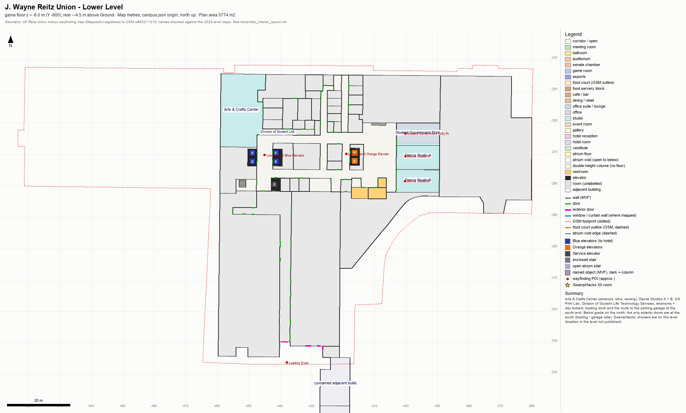
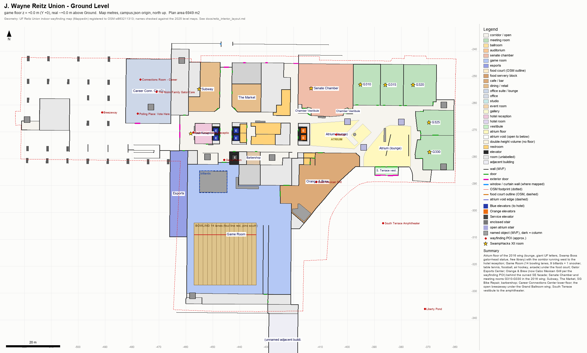
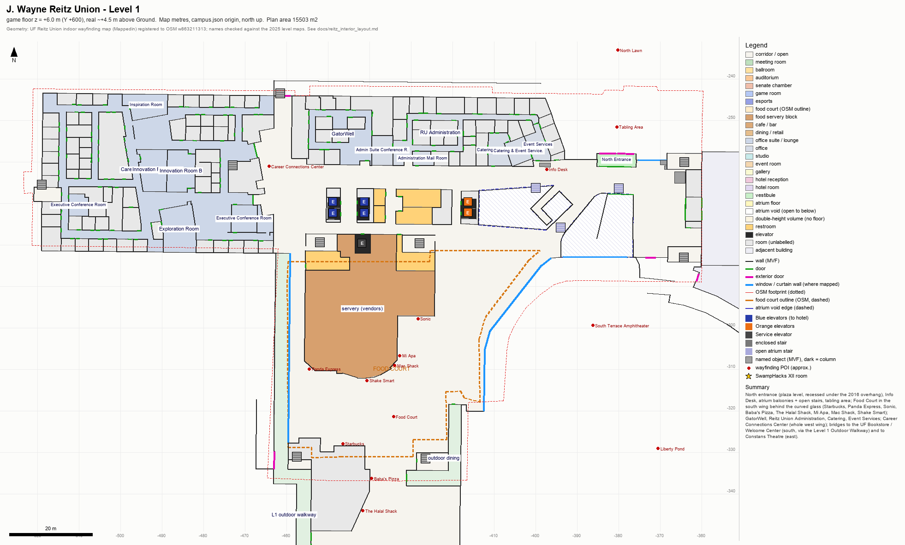
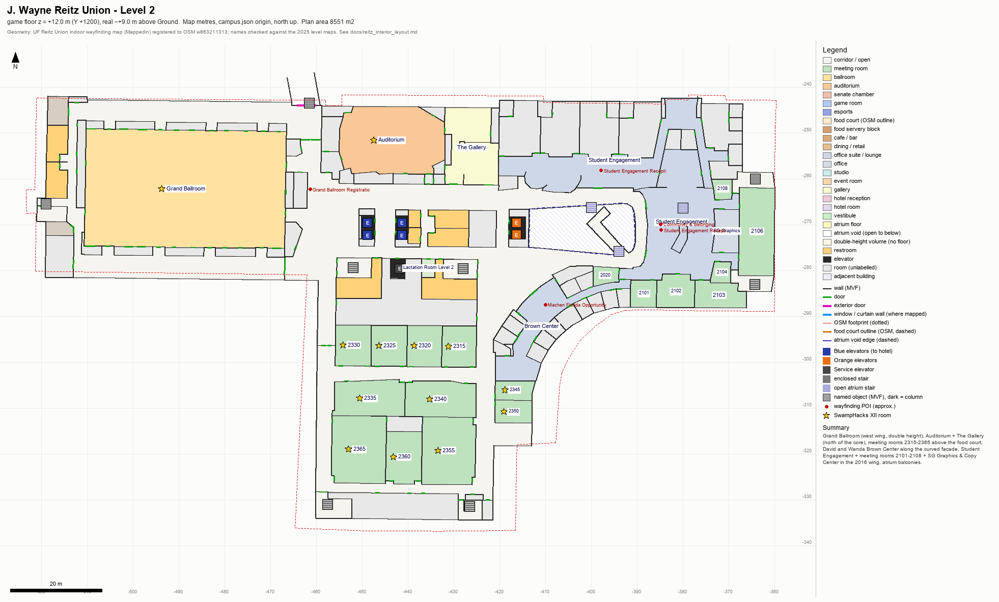
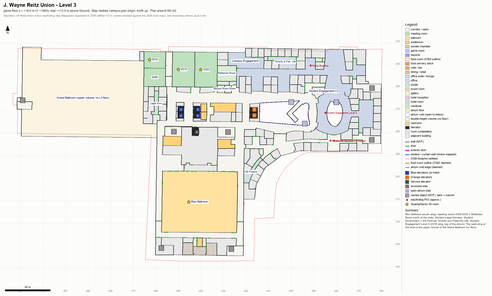
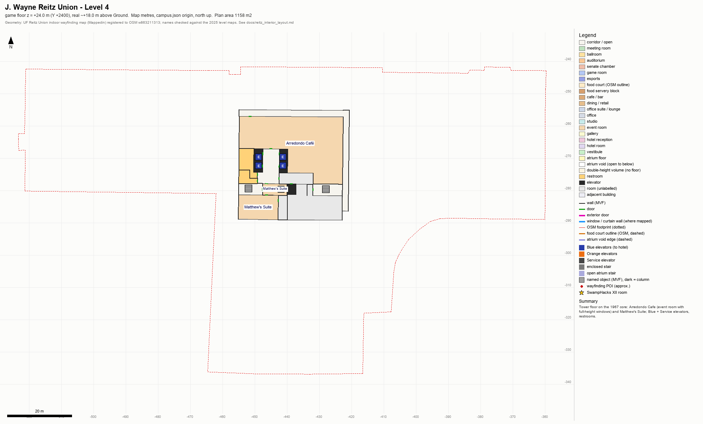
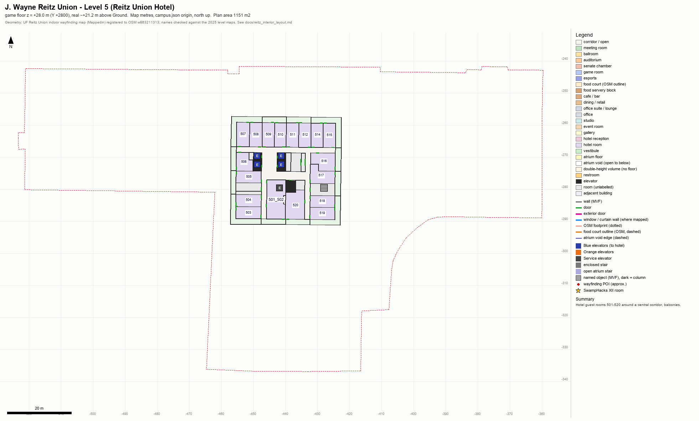
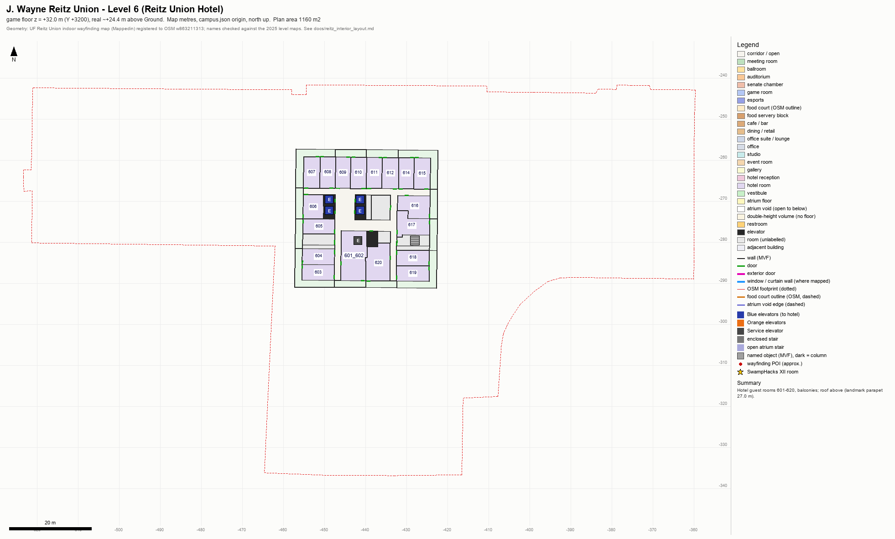
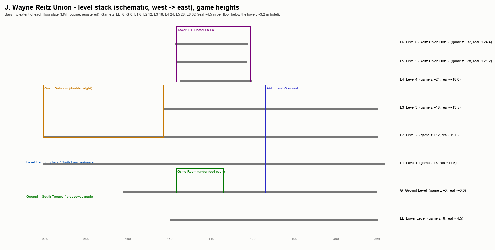

# J. Wayne Reitz Union: interior layout (reference research)

Status: reference research. Since it is built: the Reitz Union interior is **area 2 of Course 2** (`levels/wf`, entered through the real doors of the exterior landmark by instant warps; `tools/campus/interiors/reitz.py`, `docs/flow.md` §9.2.1). The build uses its own vertical frame (the Ground Level at game 0 m, the stage centre (−470, −293), not the `center_m` below) and deviates where `reitz.py` NOTES say so. It is also the reference for the reviewers who check the build against the real building.

Files:

| File | What |
|---|---|
| `data/uf/reitz_interior_layout.json` | The layout as data (schema `sgl64.reitz_interior_layout/1`): 8 floors (Lower Level to Level 6) with z levels, outlines, every room/corridor polygon, walls, doors, windows, fixtures, wayfinding POIs, exterior entrances, elevator/stair cores, the atrium, SwampHacks XII room uses, finishes from the photos, photo coverage, deviations, sources. Map metres, same origin as `campus.json`. |
| `art/levels/reitz_interior/layout_ll.png`, `layout_g.png`, `layout_l1.png` … `layout_l6.png` | One sketch per floor, drawn from the JSON. |
| `art/levels/reitz_interior/layout_stack.png` | Schematic west→east stack of the levels (game heights). |
| `art/levels/reitz_interior/reference_sheets/reitz_ref_*.jpg` | 17 contact sheets: the official level maps + one sheet per space group (109 photos). |
| `reference/interiors/reitz/` (gitignored) | The photos, the official level-map PDF + renders, the wayfinding-map bundle, and `index.json` (file, source page, image URL, credit, licence, caption, space, floor, view direction, era). |

How confident each item is (every zone, prop and door in the JSON carries one of these labels):

- **sourced**: stated in a cited source (text, photo or OSM tag).
- **plan**: from the official indoor wayfinding geometry (S2), registered to the OSM footprint (±1.5 m at the outer walls); room names cross-checked against the printed 2025 level maps (S1).
- **inferred**: my reading of the sources, not stated anywhere (positions, sizes, colours).
- **gameplay**: nothing yet; section 9 lists the suggested deviations.

Coordinates: map metres, x east, y north, origin Century Tower (as `campus.json`). `z_game_m` is the height above the **Ground Level** floor. `center_m` = (−441.5, −289.5), so game `X = (x + 441.5)·100`, `Y = z·100`, `Z = −(y + 289.5)·100`. Yaw: 0 faces +Z (south), 0x4000 east, 0x8000 north.

---

## 1. Summary

1. **The geometry is the real building plan.** The Reitz Union publishes an indoor wayfinding map (Mappedin) and links each bookable room to it from its *Our Spaces* page. Its public data bundle has georeferenced polygons for every room, wall, door and fixture on 11 floors (S2). I registered it to the OSM footprint that the exterior landmark extrudes (section 3), and every label on the official 2025 printed level maps (S1) lands in the matching room. Room areas agree with the published square footage (2315: 723 sq ft = 67.2 m², plan 67.5 m²; Grand Ballroom 11,562 sq ft = 1,074 m², plan 1,119 m² including walls).
2. **Eight levels:** Lower Level (LL), Ground (G), Level 1, 2, 3, 4 (tower), 5 and 6 (Reitz Union Hotel, 36 rooms). OSM's level 0 is Ground.
3. **The site slopes, so both Ground and Level 1 are "front doors".** The 2016 north entrance and the North Lawn tabling area are on Level 1, recessed ~14 m under the overhang of the upper floors. The South Terrace / amphitheater doors, the breezeway (circle drive and garage side), the hotel entrance and the north doors by Subway are on Ground. The Lower Level only opens at the south end (loading dock, garage route).
4. **The atrium** (2016 wing, just east of the Orange elevators) runs from the Ground-level lounge up to the roof over Level 3, with two voids on Level 1 (~170 + ~220 m²), balconies on L1-L3 and open scissor stairs. Its look, from photos: cedar-slat ceiling with dark curved ribs (patterned on a gator's underbelly), white curved balcony fronts, metal picket railings with gator-shaped cut-outs, terrazzo with inlaid gator tracks, and giant orange UF letters on a gator-skin wall. A "Swamp Boss" gator-head statue and a free library stand on the atrium floor.
5. **Game Room (Ground) is under the food court (Level 1)** in the south wing. Its 14 bowling lanes run north-south with the pins at the south wall. The billiards area (9 tables + 1 snooker) is in the north-west part, and the Gator Esports Center is a long narrow room along the west side (2,555 sq ft, 44 stations).
6. **Food court (Level 1):** an enclosed vendor block (~743 m²) with a curved storefront, wrapped by the seating hall along the curved SE glass. The vendors are Starbucks, Panda Express, Sonic (opened 2025), Baba's Pizza, The Halal Shack, Mi Apa, Mac Shack and Shake Smart. Their wayfinding and OSM pins disagree, so treat the list as "who is there", not exact positions.
7. **Ballrooms:** the Grand Ballroom (L2, west wing) is double height, because Level 3 has no floor over it. The Rion Ballroom is on L3 in the south wing. The Auditorium (299 seats) and The Gallery are on L2 north of the core.
8. **Meeting rooms:** G310-G330 sit in the 2016 wing on Ground, next to the Senate Chamber. 2315-2365 are on L2 above the food court, 2101-2108 on L2 in the 2016 wing, and 3305-3320 on L3 north of the core.
9. **Photos:** 109 photos from public sources. Coverage is good for the atrium, Game Room, esports, ballrooms, auditorium, meeting rooms, the Level 4 rooms, the hotel rooms and both exteriors. It is thin or missing for the hotel lobby, Orange & Brew, the Info Desk, the current Starbucks, Subway/The Market, enclosed stairs, elevators and restrooms (section 8).
10. **Three findings about the existing exterior landmark** (`reitz_reitz_union.py`, not changed here):
    - It puts an enterable food court at deck 2.0 m behind the curved glass. The real food court is on Level 1.
    - Its tower block is 40 × 22 m at y −274..−252. The real Level 4-6 floor plate is about 35 × 34 m at y −291..−255.
    - The old Colonnade building it names was demolished in 2013.

---

## 2. Sources and what they say

- **Official level maps 2025 (S1).** Six pages (Lower, Ground, 1, 2, 3, 4) give room names per level. They are drawn with page-up = west and right = north. I rendered them at 100/300 dpi and registered each page to the plan outline by mask overlap (IoU 0.95 for L2/L3, 0.88-0.89 for LL/L4, 0.81 for L1, 0.75 for G; Ground is lowest because the printed page includes the breezeway). Every label was mapped to metres (`printed_map_labels`).
- **Indoor wayfinding map (S2).** Mappedin venue `67bdc505679a9d000bfacd1d`, linked from union.ufl.edu. The public viewer downloads one data bundle (`mappedin-public-mvf-prod…/mvf?venue=…` → zip, updated 2026-07-31), and I downloaded it the same way. It contains floors, spaces (rooms/corridors/voids), obstructions (walls + named fixtures such as "Bowling Lanes", "Billiards & Pool Area", "UF Letters", "Swamp Boss - Gator Head Statue", "Info Desk", "Florida Hall of Fame Wall"), doors (exterior flag), windows, elevator/stair connections and POIs. The bundle is in `reference/interiors/reitz/maps/mappedin_mvf/`.
- **Our Spaces (S3).** Square footage and capacities. Grand Ballroom 11,562 sq ft (¾ 8,610; ½ 5,740; ¼ 2,870). Rion 8,669 (½ 4,335). Auditorium 2,400 / 299 seats. Chamber 3,271. G310 1,268, G315 1,037, G320 1,424, G325 986, G330 1,278. 2315 723, 2320 678, 2325 700, 2330 722, 2335 1,185, 2340 1,199, 2345 339, 2350 377, 2355 1,742, 2360 895, 2365 1,782. 3305 667, 3310 738, 3315 1,487, 3320 1,503. Arredondo Café 2,400, Matthews Suite 1,096. The page also has one or more photos per room.
- **Game Room / Esports / Arts & Crafts / Gallery / Dining pages (S4-S8).** 14 lanes, 9 billiards + snooker, 2 foosball, air hockey, table tennis. Esports has 44 stations (12 arena PCs, 24 game pods, 6 couch co-op, 2 stream pods). The ACC (ceramics, kilns, sewing) is on the Lower Level, The Gallery on Level 2 by the Auditorium, the barbershop on Ground and the UF Bookstore on Level 1.
- **History (S9, S11-S13).**
  - Opened 1967. The 2013-16 project ($70.7 M, CannonDesign + Walker Architects, Skanska) demolished the Colonnade building and built about 126,000 sq ft in its place, plus about 90,000 sq ft of renovation (ENR).
  - The old central staircase was removed in 2014 and replaced by stacked restrooms (Alligator).
  - The foyer railings have gator cut-outs on all three floors, and the wooden ceiling mimics a gator's underbelly (Alligator photo captions, 2015-16).
  - The Bryan Lounge is "on the first floor" (S9). It is not on the current maps.
- **OSM (S14).** Building outline w863211313 (the landmark footprint), food court outline w1315821081 (level 1), level-tagged doors, rooms and vendor POIs. These confirm the level numbering.

---

## 3. Plan fit (wayfinding map → OSM footprint)

The raw wayfinding geometry sits about 2.0 m east of the OSM outline and, on Levels 2-3, up to about 2 m north of it. Each floor is also rotated 0.5-1.1° from the OSM axis. OSM's own indoor Level 2 outline (w1323490478) agrees with the raw data on the north wall, so the upper floors may really overhang the ground-level line.

So that the interior fits inside the exterior landmark:

1. Each floor is rotated about the shared elevator core (−430, −269) so that its main wall axis matches the OSM axis (G 1.12°, L1 0.65°, L2 0.52°, L3 0.60°, LL 1.15°, L4-L6 0.84-0.87°).
2. All floors then get **one** translation, (−2.04, −1.96) m, which puts opposite exterior walls evenly on either side of the OSM edges. A single translation keeps the floors stacked: the elevators line up within 0.5 m on every floor.

Residuals (outermost plan wall minus OSM edge, + = outside), from `plan_fit.per_floor`:

| Floor | W wall | E wall | N (ballroom wing) | N (core) | N (2016 wing) | S (ballroom wing) | S wing south |
|---|---|---|---|---|---|---|---|
| G | −1.5 | +0.7 | +0.3 | −1.7 | −0.6 | −1.5 | +0.5 |
| L1 | −1.8 | +1.3 | +0.2 | −1.2 | 0.0 | +0.3 | +0.5 |
| L2 | −0.8 | +0.2 | +0.3 | −1.3 | +0.2 | +1.3 | −1.8 |
| L3 | −0.3 | +0.3 | −0.1 | −1.3 | +0.1 | – | −1.3 |

A −1.3 at the core's north wall is real: the Level 1 covered bridge / colonnade runs outside it. The −3.6 to −4.6 on the south wing's west and east walls at L2/L3 are real setbacks above the food court. The raw, unregistered bundle stays in `reference/` if a later builder prefers a different fit.

---

## 4. Floors

| Floor | Game z | Real z (est.) | Plan area | What is there |
|---|---|---|---|---|
| LL | −6.0 | −4.5 | 5,774 m² | Arts & Crafts Center, Dance Studios A/B, SG Print Lab, DSL Technology Services, lockers, restrooms; south doors to the loading dock / garage |
| G | 0.0 | 0.0 | 6,949 m² | Atrium lounge, hotel reception, Subway, The Market, SG Bike Repair, barbershop, Game Room, Gator Esports Center, Orange & Brew (Cabo Mexican Grill POI), Senate Chamber, G310-G330, Career Connections Center (lower), breezeway |
| L1 | 6.0 | 4.5 | ~9,500 m² in the footprint (15,503 with the Bookstore / Constans links) | North entrance, Info Desk, tabling area, atrium balconies, food court, GatorWell, Administration, Catering, Event Services, Career Connections Center |
| L2 | 12.0 | 9.0 | 8,551 m² | Grand Ballroom, Auditorium, The Gallery, 2315-2365, Brown Center, Student Engagement, 2101-2108, SG Graphics |
| L3 | 18.0 | 13.5 | 8,190 m² | Rion Ballroom, 3305-3320, Reflection Room, Student Legal Services, SG + SG Finance, Sorority & Fraternity Life, Student Engagement L3 |
| L4 | 24.0 | 18.0 | 1,158 m² | Arredondo Café, Matthew's Suite (tower) |
| L5 | 28.0 | 21.2 | 1,151 m² | Hotel rooms 501-520, balconies |
| L6 | 32.0 | 24.4 | 1,160 m² | Hotel rooms 601-620, balconies |

Real elevations are not published. 4.5 m per floor below the tower and 3.2 m on the hotel floors are estimates. The game spacing (6.0 m, hotel 4.0 m) does not depend on them.

What each floor record in the JSON holds:

- `zones`: every room and corridor polygon, keeping the plan's space id.
- `props`: named fixtures and the breezeway columns.
- `pois`: wayfinding pins.
- `openings`: exterior doors with their facing.
- `windows`: only where the plan maps them. Most curtain walls are not mapped; use the photos.
- `walls_m`: wall centre-lines. Doors are not cut out of them.
- `doors_m`: door segments lying on the walls. Cut these out of `walls_m`.
- `connections_mvf`: raw stair/elevator nodes. These are incomplete; use `vertical` instead.
- `printed_map_labels`: the S1 labels mapped into map metres.

### Entrances (`entrances`)

| Entrance | Floor | Where (map m) | Faces |
|---|---|---|---|
| North entrance (2016, main) | L1 | (−384.6..−378.2, −258) | N |
| South Terrace doors | G | (−389.5..−381.2, −286.3) | S |
| Hotel entrance from the breezeway | G | (−462.2, −272..−269) | W |
| North doors by Subway / The Market / Bike Repair | G | (−445.8..−420, −245) | N |
| South exit to the terrace stairs | L1 | (−373.5, −283) | S |
| Food court → Level 1 Outdoor Walkway (to the Bookstore) | L1 | (−463, −330) | W |
| North exit stair | L2 | (−461, −244) | N |
| Loading dock / garage side | LL | (−439..−426, −330..−332) | S |

---

## 5. Elevators and stairs (`vertical`)

- **Blue elevators:** 4 cars in two facing pairs at x −448.8 / −441.3, y −269.6 / −272.3. They serve LL to L6 and are the only bank that reaches the hotel. On Ground they open beside the hotel reception desk.
- **Orange elevators:** 2 cars at x −416.3, beside the atrium. They serve LL to L3.
- **Service elevator:** at (−441.8, −279.6). It serves LL to L6.
- **Atrium stairs:** open scissor flights from G to L3 across the voids.
- **Enclosed stairs:**
  - core west (−452, −279.4) and core east (−428, −279.6), the east one running to the hotel floors
  - west bump (−519, −265.5)
  - north-west (−461.5, −243.5)
  - south wing south-west (−457.5, −331) and south-east (−426.5, −331.5)
  - 2016 wing north and south ends (−364.2, −260 / −283)
  - Career Connections Center internal stair (−473, −260.8)

---

## 6. Key spaces: what they look like (from the photos)

Contact sheets: `art/levels/reitz_interior/reference_sheets/`. The `materials_and_light` block in the JSON repeats these notes per zone, adds suggested vertex-colour light, and lists the new textures a builder would need.

- **Atrium (G-L3).**
  - Floor: white terrazzo with a blue patterned carpet inset under orange, grey and navy lounge furniture.
  - Balconies: white curved fronts with LED coves and vertical-picket metal railings.
  - Ceiling: cedar-tone wood slats with dark curved ribs, with a clerestory band at the top.
  - Stairs: white scissor stairs crossing the void.
  - Art: giant extruded orange UF letters on a blue base in front of a grey/white gator-skin wall, and navy gator footprints inlaid in the terrazzo.
- **Game Room (G).**
  - Floor: grey wood-look planks.
  - Lanes: 14 maple-look lanes with Brunswick ball returns and white round columns. A black overhead truss with monitors hangs over the approaches, and a video/banner strip sits above the pins with a gator mural on the masking units (Kosmic blacklight mode).
  - Seating: navy curved booths behind the approaches.
  - Billiards: blue-felt tables under square LED frames on blue/orange patterned carpet.
  - Walls: dark navy, with a "GAME ROOM - The University of Florida" space-themed wall graphic.
- **Gator Esports Center (G).** A long narrow room:
  - dark ceiling, wood-look floor
  - black desks with blue edge light
  - white hex neon panels on hex-textured walls and lit "GATOR ESPORTS CENTER" letters
  - glass streaming booths and a red-orange bench.
- **Food court (L1).**
  - The hall has white columns and white tile.
  - A diamond-checker (tan/brown/grey) queue ring runs along the curved servery front, under a curved soffit.
  - Each storefront has its own colours (Sonic: navy + red neon).
  - The curved SE glass wall has white horizontal bands.
- **Grand Ballroom (L2).**
  - Floor: royal-blue carpet with flowing white lines.
  - Walls: light grey with a band of white 3-D triangular acoustic panels, pilasters, and walnut double doors with transoms.
  - Fittings: 4 drop-down screens.
  - Ceiling: coffered, each coffer a field of white luminous slats.
  - A high clerestory band runs along one long wall.
- **Rion Ballroom (L3).**
  - Floor: maple hardwood.
  - Walls: white with dark-grey vertical panels.
  - Ceiling: acoustic tile crossed by red-brown wood slat beams.
- **Auditorium (L2).**
  - Seats: navy with honey-wood arms and backs on a raked floor.
  - Walls: wood panels by the screen, navy accents.
  - Ceiling: dark wood slat bands with LED coves.
- **Senate Chamber (G).**
  - Seating: curved tiers of grey desks with navy high-back chairs.
  - Dais: cherry wall with chevron reveals behind it, US and Florida flags.
  - Walls: cream.
- **Meeting rooms (typical).**
  - Floor: blue/grey patchwork carpet tile.
  - Walls: white with a white chair rail and one accent wall (royal blue on G310-G330, pale grey-blue on L2).
  - Ceiling: 2×2 acoustic tile with linear LEDs.
  - Doors: honey-wood with a narrow vision panel.
  - Framed art.
- **Level 4.**
  - Arredondo Café: olive carpet, full-height windows.
  - Matthew's Suite: grey-blue walls, white millwork, framed historic photos.
- **Hotel rooms.** Royal-blue accent wall, cherry furniture and blue bed skirts. The balconies have white slotted concrete balustrades.
- **Lower Level.**
  - Dance studios: black sprung floor, mirror walls.
  - Arts & Crafts Center: entrance with a hand-drawn colour mural and the ACC roundel.

---

## 7. SwampHacks XII (`swamphacks_xii`)

From the hacker guide, as relayed in the task brief. The Notion page needs JavaScript, so I did not re-read it here.

| Use | Floor | Rooms |
|---|---|---|
| Workshops | G | G310, G320, G325, G330 |
| Hacking | G | G315, G325, G330, Senate Chamber |
| Hacking | L2 | 2315-2340 |
| Main stage / ceremonies | L2 | Auditorium |
| Hacking, meals, expo | L2 | Grand Ballroom |
| Mentors | L2 | 2345, 2350 |
| Sleep | L2 | 2355, 2365 |
| Quiet room | L2 | 2360 |
| Volunteers | L3 | 3310 |
| SwampHacks rooms | L3 | 3315, 3320, Rion Ballroom |
| Showers | LL | No public plan names the room |
| Overnight entrance | G | Reitz Hotel ground floor near Subway: the ground-level north doors next to Subway, or the hotel entrance from the breezeway |

The sketches mark these rooms with a yellow star.

---

## 8. Photo coverage (honest)

109 photos in `reference/interiors/reitz/photos/` (index: `reference/interiors/reitz/index.json`), plus the official maps.

| Space | Photos | Status |
|---|---|---|
| Atrium / lobby | 7 (incl. the UF letters and the gator-track floor) | good (ENR 2016, Flickr, Alligator, UF) |
| North entrance + north facade | 5 + 12 context | good |
| Game Room | 24 | good (2025-26, after the renovation) |
| Gator Esports Center | 10 | good (UF + builder) |
| Grand Ballroom | 4 | good |
| Auditorium | 3 | good |
| Meeting rooms G310-G330 / 2315-2365 / 3305-3320 | 4 / 5 / 3 | good (one typical photo per room group) |
| Level 4 (Arredondo Café, Matthew's Suite) | 5 | good |
| Hotel rooms | 3 | good |
| Food court | 6 | thin (closed counter 2023, Sonic 2025, Starbucks counter 2017, older dining shots); no current overview |
| Breezeway | 3 | thin (2023 Flickr + one night shot) |
| Rion Ballroom, The Gallery, Senate Chamber | 1 each | thin |
| Arts & Crafts, dance studios | 2 each | thin |
| Career Connections Center, GatorWell, Bookstore link, Student Engagement | 1 each | thin (CCC from its 2018 opening; the GatorWell corridor location is not confirmed) |
| Starbucks | 2 | thin (2017 counter close-up before the 2018 refit + one pre-2016 shot); current counter not photographed |
| The Colonnade | 1 | pre-2016 only (demolished 2013) |
| **Hotel reception / lobby** | 0 | **none found** |
| **Orange & Brew / Cabo Mexican Grill** | 0 | **none found** |
| **Info Desk** | 0 | **none found** |
| **Meeting rooms 2101-2108** | 0 | **none found** |
| **Subway, The Market, barbershop, SG Bike Repair** | 0 | **none found** |
| **Showers (LL)** | 0 | **none found** (location unknown too) |
| **Enclosed stairwells, elevator lobbies, restrooms** | 0 | **none found** |

The whole table is in the JSON as `photo_coverage`, with per-photo file lists. There, `status` is count-based (3+ photos = good); the statuses in this table are my judgement of how useful the photos are. Sources searched:

- union.ufl.edu (every page in its sitemap)
- UF News archive, ENR, the Alligator (30 articles)
- Wikimedia Commons (category + search)
- Flickr Creative Commons through the Openverse API (≈120 hits)
- the hotel, builder (Oelrich), Student Engagement, Career, GatorWell and Business Services sites

Mainstreet Daily News blocks scripted access (403), so I skipped it. I did not use Google Images, paywalled pages or anything behind a login.

---

## 9. Deviations a builder should expect (`deviations`)

- **Floor height.** Floors are 6.0 m apart in the game (4.0 m on the hotel floors) against about 4.5 m real; plan dimensions stay 1:1.
- **Grand Ballroom.** It keeps its real double height: about 11 m clear in the game, against about 7 m real (estimated from photos). Since fidelity pass 4 the perimeter soffit is at 9.3 m and the screens fill the upper wall, so the room reads closer to the photos' proportions.
- **Atrium.** It is real and already camera-friendly: Ground to the roof over L3, about 23.4 m in the game.
- **Bowling lanes.** They stay at regulation length, 18.29 m from foul line to head pin. The plan's 15.5 m lane block is extended north to y −303.9 (inferred).
- **Registration.** Every floor carries the shift described in section 3.
- **Atrium balconies (build rule).** Where a plan wall or door lies on the edge of an atrium void, the game does not build it. That edge gets only the balcony: a white fascia, a picket rail (30 cm collision block) and the slab edge. The photos show open balconies on all three levels. The rail is cut where each scissor-stair flight meets the slab, so the stair can be climbed from Ground to L3.
- **Cedar vault.** A lens-shaped barrel that rises 2.0 m (`VAULT_RISE`) over the 25.6 m clerestory top, with three long dark ribs along its length and a dark band at the head of the clerestory (ru_atrium_enr_vertical, ru_atrium_hdr_flickr). The rise is an estimate from the photos.
- **Outside the glass (visual only).** A paving apron and a lawn at Ground grade, Liberty Pond with oaks, a tree line all round, and a Level 1 plaza in front of the north entrance. The Level 1 outdoor walkway and the outdoor dining area get slabs with a canopy and a rail. The main roof leaves out the tower (L4+). The Level 1 plaza and the tree ring are simplified grades, not survey data.
- **Floor collision** is clipped to each floor's outline, so no invisible ledge reaches past a facade. The Level 1 south-exit porch (door 3) is closed by rails with a tall invisible guard and by a solid face on the facade behind it.
- **Door thresholds.** The area-2 warp strips of doors 0-2 start 0.10 m outside the door line (`STRIP_GAP`), with a plain floor in that gap. Area 1's strips end exactly on the line, so the two never share an edge (a shared edge flips Mario between areas every frame). Door 3 already had a 4 cm gap.
- **Meeting-room set-ups.** Chair rows start 2.6 m from the screen wall. The screen (accent) wall is never a window wall. G330 has rows again (fidelity pass 3: ru_os_g330 shows rows of black chairs facing the blue wall, with the navy draped table behind them).
- **Meeting-room furniture check.** `reitz.py --selftest` fails when more than 5 % of a room's furniture vertices (chair rows, draped tables, classroom / U / boardroom tables) fall outside the room. Classroom tables that would cross a wall of a tapered room are dropped (3310 keeps one column).
- **North entrance recess (visual only, fidelity pass r1).** Outside the north doors, area 2 now shows the 2016 wing's overhang as area 1 builds it, clipped to the open part of area 2's Level 1 outline: a white soffit at the Level 2 slab underside (11.4 m, i.e. area 1's 5.4 m) with three rows of linear lights, three white columns on the overhang edge (x −394.0, −385.5, −377.0; area 1 has a fourth at −402.5, where area 2's plan has Level 1 rooms), the east side wall and a white fascia at the face (ru_north_entrance_hotelsite, ru_north_entrance_enr_dusk). The Level 1 plaza follows the same outline. The vestibule's door frames are aluminium, not wood (ru_ribbon_cutting_doors), and the two entrance vestibules (north, South Terrace; `GLASS_VESTIBULES`) are glass boxes toward the corridor / atrium: glass storefront with a steel base and a transom bar at the 3.0 m door head (collision unchanged).
- **Atrium lounge (fidelity pass r1).** One large dark-navy carpet with light-blue squiggles fills the west void's floor under six clusters (3 x 2, 0.6 m aisles between their 0.48 m collision blocks); two more sit on the east rug (ru_atrium_enr_lounge shows about ten). The carpet stops about 1.5 m short of the UF letters, so the floor in front of them is open terrazzo. The terrazzo texture has no joint lines (the photos show a poured, seamless floor). Ground and Level 1 have a brighter ambient than the other floors (sky 0.74 against 0.66), for the daylit atrium.
- **UF letters bay (fidelity pass r1).** The Ground ceiling under the Level 1 balcony over the letters is plain white (`WHITE_SOFFITS`), not the near-void cedar band. A WELCOME TO THE REITZ UNION banner hangs on that balcony's rail. The gator-skin plates are about 0.28 m (1.0 m per texture repeat), the size in ru_atrium_uf_letters_flickr.
- **Atrium top (fidelity pass r1).** The clerestory is a dark glazed ring on every long side, with dark mullions, under the cedar lens. Three dark drum pendants on long rods hang into the void at the Level 3 storey. No downlight is placed in or within 0.5 m of a void.
- **Info Desk (no photo).** It is sized to the plan object (2.7 x 1.0 m at x −399.1..−396.4, y −261.3..−260.3), with a curved navy front, a white top and a black kick base. The look is inferred.
- **Preview cameras.** `reitz_atrium_lounge`, `reitz_atrium_up` and `reitz_atrium_stairs` (the ENR vertical view, from the Level 3 west-end balcony, 95° field of view) are matched to their photos.
- **Food court vendors (fidelity pass 2).** The storefronts (`SERVERY_FRONTS` + `VENDOR_STYLES` in `interiors/reitz.py`) follow the `food_vendors` pins in `props_extra` L1 where they agree. The signs are generic (no brand marks).
  - **Burger drive-in (Sonic)** is on the NE block's south face, x −432.0..−424.9, y −297.2. Both pin sets put it there. Its look is from ru_food_court_sonic_2025: a navy fascia with the neon name above a white-framed opening, a bright white kitchen with a row of blue-lit menu screens, a navy counter, a wood-look panel on the right and a navy panel with a red/blue neon swirl on the left.
  - **Coffee bar (Starbucks)** is on the servery's east face, y −303.0..−307.4 (OSM pin). Its look is from ru_starbucks_2017, before the 2018 refit: maple counter, top and side panels, an orange/green/cream small-square mosaic back wall and black chalkboard menus. It has no hood.
  - **Wok (Panda)** is at the SW corner (MVF pin). It has a red/black counter front. A lime wall with a sky-blue post at the west end of its slot reproduces the left edge of ru_food_court_counter_2023.
  - **Halal and pizza (Baba's)** are on the south front. Mac, shakes and the Latin café keep the faces that would otherwise be blank: the east face north of the coffee bar and the NE block's east face. Neither pin set places them.
  - **The others** keep the pale-blue siding of ru_food_court_counter_2023.
  - **The servery's west face and north side** are back of house, with no storefront and no checker.
- **Food court queue ring and soffit (fidelity pass 2).**
  - The checker ring is one band, `FC_RING_DEPTH` 2.6 m deep. It runs only in front of the storefronts, from the SW corner, along the south front and the east face, round the NE block, and up its east face.
  - The cream soffit over it is just as deep, at `FC_SOFFIT_Z` 3.6 m (the photo shows about 3 m; it is raised for the camera). Since fix round 4 it does not run in front of the burger front (see below). Its outer edge is a smooth curve (`_offset_open`): convex corners are rounded, the curved south front is smoothed, and it has a 0.7 m fascia. Two staggered rows of downlights run along it.
- **Food court hall floor (fidelity pass 2).** The tile is large-format white / very light grey (60 cm, faint grout). It runs to the curved SE glass and the outdoor-dining nook (`FC_HALL_EAST`), not only to the OSM outline, so there is no terrazzo seam by the glass.
- **Level 1 outdoor walkway (visual only, fidelity pass 2).** White canopy piers stand on the outer edges, no more than 6.5 m apart. The plan's door at (−463, −330) on the walkway's west edge is a glass pair in a white surround (the Bookstore entrance). The food court's west strip therefore looks out on the covered route.
- **Ground meeting rooms G310-G330 (fidelity pass 3; ru_os_g310_g320, ru_os_g330).**
  - The royal-blue accent is the corridor end wall, the one with the two honey-wood-framed doors at its ends: the south walls of G310 / G315 / G320 / G325 and the slanted west wall of G330. The long side walls stay white.
  - There is no screen on the blue wall. A ceiling projector on a drop rod and a grey retracted-screen housing at the ceiling, 0.55 m in front of the blue wall, stand in for it. Upstairs rooms keep their wall screens.
  - The white walls get a white raised-panel wainscot under the chair rail (`int_ru_wainscot`, 0.10-0.88 m). The long interior side walls carry a row of small framed prints at 1.55-2.15 m, every 1.7 m (`int_ru_prints`, 8 prints). There is an EXIT sign over every door, on the room side.
  - The chair block is centred on the room's full width across the facing, not on the accent wall (G330's blue wall is shorter than the room). On Ground, every chair vertex must lie inside the room: the fit loop narrows the rows first and only then drops rows, and about 1.6 m is left behind the last row. The navy draped table stands there, beside a side wall where it fits (ru_os_g330 shows it in the foreground).
- **Senate Chamber (fidelity pass 3; ru_os_chamber).** It has 7 curved rows (r0 6.0 m, pitch 1.25 m, rise 0.15 m), each clamped to 9.6 m either side of the centre line, so the rows fill the room to about 3 m from the back wall. The desks are long continuous light-grey stone-look counters (`int_ru_stone_grey`). The navy high-back chairs are lower (back top 1.05 m) and denser (0.72 m apart). The carpet is dark navy (`int_ru_carpet_chamber`). The US flag is at the west (left, seen from the seats) end of the cherry panel and the Florida flag at the east end. A ceiling projector hangs over the rows. Collision per row: the desk band (both faces, top, ends) and a floor. The 0.15 m risers need no walls.
- **Gator Esports Center (fidelity pass 3; ru_es_overview, ru_es_oelrich_9352).**
  - The sign is one line, GATOR ESPORTS CENTER, in white letters on a black bulkhead across the south end, with a blue LED underline. The line is 128 px wide, stored as two 64 x 16 halves of `int_ru_sign_esports` and drawn as two quads.
  - The hex walls are near-black with faint blue edges, and the floor is a wood-look plank (`int_ru_wood_lvt`).
  - Eight glass dome pendants hang over the west PC row, the island and the couch area.
- **Hotel reception (no photo, fidelity pass 3).** It sits on the plan prop along the west wall (y −272.9..−268.0). There is a honey-wood front counter with a navy reveal, a white transaction top and a black kick, a white back counter, a royal-blue sign wall with the lit REITZ UNION HOTEL sign, two monitors and three navy drum pendants. The look is inferred from the house finishes.
- **Bowling pin end (fidelity pass 3; ru_gr_lane_screens).** A short dark-navy masking fascia (1.25-1.9 m) sits under one continuous video wall (2.0-4.9 m) across all 14 lanes. The wall shows a seamless broadcast tile (a studio desk with two presenters and a lower third) 3 times. The backing and the end returns run up to the ceiling. The gator mural (ru_gr_kosmic_lanes) is the blacklight show only, so it is not modelled. The overhead TV strip is the truss's score monitors.
- **Ball returns (fidelity pass 3; ru_gr_lanes_overview_1).** Each has a rounded black Brunswick hood (a 9-point profile) with a steel lip, a low black base with two steel rails, and 4 low-poly balls (8-sided lathe, 32 triangles each). The collision block is unchanged.
- **Billiards carpet (fidelity pass 3).** It is about 40 % darker: deep navy scales with light-blue highlights and orange flecks (ru_gr_billiards_room).
- **Food court preview cameras (fidelity pass 2).**
  - `reitz_food_court` uses the matched ru_food_court_counter_2023 viewpoint: (−457.2, −314.2, 7.55) to (−433.0, −310.5, 7.2), vfov 54.
  - `reitz_food_court_burgers` looks north at the burger front.
  - The new `reitz_food_court_coffee` looks west at the coffee bar.
- **Grand Ballroom (fidelity pass 4; ru_os_grand_ballroom_1, _3).**
  - The upper wall now follows the photos. The drop-down screens are 7.0 x 5.0 m, from 3.9 to 8.9 m: about twice the 2.6 m door head tall, starting at about 1.5 door heights. There are four on the stage (south) wall, two on the north wall and one on the west end wall. Between them, full bays of white 3-D triangle acoustic panels run from 3.6 m up to the soffit, between white pilasters (one at each screen edge, then every 4.6 m or less). The blank grey band is gone.
  - The perimeter soffit is lowered to 9.3 m (`GB_SOFFIT`). The luminous coffers stay at the 11.4 m clear height. Both soffits are clipped to the room outline, so nothing pokes through the walls.
  - The clerestory band is on a short end wall, as in ru_os_grand_ballroom_3 (it was on the north long wall). It is lit glazing at 6.5-8.0 m with mullions, under a lowered end soffit (`GB_END_SOFFIT` 8.3 m, `GB_END_D` 4.0 m deep, with two rows of downlights). The photos do not fix the compass end. The east end is used because GB3 looks down the long axis with the stage on the right long wall and the window band on the far wall, which is the east end when the stage is on the south wall. From Level 3 the band is only a decal on the ballroom's own face.
  - The carpet (`int_ru_carpet_ballroom`) has nine thin lines (six white, three light blue), each drawn from its true distance, about 4 cm wide, at 3.6 m per 64 px. The old lines were 1-2 px at 6 m and rendered as wide white chains.
- **Auditorium (fidelity pass 4; ru_os_auditorium_3).**
  - The rows are continuous, with no centre aisle. Each row is as wide as the room allows at its depth, with side aisles of at least 1.3 m, because the north-east corner is cut on the diagonal.
  - A railed cross-aisle runs in front of the first row: a navy parapet 0.9 m high with a honey-wood cap, open at both ends.
  - The screen is narrowed to the straight end wall, between two navy pilasters. The angled walls either side are honey-wood panel blocks, each with an exit door and a lit EXIT sign.
  - The ceiling has six thick, bright LED coves, 0.72 m wide in dark lips, instead of four thin lines.
  - The rake's collision is now one ramp through the middle of every step top (within 9 cm at the step edges, standard SM64 practice for stairs) instead of a prism per step. That saves about 90 collision tris and pays for the new ceilings below.
- **Rion Ballroom (fidelity pass 4; ru_os_rion_ballroom).** The clear height is 6.0 m (it was 7.4 m; the photo looks like about 5 m). There are 11 narrow red-brown beams (0.34 m), about 2.8 m apart, with a flush LED line between each pair. A light cove (a glowing strip under a white lip) runs along the top of every wall. The dark-grey wall panels are 0.6 m wide, every 2 m, in `int_ru_wall_slate`.
- **Upstairs meeting rooms (fidelity pass 4; ru_os_2315_2330, ru_os_3315_3320, ru_os_2355_2365).**
  - The accent wall is a medium slate grey-blue (`int_ru_wall_slateblue`, #6E7D96, about (110, 125, 150)). It was the pale `int_ru_wall_greyblue`, which stays for Matthew's Suite.
  - L2 / L3 meeting rooms (and, since fidelity-3 of fix round 2, G310-G330 and the Senate Chamber) have a dropped lay-in ceiling at 3.9 m (`MEETING_CLEAR`, style key `ceil_h`), against about 2.7-3 m real, raised for the camera. It is drawn, has a collision ceiling at 3.9 m, and the light fixtures hang from it. The walls and the plain ceiling above keep the floor's 5.4 m clear height, so the wall collision still merges with the corridor side.
  - The side walls carry a row of framed photos / art (`int_ru_prints`, 0.9 x 0.8 m every 2.0 m), plus EXIT signs over the doors. There is no wainscot upstairs. The wall screen is now 1.2-3.3 m.
- **Hotel room 516 (fidelity pass 4; ru_hotel_room).** The blue wall carries a full-size cherry dresser (1.8 m) with the TV mounted on the wall above it, a cherry-framed mirror to the west and a cherry desk with a navy chair to the east, clear of the balcony door. The room's west bay (the plan's notch beside the corridor door) is an entry / bath block: a wall-high cream box with a bath door, one collision face. The `reitz_hotel_room` preview now looks from the balcony-door corner (−424.95, −269.2) south-west at the blue wall, the bed and the bath block.
- **Arredondo Cafe (fidelity pass 4; ru_os_arredondo_cafe).** A stone-clad column (`int_ru_stone_clad`, 0.9 m square, `ARREDONDO_COLUMN` at (−437.5, −262.5); the position is estimated) stands mid-room, and the two tables nearest it are left out. Roller shades (`int_ru_shade`) hang on every window-wall bay, lowered to different heights (0.7-1.6 m), under a white head rail, on the cafe's west glass and round the Level 4 ring corridor it opens onto (`OPEN_PAIRS`). The `reitz_arredondo` preview now looks east from the west end, with the north window wall on the left, as in the photo.
- **Doors without photos (fidelity pass 4).**
  - Elevator entrances (the closed halves of the Blue banks, the Orange and service elevators) are one pair of brushed-steel sliding doors with a centre seam (`int_ru_door_elev`), in a steel frame, with a lit call-button plate beside them (`int_ru_call_button`). They were hinged steel doors with vision panels.
  - Hotel guest-room doors are cherry with a brass room-number plate and a card lock (`int_ru_door_hotel`).
- **Stair halls (no photo).** The enclosed stairs are not built. Their doors are closed and the shafts are sealed (section 5), so Mario moves between floors by the Blue elevator pads and the atrium scissor stairs. Without photos of the stairwells this is a deliberate omission, not an error.
- **Design pass (wayfinding, gameplay, camera).**
  - *Wayfinding.* A big floor number (`int_ru_floor_atlas`, 1.3 m) hangs on the lobby face of the wall over every Blue elevator car, above that car's destination sign. The destination signs themselves were moved onto that face; they had sat 0.35 m inside the car, hidden behind the door header. A two-face sign hangs from the ceiling in each Blue elevator lobby (`wayfinding()`; textures `int_ru_wayfind_<floor>` for the north face and `_s` for the south face, from `WAYFIND` in `interior_kit_reitz.py`). It names the floor's destinations with arrows for each face's reader: GAME ROOM, ESPORTS, ATRIUM and HOTEL DESK on G; FOOD COURT, ATRIUM and NORTH EXIT on L1; GRAND BALLROOM, AUDITORIUM and MEETING ROOMS on L2; and so on. The atrium fascia carries the floor number beside the scissor-stair ends (`FASCIA_NUMS`; 3 panels on L1-L3). The UF blue and orange follow the building's own signs. Per-floor accent wall colours were not added, because the photos show the same white, navy and cedar palette on every floor.
  - *Camera.* The side walls of the hotel corridors (L5 / L6) and the G elevator corridor, and the freestanding LL wall block at x −427.3..−425, are `SURFACE_NO_CAM_COLLISION` wherever a closed room (or, for the G corridor and LL block boxes, unzoned space inside the building) lies behind them and the run has no open door (`NOCAM_CORRIDORS`). The camera can pull back through them, as in vanilla; Mario still collides with them. Exterior walls never get this.
  - *Grand Ballroom.* The aisles are 2.0 m (`GB_AISLE`, was 1.6 m), and each of the three seat blocks has its own collision box (`chair_rows(col_blocks=True)`), so the aisles are walkable floor up to the stage. A coin line runs along the stage. The coin ring moved to the open floor behind the rows, where it is placed as its fallback line of 5 (`stage_pickups` coin_ring).
  - *Pickups.* There are 17 entries in `PICKUPS`, plus 16 from the builders (`EXTRA_PICKUPS`): two coins on each scissor-stair flight (12), the Grand Ballroom stage line, and coins on three billiard tables. New coin lines are in the LL dance studio, the L3 elevator lobby, the Arredondo Cafe (the aisle between the two table rows, east of the column) and the L5 / L6 hotel lobbies. A 1-up sits on top of the Swamp Boss gator head.
  - *Atrium.* The balcony band's bottom edge is rounded in two facets, so it reads as a curved white band (ru_atrium_enr_lounge). The scissor stairs have slimmer stringers (`STAIR_STRINGER` 0.24 m, was 0.35 m) and landings (`LANDING_T` 0.22 m, was 0.35 m). Transverse cedar-vault ribs were tried and removed: ru_atrium_hdr_flickr and ru_atrium_enr_vertical show only long ribs.
  - *Billiards carpet.* The 16-texel light / dark block alternation, which read as big quilted squares, is gone. Outlines and highlights are lower in contrast, so the 1-texel lines no longer shimmer.
  - *Collision budget.* The bowling ball racks stand in the 0.39 m gaps between the booth pits, so their collision is now only the front face and the top (`ball_rack(front_only=True)`). This saves 36 tris and pays for the ballroom blocks.
  - *Not done.* The slippery bowling lanes need `COL slide` in area 2's material set, which `build_stage.py` / `stage_materials.py` do not provide. A rolling bowling-ball hazard needs an object path that area 2 cannot place, because area builds take only pickups and pads. A red-coin hunt would add a star outside the flow contract.

---

### Fix round 2 (blocking pass)

- **East atrium void**: the part of Level 1 void 02 that the Level 2 void does not continue (under the sealed
  student-engagement suites) is capped at the Level 1 ceiling (11.4 m): white tile with downlights, the cedar band
  within 3 m of the Level 2 void, a white fascia on the edge where the cap meets that void, and a collision ceiling.
  Atrium void edges without a plan wall (the voids are convex hulls of the plan's chevron cuts) now get the balcony
  edge (fascia, pickets, collision) where the outside is walkable, or a solid wall into the void where it is sealed.
- **Cedar soffit bands**: one polygon per void (the void above offset 3.2 m, clipped to the zone) cut out of the tile
  ceiling, instead of a material per 6 m ceiling piece (no sawtooth slivers).
- **Scissor stairs**: the balcony rail opens only on the edge line a flight actually crosses, 0.2 m narrower than the
  flight's own rails (the collision blocks overlap at the junctions); the landings' inner edge between the two flights
  is railed.
- **SE glass view** (ru_dining_windows, ru_os_amphitheatre): tall oaks and pines close against the curved SE facade
  (canopies ~7-16 m above Ground), the amphitheater's stepped grass terraces in the bowl the curve wraps, and an
  umbrella terrace by the South Terrace doors. Backdrop trees are checked against every floor's zones (two oaks stood
  inside the Level 1 hall south of the food court).
- **Game Room / Esports** (ru_es_oelrich_8951, ru_gr_esports_bridge_billiards): the 27 m wall to the Esports Center is
  a glass storefront (steel base, transom) with a glass door, the GATOR ESPORTS CENTER sign and a row of TVs above; the
  arcade cabinets, the blue kiosk, a black high-top bar with stools and ottomans stand along it on the billiards side
  (pool tables shifted 1 m east). The service corridor between the lanes and the east games is back of house: a closed
  steel door across its north end.
- **Meeting rooms** (ru_os_2315_2330... ru_os_3315_3320): no permanent wall screen upstairs; a ceiling projector and a
  retracted screen housing. 3305: the pull-down screen is down in front of a white wall, the U's legs run the room's
  length. 3310: a hollow square of tables. 2345 / 2350 (and the other boardrooms): a ~6 m table along the long wall with
  chairs on both sides and a wall TV on the end wall. Rows are framed on the room's full wall (2335).
- **Hotel**: room 516's balcony is open (no facade or glass on its outer edge, only the slotted balustrade) and the
  room side is a glass wall with a slider. Sealed rooms behind the NO_CAM hotel corridor walls (and the G elevator
  corridor) have a cheap backing box (floor, ceiling, inner walls except the corridor side) for the camera.
- **Misc**: FONT3 has Z and Q ("REITZ UNION" signs), the Matthews Suite photos skip the window walls, the Grand
  Ballroom coffers hang 0.1 m below the tile ceiling (no z-fight), the gap floor at the Ground north and South Terrace
  doors starts 0.15 m inside the door line (no NULL-floor crack).

### Fix round 2 (fidelity pass)

- **Cedar vault** (ru_atrium_hdr_flickr from below, ru_atrium_enr_vertical): the cedar is a pointed LENS inside the
  west void (half-width B(1 - t^2) about the void's mid line, the crown rising 2 m), not the void's rectangle; five
  dark ribs follow constant fractions of the lens width, so they bow and converge at both ends. The void's corners
  outside the lens are a flat white soffit at the clerestory head (25.6 m), with a dark lip round the lens.
- **Gator-skin wall** behind the UF letters (ru_atrium_uf_letters_flickr): light white / cream plates with thin
  (mostly 1 px), only slightly darker seams (grout 165,165,170 instead of 118,118,122); three warm wall-wash lights
  under the Level 1 soffit keep it light in the baked lighting.
- **Gator tracks** (ru_floor_gator_tracks): the 7 cm steel strip is a continuous S-curve (a sine of amplitude 0.35 m,
  wavelength 2.5 m laid along the old line), with the navy prints (0.4 m, about 1 m apart) alternating 0.3 m either side, turned to the
  local tangent.
- **Lounge chairs** (ru_atrium_enr_lounge): new `int_ru_fabric_plum` (plum / maroon-brown) club chairs with taupe
  cushions: two of each cluster's three club chairs, next to one navy club chair and the orange swivel tub.
- **North entrance door bank** (ru_ribbon_cutting_doors): each of the four plan door bays holds a pair of glazed
  leaves in white aluminium with wide stiles and a deep bottom rail, tall steel pulls on both faces, a white transom
  bar at 2.45 m and transom glass above. The curtain glass and its mullions / transom now stop at the bays (they
  crossed the openings, so the leaves could not be told from the fixed glass). Visual only: the bays stay open and
  the warp strip just outside is unchanged.
- **Thresholds**: the outside paving at the entrances sits 3 mm over the interior floor's base (zero-offset coplanar
  strips at the north door line are gone).

### Fix round 2 (fidelity-2 pass: the Level 1 food court)

- **Burger storefront** (ru_food_court_sonic_2025; the wording stays generic): the name is now channel letters straight
  on the navy fascia. `int_ru_sign_burger_glow` is a cutout card, so it has no panel behind it, and the letters glow
  red-orange, 0.86 m tall over 4.2 m. Four landscape menu screens (`int_ru_menu_screen`, 0.82 x 0.46 m each, 3.6 m
  in all) hang on drop rods 0.75 m inside the opening. The opening shows about 1 m of bright kitchen
  (`storefront` style `kitchen`): a white tile back wall, a steel pass shelf with heat-lamp posts and a lit hood, a
  reach-in fridge, a fryer / grill block, and steel wall shelves with boxes. The red / pink / blue neon
  (`int_ru_neon_swirl_tall`, 32 x 64) now fills the height of the left navy panel.
- **The photographed servery slot** (ru_food_court_counter_2023): slot 0, by the lime wall and sky-blue post, is the
  photo's empty former counter. It has pale-blue siding, a white top and a plain cream fascia with no sign and no
  menu, plus a kitchen line and black security-camera domes under the soffit. The red / black wok counter moved one
  slot east, and the halal counter took the pizza slot (the generic pizza front is gone).
- **Vendor names**: no boxed sign panels on the photographed fronts. Wok, halal, mac & cheese, shakes, tacos and
  coffee each get cutout letters (`int_ru_vletters_*`) on a fascia: black for wok and halal, cream for the others,
  maple for coffee.
- **Hall ceiling** (ru_food_court_counter_2023): 206 glowing 2 x 4 lay-in troffers (`int_ru_troffer`, 0.6 x 1.2 m, a
  4 cm deep white rim) on a 2.4 m grid over the whole seating hall. They stay 0.9 m clear of the soffit band and
  walls and 1 m clear of the columns.
- **Seating** (ru_food_court_booths_2016, ru_food_court_counter_2023): 8 orange booths (`diner_booth`,
  `int_ru_leather_orange`, dark tables) line the west glass in the 4 m west strip, table ends against the wall, with one
  collision block for the run. The south hall's 7 x 4 grid of single tables became 4 rows of 5 table pairs pushed
  together (40 tables). The east hall gained 10 more pairs (20 tables) between the NE block's queue ring and the
  curved glass. Every pair has one merged collision block, so area 2's collision is 12,406 tris, against 12,386
  before this pass (soft line 12,288).
- **Columns**: the south row of white hall columns moved from y -320.5 to -321.1. The chairs of the y -319.5 tables
  reached 0.1 m into them.
- **Starbucks** (ru_starbucks_2017): the counter, top, side walls and fascia are smooth vertical-grain maple panels
  (`int_ru_maple_panel`). `int_ru_maple` stays the Rion Ballroom floor. On the counter: two black espresso machines
  with steel group heads, a register with a screen, and a lit pastry case (`int_ru_pastry`) with a glass sneeze
  guard. The chalkboards moved down to 1.6-2.35 m, under the fascia.
- **Walkway door**: the free-standing glass pair 0.4 m outside the Level 1 walkway's west slab edge is gone. It stood
  behind the full-length rail, 6 m above the lawn, with nothing behind it, and its "Bookstore" label was wrong (the
  Bookstore is south of the walkway). The plan door stays in the layout data.
- **Proportions** (documented raise, reduced): the queue-ring soffit and the storefront openings / kitchen ceilings
  are at 3.6 m (was 4.0 / 3.9 m; photo about 2.9 m). The hall ceiling stays at the floor's 5.4 m clear (photo about
  3.6 m). Lowering it would need a new collision ceiling over the whole L1 corridor zone.

### Fix round 2 (fidelity-3 pass: Ground, the Game Room, Esports and the Senate Chamber)

- **Dropped ceilings on Ground** (documented raise): G310-G330 and the Senate Chamber now have the same 3.9 m
  lay-in ceiling as L2 / L3 (`MEETING_CLEAR`, style key `ceil_h`), with a collision ceiling at 3.9 m. The photos
  (ru_os_g310_g320, ru_os_g330, ru_os_chamber) show about 3 m, about 1.4x the door. At 5.4 m the royal-blue accent
  walls were tall slabs. The projectors, screen housings, lights and the chamber's cherry wall stop at the new ceiling.
- **Billiards carpet** (`int_ru_carpet_billiards`): this reverses the earlier "about 40% darker" request. Both photos
  measure a lighter, desaturated grey-blue. The new carpet is irregular croc scales (a toroidal Voronoi) outlined in
  pale blue-grey with a few tan lines. Its texture mean is about (107,122,151) with saturation 0.34; it was
  (38,52,110), 0.65.
- **Game Room east windows** (`window_spec`): the windows by the table games now have a charcoal dado
  (`int_ru_wall_charcoal`) to 1.1 m, with glass from there to the ceiling (ru_gr_foosball_windows, ru_gr_ping_pong).
  They were floor-to-ceiling glass because the CURVE rule overrode the zone.
- **Esports**:
  - The GATOR ESPORTS CENTER sign is now bold italic white letters with a 1-texel blue halo. The 256 x 16 px line is
    split over two textures (`int_ru_sign_esports`, `int_ru_sign_esports_b`) and drawn as four quads (`_esports_sign`).
    On the end-wall bulkhead the letters are about 0.5 m tall over about 5.4 m; the bulkhead band is 0.95 m. The
    sign over the storefront door on the Game Room side uses the same line.
  - The walls (`int_ru_hex`) are flat matte black. Only the neon clusters are hexagons.
  - The gaming chairs are all black (the red back panels are gone).
  - The bar, stools, ottomans and TV row on the Game Room side of the storefront were already built in the blocking
    pass.
- **Senate Chamber** (ru_os_chamber):
  - The cherry wall is one 9 m feature wall mapped once (`int_ru_chevron`, now 64 x 32): three courses of large
    panels in slightly different tones and two broad diagonal reveals forming one big chevron. It replaces the
    tiled 0.6 m zigzag.
  - The dais desk has a plain cherry front, a dark kick strip and two small navy UF FLORIDA plaques
    (`int_ru_dais`, cropped by UVs), instead of the big UF roundel.
  - Two cherry podiums with the same plaque stand at the dais ends.
- **Bowling ball racks** (`ball_rack`): the racks are open frames (end panels, a plinth, two shelves on steel rails)
  holding two rows of round 8-sided balls, so both shelves show. They were closed boxes of 0.22 m cubes.
  Collision is unchanged.
- **Preview camera** `reitz_bowling_lane`: moved to (-444.46, -301.9, 1.6), behind and between the two white columns
  that frame ru_gr_lane_screens.
- **Ground north-door corridor** (`g_north_corridor`): the plan run is unchanged. The arrival through the north warp
  door now has:
  - a lay-in soffit at 3.9 m over the run and the door alcove, with a collision ceiling, five downlights, and a
    fascia where it meets the 5.4 m main corridor;
  - a lit EXIT sign hung just inside the door;
  - the Ground wayfinding blade (both faces);
  - on the restroom wall, a drinking-fountain + AED niche: a slate panel, a bi-level steel fountain (with collision)
    and an AED cabinet (`int_ru_aed`).
- **Budget**: area 2 collision is 12,476 tris (+90: the six Ground ceilings, the corridor soffit, the fountain and
  the podiums). That is still the single soft warning (12,288 line). The level renders 198,095 tris in all; area 2
  is about 116k.

### Fix round 2 (fidelity-4 pass: Levels 2-6 event rooms, meeting rooms and the hotel)

- **Arredondo Cafe (L4)**: the large ceiling-hung projection screen (4.8 x 2.7 m, black case + rods) now hangs
  centred on the far (east) end in front of the east glass (`ARREDONDO_SCREEN`), with a ceiling projector mid-room,
  as `level4()`'s docstring and ru_os_arredondo_cafe show. The chairs have tan-orange padded seats
  (`int_ru_seat_tan`) and taller cherry wood backs (`cafe_table_set(seat_box=True)`); the tables are a staggered
  3.3 m grid of 33 sets (was about 14), clear of the stone column, the plan doors and the cafe coin line. Not
  denser, because every table keeps a 10-triangle collision box.
- **Hotel suite 501/502 (L5)**: the plan zone is two hotel rooms (two corridor doors), so a full-height partition
  (`SUITE_SPLIT_Y`, with collision) now splits it into the south sitting room (ru_hotel_suite) and the north
  bedroom (a queen bed set). The sitting room is dressed from the photo, which looks east at the solid back wall:
  - the blue sofa between two cherry end tables with white-shade lamps (`lamp_table`), and a framed aqua print over
    it (`int_ru_print_suite`, right half);
  - the royal-blue accent wall on the left (the partition's south face) with a large framed palm print (left half);
  - the window wall on the right: pleated gold drapes (`int_ru_drape_gold`) at both ends, the east one drawn across
    the balcony slider, a white sheer, and a navy patterned valance (`int_ru_valance_navy`);
  - two rounded butterscotch leather loveseats (`loveseat_round`, `int_ru_leather_tan`) facing each other across a
    cherry coffee table.
  The bedroom takes the zone's auto accent wall (east). New preview camera `reitz_hotel_suite`.
- **Room 516 + its camera** (ru_hotel_room looks north: the royal-blue wall with the dresser + TV on the LEFT, the
  cherry headboard + nightstands + lamps AHEAD, the window on the right). The royal blue, the cherry dresser and the
  wall TV moved to the east face of the entry / bath block (the bath door at its south end); the plan's south wall
  is cream with the desk; the cherry-framed mirror hangs on the notch wall. `reitz_hotel_room` is now
  (-425.3, -273.45, 30.65) -> (-428.5, -268.8, 30.05), vfov 72. The reviewer's suggested view
  (-425.1, -273.9) -> (-431.6, -268.9) showed the headboard on the right wall of the old layout.
- **Preview camera** `reitz_rion_ballroom` now stands at the north-west behind the rows and looks south at the
  stage and its black drape on the far wall (it stood beside the stage).
- **Rion Ballroom (L3)**: 7 darker mahogany beams (`int_ru_mahogany`, 0.4 m wide, 4.2 m apart), with an LED line
  in every other bay, so the white tile ceiling and its downlights dominate. The old ceiling had 11 cedar beams at
  2.8 m. The theatre rows fill the floor: 16 rows of 36 seats in three blocks (was 12 x 24), still one low
  collision box. The stage is 8 m wide with a 4 m black drape that now stands clear of the south wall. Before, the
  drape sat on the wall line and was hidden, so the photo's focal point was missing.
- **Grand Ballroom (L2)**: two seat blocks of 15 with a 3.2 m centre aisle (`GB_CENTRE_AISLE`) on the podium axis
  (ru_os_grand_ballroom_1). The podium moved to the stage centre front, 0.75 m clear of the stage coin line.
- **Office chairs**: the 3305 U, the 3310 hollow square and the 2345 / 2350 boardroom tables seat black high-back
  mesh office chairs on casters (`office_chair`, via `folding_table(chair="office")`; visual only). Rows, G325 and
  the other rooms keep the black stacking chairs.
- **Upstairs accent walls**: `int_ru_wall_slateblue` is now #7F90AC (+15 % value; was #6E7D96), the light slate
  grey-blue of ru_os_2315_2330 and ru_os_2355_2365.
- **L2 / L3 meeting-room doors** (deviation, see `deviations`): each meeting room keeps ONE walk-through door, its
  first plan door to a corridor (`_closed_look`). Its other plan doors, the second corridor door and the doors
  between adjoining rooms, are drawn as closed walnut leaves with a narrow vision lite and a lever
  (`int_ru_door_meeting`) in a continuous wall: 8 on L2, 6 on L3. The open doorways get painted returns and steel
  trim instead of the wood jamb returns, which read as door leaves standing open at 90 degrees into the 2.6 m
  corridors.
- **New textures** (appended, so the existing seeds are unchanged): `int_ru_leather_tan`, `int_ru_seat_tan`,
  `int_ru_mahogany`, `int_ru_drape_gold`, `int_ru_valance_navy`, `int_ru_print_suite`, `int_ru_door_meeting`.
- **Budget**: area 2 collision is 12,448 tris (-28). The closed doors save 188 tris and the Arredondo tables add
  170. It is still the single soft warning. The level renders 205,487 tris; area 2 is about 124k.

### Fix round 2 (design pass: circulation, arrival, camera, textures, rewards)

- **Circulation (LL / L2 / L3)** (`circulation_dress`, `_corridor_art`). The pass walks the outline of every
  solid room (meeting rooms, ballrooms, auditorium, studios, restrooms, service, elevators; no glass storefront
  types) where a corridor lies outside it. It walks the rooms, not the corridors, because many room blocks are
  islands inside the big corridor polygons. On those walls it adds:
  - a navy room-number plaque (`int_ru_room_plaque`, 0.15 x 0.3 m at 1.4-1.7 m) on the latch side of every room
    door that opens onto a corridor: 32 on LL, 62 on L2, 64 on L3;
  - a framed print (one of the eight `int_ru_prints` cells, 0.75 m) or every third time a cork bulletin board
    (`int_ru_bulletin`, 1.2 x 0.9 m) every ~5 m, kept 0.45 m clear of doors and 0.6 m clear of corners: 45 on LL,
    120 on L2, 113 on L3. The LL accent mural is skipped.
  - No photo shows the exact art or signs on these walls; the framed-art rows follow ru_os_g310_g320 and
    ru_os_g330. All the plaques share one design (per-room numbers do not fit at N64 texture size).
- **L2 pre-function hall** (west of the atrium): two navy lounge groups (sofa, a navy and a plum club chair, a
  coffee table on an `int_ru_carpet_atrium` rug) at (-458.6, -270.6) and (-421.6, -281.2), each with one
  seat-height collision block. Two maple lobby benches stand against the restroom core on L2, L3 and LL.
- **L1 south hall (the Bookstore link)**: the backdrop oaks were already kept out by `_tree_clear` (blocking
  pass). The hall gets:
  - two back-to-back bench pairs and five charcoal planters with shrubs (collision only to the planter rim,
    0.55 m);
  - over the plan's 4.5 m link doors (-443.2..-438.7, y -357.1), the storefront sign from ru_bookstore_entrance:
    glowing white UNIVERSITY OF FLORIDA / BOOKSTORE letters with a blue halo (`int_ru_sign_bookstore`) on a dark
    fascia band. The sign sits on a 0.6 m white sign ledge (top 3.1 m, collision top and underside).
  - The Bookstore itself is still not modelled: the glass door bank looks out to the backdrop, not into the store.
- **Arrival glass**: the north entrance door bank, its curtain glass, and the GLASS_VESTIBULES storefront walls
  use the new `int_ru_glass_clear` (alpha 0.14, #DCE6EA) instead of `int_ru_glass` (0.30, #A8CCE0). The vestibule
  transom is now 5 cm (2.95-3.0 m; was 3.0-3.1 m). The balconies and the vault read at once through the doors.
- **Hotel camera (L5 / L6)**: NO_CAM stays only on the guest-room side of the corridor ring. Corridor walls whose
  room reaches no closer than 3 m to the floor outline (the core: elevators, service, linen; `_core_room`) are
  camera-solid again. A camera that swung through the core used to be hidden by the far corridor's walls. NO_CAM
  wall runs went from 36 to 22 on L5 and 39 to 26 on L6. The core rooms no longer get sealed backings (23 -> 19 and
  26 -> 22).
  - The sealed backings also drop the wall between two backed rooms. Each such wall faced into its own room, so a
    camera that had swung into one guest room was blind to Mario in front of the next.
  - Measured with the design reviewer's follow-cam sweep (8 directions, 10 m back, +3.6 m, pulled in by
    camera-colliding walls only), Mario is hidden in 14.0% of L5 samples (was 17.9%) and 18.0% of L6 samples (was
    27.9%). The camera is within 3 m of Mario more often: 50.0% / 31.5% (was 37.9% / 9.6%).
  - Variants measured and rejected:
    - core-only NO_CAM: 14.0 / 20.6% hidden;
    - no NO_CAM in the ring: 7.3 / 4.1% hidden, but 70% cramped;
    - guest-side NO_CAM without the backing change: 21.9 / 34.2% hidden.
- **Bowling**: the overhead truss and score monitors are 0.4 m higher (`zt` 4.3 -> 4.7; monitors 3.5-4.65 m).
- **Thin lines (no mipmaps)**:
  - `int_ru_cedar` is now soft two-tone slats, 2 texels light and 2 texels 12% darker, 32 px over 1.6 m. It was
    1-texel dark gaps every 4 texels at 0.8 m.
  - `int_ru_carpet_atrium` squiggles are 2 texels tall.
  - Every `int_ru_carpet_ballroom` line is at least 2 texels (11 cm) wide; the meander pattern is unchanged.
- **Gator tracks**: the footprint fills ~85% of its 0.4 m quad (palm r 8 px, longer toes), so the trail reads from
  the follow camera.
- **Already done in earlier passes**: the lounge cluster collision is 0.48 m (seat height), and the gator-track
  prints are 0.4 m.
- **Rewards**: 3 coins on the Bookstore sign ledge (double jump, or a jump and a ledge grab) and 3 coins on top
  of arcade cabinets 0, 3 and 6 by the Esports storefront (1.85 m tops; hop from the 1.07 m bar). Area 2 now has
  84 coins.
  - Red coins are not built: `stage_pickups` has no red-coin kind and area 2 has no star slot of its own.
- **New textures** (appended, so the existing seeds are unchanged): `int_ru_glass_clear`, `int_ru_room_plaque`,
  `int_ru_bulletin`, `int_ru_sign_bookstore`. Redrawn in place: `int_ru_cedar` (tile 0.8 -> 1.6 m),
  `int_ru_carpet_atrium`, `int_ru_carpet_ballroom`, `int_ru_gator_track`.
- **Budget**: area 2 collision is 12,632 tris (+184 for the benches, lounge blocks, planters and sign ledge). It
  is still the single soft warning. The level renders about 207k tris.

### Fix round 4 (blocking pass, after review round 3)

Every round-3 blocking item was worked; each fix carries a `fix round 4` comment in `tools/campus/interiors/reitz.py`.

- **Interior camera (design):** `SGL_STAGE_CAMERA[LEVEL_WF] = { area = 2,... }` in `mods/sgl64/levels.lua`; `stage_camera_update()` ignores an entry whose `area` is not the player's `currAreaIndex`, so the Reitz Union interior gets the Marston / Library West camera (650 / 1000 back, 220 / 330 up, collision on) and the campus (area 1) keeps the player's own, restored on the way out. Luatest: `test_reitz_missions.lua` "the Reitz Union interior (wf area 2) gets the interior camera".
- **Cedar vault (fidelity-1):** the cedar now spans the west void wall to wall (cross-section rising 2 m along the crown, easing down only at the west end wall), two long dark ribs that bow apart toward the east, no lens lip, no white corner soffits, no drum pendants (their light stays). Across the east end a convex silver metal-panel bulkhead (`int_ru_metal_panel`, half-sine bulge 1.8 m) drops from above the crown to the L3 ceiling line, with a row of 11 small downlights along its soffit; the east clerestory glass behind it is gone.
- **SE glass view (fidelity-2):** the amphitheater oaks / pine near the curve have crowns at 3.4-11 m (pine 3.6-12.2 m) instead of 6.8-17.2 m, plus understory crowns (2.4-7.6 m) between the trunks.
- **Outdoor dining terrace (fidelity-2):** `outdoor_dining_area` has a collision floor over its whole paving and an invisible no-camera guard (to the canopy, 4.2 m) on its outer edges, so the visible rail is where Mario stops.
- **Esports storefront (fidelity-3):** one layer of dark smoked glass (`int_ru_glass_smoke`, #1C2234, alpha 0.62) on the Game Room side with a black base and transom; the arena side has only the black base and transom bands.
- **Wall colours (fidelity-3):** G315's accent is `int_ru_wall_paleblue` (#BCC4D0); the billiards hall's walls (game_room runs inside x -459.6..-440.0, y -297.5..-281.0) are `int_ru_wall_billiards` (#4E4440, warm charcoal); the GAME ROOM graphic moved east into the north-wall niche (x -447.85..-443.85) above the cue racks.
- **Upstairs meeting rooms (fidelity-4):** `FRONT_DOOR_WALL` (2315, 2320, 2325, 2330, 2360, 3315, 3320) takes the wall run carrying the most of the room's doors (then the longest, >= 2.5 m) as the front (accent, screen housing, projector, rows facing it), else the longest corridor-facing run (2360 and 3315: their door runs are short or face sealed rooms); `FRONT_END_WALL` (2335, 2340) takes the short door-less end wall nearest the door; `NO_ACCENT` (2345, 2350, 3315, 3320) stays white. The navy draped table goes to the first room corner more than 2.3 m from every door. (Superseded in part by the fidelity-4 pass below: the front is now a whole wall line, and end walls follow the right-hand door rule.)
- **Sky below grade (technical):** the paving apron's hole is the Ground outline, not the roof footprint (grade now runs under the overhangs); Liberty Pond has a bed at -1.1 m.
- **LL print lab door (technical):** a plan door that straddles a class change belongs to the wall run holding its middle; the 0.42 m W|W part of the print-lab door stays solid wall and the W|S part is closed (sdoors: 0 of 268 doors into sealed rooms walkable).
- **Auditorium (technical):** the top riser's back and every row's ends are rendered (navy); a carpeted stair (10 risers of 0.18 m, 0.52 m treads) climbs south along the back wall from the Gallery door (-431.9, -249.8..-248.9) to the top row, with a wood parapet along the top row's back north of it. The seat rows themselves are wall-to-wall collision (hop over the 0.44 m seats).
- **Atrium rail junctions (technical):** closed collision posts (`RAIL_PLUGS`, NO_CAM, rail height) in the pockets at the L1 junction, the L2 NE flight head, the L3 flight head and the L3 kink (in the wedge between the kink rail's east face and the main rail's end, game 7807..7812, -1847). Posts that walk starts showed standing on walkable floor (the L2 SE flight foot, a second L2 NE post) were dropped.
- **Decals (technical):** corridor prints, bulletin boards and room plaques are offset from the BUILT wall face (`_face_off`: nearest parallel plan wall, its face WALL_T / 2 or EXT_T / 2 out, +4 cm), not the zone polygon edge; the Bookstore fascia / sign are 1.8 / 4 cm proud; the Grand Ballroom screens 8 cm.
- **Also (technical improvements):** a collision block fills the gap between the UF letters' plinth and the thin Senate Chamber wall (stepping off the plinth's back tunnelled through it).

### Fix round 4 (fidelity-1 pass: the atrium, the lounge and the north entrance)

Each change carries a `fix round 4 (fidelity-1...)` comment in `tools/campus/interiors/reitz.py` / `tools/campus/interior_kit_reitz.py`.

- **Lounge furniture (ru_atrium_enr_lounge):** every group is now a navy 2-3 seat sofa (`lounge_sofa`: navy body, lighter navy seat cushions, tan wood side panels) facing a tan wood coffee table (`int_ru_wood_tan`), with a bright orange club chair (`int_ru_fabric_orange`, wood arms) and a navy wood-armed club chair, an orange swivel tub or a plum chair opposite. The six groups on rug 1 keep their 3 x 2 grid and collision blocks. Rug 2 now runs east across the east void's empty terrazzo (x -392.6..-378.2) under four more groups, with one collision block per row of two. Before, each group was four plum or navy club chairs and one swivel tub around a taupe table: the render showed 1.6% tan/wood (the photo 14%) and 27% navy (the photo 10%).
- **UF letters (ru_atrium_uf_letters_wall):** the letters use their own brighter orange (`int_ru_orange_uf`, #FA8A1E; `int_ru_orange` stays for everything else). Two warm lights (r 4.5 m) 1.3 m in front of the letter faces counter the Level 1 soffit's shadow, which had baked them a brick red.
- **Gator-skin wall (ru_atrium_uf_letters_flickr):** the texture maps over 2 m, not 1 m, giving plates about 0.55 m across. The seams are soft and light (about 2 texels, a blend toward #C9C7C2) instead of a 1-texel grey grout line.
- **Gator tracks (ru_floor_gator_tracks):** the strip is a 4 cm unlit bright stainless line (`int_ru_steel_bright`), replacing the 7 cm mid-grey one. The prints are unchanged.
- **Swamp Boss (no photo):** a UF-blue plinth with an orange band carries a long, low gator head. It has a broad skull with eye bumps and orange eyes, a tapered snout with nostril bumps, an open lower jaw (red mouth) and white teeth on both sides. The collision (a 1.2 m plinth) and the 1-up on top are unchanged.
- **Info Desk (no photo, inferred):** a navy accent panel fills the 3 m wall behind the desk, between its two wood doors, standing 6 cm proud of the wall. White J. WAYNE REITZ UNION cut-out letters sit on it above the INFORMATION DESK sign. Before, the desk stood against a blank white wall.
- **Z-fighting:** the entrance paving sits 0.8 cm under the door's floor height, which is 1.2 cm over the interior floor's base. It was 3 mm, and both rounded to game unit 598 at the north door. Window head reveals sit 1.5 cm under the head, so a full-height pane's reveal no longer z-fights with the ceiling (vestibule and Level 1 east).

### Fix round 4 (fidelity-2 pass: the food court)

Each change carries a `fix round 4 (fidelity-2...)` comment in `tools/campus/interiors/reitz.py` / `tools/campus/interior_kit_reitz.py`. The two round-3 fidelity-2 blocking items (view out of the curved SE glass, the terrace's east leg) were fixed in the blocking pass.

- **Burger storefront (ru_food_court_sonic_2025):** the neon left of the opening (`int_ru_neon_swirl_tall`) is a cutout straight on the navy wall: thick red / pink and blue tubes (a coloured halo round a pale core), about 1.3 x 2.5 m from counter height to just under the sign (`panel_decal_w` / `panel_decal_z` / `panel_decal_y` in `VENDOR_STYLES["burger"]`). Before, it was a 1.26 x 2.13 m navy card with two blue edge lines, which read as a dim framed poster. `int_ru_counter_navy` is the photo's saturated royal navy (#062A56; was #1A2248). The navy also wraps the 1.2 m of wall left of the storefront.
- **Ceiling in front of the burger front:** the cream soffit (`_fc_soffit_runs`) stops on the coffee / mac east face at `FC_SOFFIT_STOP_Y` (−299.6) and starts again round the NE block's east face. Over the burger front the navy wall runs on above the fascia (3.6 m) to a shallow cream bulkhead (`FC_BULK`: 0.55 m deep, 0.62 m tall, under the 5.4 m ceiling), and the lay-in troffer grid runs up to it. The checker queue floor is unchanged.
- **High-tops by the curved glass (ru_dining_windows):** tall black metal bar chairs on four legs with backrests to 1.1 m (`high_top(backs=True)`), replacing the backless steel-post pucks.
- **View out of the curved glass:** the oak crowns' dense tier tops out 2.6-3.2 m over the L1 floor, with a smaller irregular tier 0.9 m above it, and the pines are about 1.6 m shorter. Foliage fills the glass from the sill to about 60% of its height, with sky above, as in the photo. The blocking pass had left the tops at 5 m, about 95% of the glass.
- **South-hall tables (ru_food_court_counter_2023):** the four rows of table pairs start 3.5 m further south (y −319.5.. −330.0), so the queue floor beside the counter run is open and the tables start further on.
- **Coffee bar (ru_starbucks_2017):** a black hand-off top on the maple counter.
- Not changed: the reflective dark-blue floor in ru_dining_windows. The photo's room is not stated, so the white hall tile stays.

### Fix round 4 (fidelity-3 pass: Ground, the Game Room, Esports, meeting rooms and the Senate Chamber)

Each change carries a `fix round 4 (fidelity-3...)` comment in `tools/campus/interiors/reitz.py` / `tools/campus/interior_kit_reitz.py`. The three round-3 fidelity-3 blocking items (smoked Esports storefront, G315's pale blue accent wall, charcoal billiards walls with the GAME ROOM graphic moved east) were fixed in the blocking pass.

- **Esports frontage (ru_es_oelrich_8951):** the black high-top bar runs perpendicular to the glass (x −459.2.. −455.8, y −297.2.. −296.6, collision unchanged in kind), with its steel foot rail and four stools on the south side. The 2.6 m strip in front of the glass is the zone's grey plank (the billiards carpet starts at x −456.6, the first table row).
- **Game Room east windows (ru_gr_foosball_windows):** the band by the table games runs 1.1 → 3.0 m (was to the 5.4 m ceiling). The wall above is the charcoal `int_ru_wall_charcoal` bulkhead, the same panel as the dado. The 5.4 m clearance is unchanged.
- **Billiards carpet:** `int_ru_carpet_billiards` is a dark neutral field now (base #52555F) with blue scale outlines (#8496C0 / #A4B2D4), and the tan scales are kept. The matched-view floor median is (82,75,85) against the photo's (79,78,84); it was (83,99,128).
- **Service desk (ru_gr_entry_graphic):** the same blue patterned carpet runs under the desk and in front of the graphic wall (x −440.6.. −425.1, y −297.2.. −290.0, sharing the billiards carpet's edge). The GAME ROOM graphic fills the wall: 10 × 4.2 m (x −435.6.. −425.6, z 0.9.. 5.1), 4 cm proud of the wall. Its GAME and ROOM lettering are both white now (ROOM was orange), as in the photo.
- **Senate Chamber chairs (ru_os_chamber):** black high-back executive chairs (`senate_tiers`). Each has a 6 cm thick back rising to 1.25 m (about 0.5 m over the 0.76 m desks), a top cap, a charcoal fabric front and seat, and a black back. They were 1.05 m navy blocks. The chairs are visual only, as before.
- **Ground meeting rooms (ru_os_g330, g310_g320, g325):** the white chair rail stops at a Ground room's accent wall, so the blue wall reads clean. Upstairs rooms are unchanged.
- **Folding tables (ru_os_g325; also the 3305 U, the 3310 hollow square and the boardroom tables):** a 3 cm top on four slim chrome posts. The full-width end panels made them read as solid benches. Their collision box is unchanged.

### Fix round 4 (fidelity-4 pass: Levels 2-6 meeting rooms, Matthews Suite, auditorium, Rion, hotel)

Each change carries a `fix round 4 (fidelity-4 pass...)` comment in `tools/campus/interiors/reitz.py` / `tools/campus/interior_kit_reitz.py`. New textures are appended at the end of the recipe table, so every earlier texture keeps its seed.

- **Meeting-room fronts (the round-3 blocking item, finished):** a `FRONT_DOOR_WALL` room now groups its wall runs by wall line and takes the line with the most doors (then the longest, at least 4 m) as the front. The accent paint covers every run of that line, so a door wall split into door bays and a sealed-room bay counts as one wall. 3315 and 3320 now face their two-door south wall (3315 had fallen back to a door-less side wall, and 3320 had a 2.5 m front, so it had no rows, projector or EXIT signs). 2315 gets its full 7.7 m front. For `FRONT_END_WALL` rooms the blue end wall is the one with the door on its right-hand long wall as you face it, and it may back onto a corridor. 2335 now faces its **west** end, as in ru_os_2335_2340; 2340 already faced its west end. 2360's slate-blue front is split into two panel bays by three white pilasters (ru_os_2360).
- **Upstairs art per room (`UPSTAIRS_PRINTS`):** 2355 and 2365 get five pieces along one long wall. 3315 and 3320 get one row of up to 11 small black-framed photos along the white front wall, between and beside the doors; these are placed from the nearest wall run, because the room polygon's edge can sit a few cm inside the wall and the frames were hidden in it. 3310 gets one frame. Every other upstairs room has bare white walls (ru_os_3305, 2315_2330, 2335_2340, 2360).
- **Matthews Suite (ru_os_matthews_1/2):** six round tables in two rows of three (was 3). A projection screen (3.4 m) hangs on the east end wall beside its door, with a ceiling projector 5 m out. The single dark strip of photos is replaced by individual cream-matted framed documents (0.8 x 0.66 m, `int_ru_photos` redrawn as two 32 x 32 variants): a 2-row grid of three just west of the north door, then single frames down the north wall.
- **Boardrooms 2345 / 2350 (`NO_PROJECTOR`):** no ceiling projector or screen housing. The table top is a pale maple laminate (`int_ru_maple_light`). The wall TV is ~1.5 m wide, right beside the door on the end wall, on the side with room for it. In 2350 that is left of the door, as photographed; in 2345 the plan door is only 1 m from the south wall, so the TV goes to its right. The TV used to face the end wall, so the game's back-face culling hid it in every boardroom; it now faces into the room.
- **Auditorium (ru_os_auditorium_1..3):** walls are mid-grey fabric (`int_ru_wall_aud` #86888A; was the pale `int_ru_wall_grey`). The screen fills the bay between slimmer (0.44 m) navy pilasters, from 0.25 m above the stage, and is nearly square (~4.3 x 3.4 m; was 3.8 x 3.0 m with navy below it). The seat backs are darker red-brown (`int_ru_row_wood` #7A4A2C).
- **Rion Ballroom chairs:** `chair_rows(kind="rion")`: dark navy pads in cherry frames and legs (`int_ru_row_rion`; were royal-blue banquet chairs).
- **Hotel balcony (ru_hotel_balcony):** the balustrade has real open slots: a low white curb, a deep white top rail and 0.16 m white fins with ~0.24 m of sky between them (were black boxes on a solid wall). The collision stays one solid 1.1 m wall. There is a cream soffit overhead (the L6 balcony's underside) with a cream edge beam, plus a matching collision ceiling.
- **Grand Ballroom carpet:** `int_ru_carpet_ballroom` tiles every 2.6 m (was 3.6), so the 2-texel minimum line is ~8 cm (was ~11 cm). The lines are thinner and crisper up close, and the share of white is unchanged.
- **Hotel floors L5 / L6:** a brighter bake ambient (sky 0.72, ground 0.56; the other upper floors use 0.66 / 0.52), and the hotel rooms' walls (and the suite partition's bedroom face) use the white `int_ru_wall` (#EDEBE6) instead of `int_ru_wall_cream`, so they read white rather than beige-grey (ru_hotel_room, ru_hotel_suite).

### Fix round 4 (design pass: things to do, readability at the gameplay camera, texture noise)

Each change carries a `fix round 4 (design pass...)` comment in `tools/campus/interiors/reitz.py` / `tools/campus/interior_kit_reitz.py`. The round-3 design blocking item (the area-aware interior camera) was already done by the blocking pass (`levels.lua` `SGL_STAGE_CAMERA[LEVEL_WF] = { area = 2,... }`, checked in `test_reitz_missions.lua`).

- **Something to do (improvement 2):** a coin ring on the L1 outdoor dining terrace (-422.1, -331.4), the reward for finding the way out through the south hall. It has at least 4 m of open reachable floor all round in the reachability flood. The arcade-top, Bookstore-ledge, billiard-table and stair coins from round 2 stay. **Goombas are not placed.** Three spots were checked in the flood, each with at least 2 m of open floor all round, and are kept as `GOOMBA_SPOTS` in `reitz.py`: two on the open plank between the Game Room table games and the east windows ((-423.5, -304.5), (-424.5, -312.5)) and one in the LL corridor's open hall under the atrium ((-407.5, -272.5)). They are not placed because `build_interior.build_area`, the area-module path that is shared with other stages, has no `"goomba"` branch in its pickup loop. A Goomba entry in `PICKUPS` would be dropped silently. Adding that branch and appending `GOOMBA_SPOTS` to `PICKUPS` places them.
- **Corridor wainscot (improvement 3; no photo, inferred in the house palette):** on LL and L2 (the LL corridor and the L2 pre-function hall) the room walls that face a corridor get a navy band to 0.94 m with a 6 cm cherry rail cap. It is visual only, 2.5 cm proud of the built wall face (prints, boards and plaques sit at 4 cm and start at 1.05 m or higher), 0.35 m clear of every plan door, and only where a plan wall stands behind it.
- **Arts & Crafts Center (improvement 4; ru_acc_studio shows tables and shelving; the pottery corner is inferred):** a wood cubby unit (6 x 3 open cubbies with a few orange / blue / green supply bins) and a two-basin steel work-sink counter on the north wall; three pottery wheels with stools across the south end; an electric kiln in the SW corner. These are low no-camera collision blocks, and the door strip and table aisles stay clear. The dance studios already had the black sprung floor (`int_ru_dance` #2C2C30).
- **Vestibule glass (improvement 5):** `int_ru_glass_clear` is now alpha 0.22 (was 0.14), with two soft 2-texel diagonal sheen streaks per 3 m tile (`tx_glass_sheen`), so the fixed panes that have collision read as glass.
- **Table games (improvement 6; ru_gr_ping_pong):** the ping-pong tables have a white 5 cm edge frame and a 4 cm centre line, 2 cm proud of the blue top, plus a dark net with a white headband and posts past the sides. On the air-hockey tables, the centre line used to be coplanar with the playfield (z-fight); they now have a raised black rail frame, a white centre line and face-off bars 2 cm proud, and steel goal-slot lips.
- **Billiards carpet shimmer (improvement 8):** the croc-scale outlines in `int_ru_carpet_billiards` use softer tones (their contrast against the field is roughly halved) and lose the 1-in-6 highlight dither, and the mid band is softer. The pattern and the photo's neutral field stay.
- **Small reads (improvement 9):** the atrium rugs get a dark 0.3 m border band (the field is the rug inset by 0.3 m and the band is the ring around it, side by side with no overlap), so from the South Terrace arrival they read as rugs, not water. The Swamp Boss gator head gets dark brow ridges over its eye bumps and a double row of dark scutes down the skull, which give it a gator silhouette from behind and from the stairs.
- **Not done:** improvement 7 (indoor music while `currAreaIndex == 2`) needs a Lua area hook outside the stage-camera section of `levels.lua`, which this pass may not edit. Improvement 1's L6 corridor soffit was located but not changed: a collision ceiling at 36.7 m (2.7 m over the floor) spans about x -444..-437, y -268.5..-267, where the rest of the corridor is at 38.4 m. Its source was not traced within the time box.

### Still open after fix round 4

- **Atrium rail junctions:** the posts cut the walk-sim falls from 1,854 to 302 (spotfall.py: L1 junction 362 -> 46, L2 NE flight head 1,023 -> 86, L3 kink 165 -> 0, L3 flight head 140 -> 6); the L2 SE flight foot (164, unchanged) and the remaining L2 NE pocket (game 7670, -2700) need the rail ends reworked (overlapping or double-sided rail collision): a post at the fall point there stood on walkable floor.
- **Collision budget:** area 2 is ~12.7k collision triangles (12,734 after the fidelity-4 pass: +42 for three more Matthews tables and the balcony ceiling) after the seam repair (soft line 12,288); the ~350 collision ceilings over sealed L2 / L3 rooms that no reachable floor comes near are the cheapest cut.
- **Small invisible faces added:** the ends of the block behind the UF letters (0.8 x 2.2 m) and the L2 NE post's two faces; corridor prints / boards still within 1 unit of some wall over ~8 m2 (was ~66 m2) where the nearest plan wall is not the built face.
- **South Terrace west door bay** (x -389.2..-388.2): still an open bay with no warp strip (a closed leaf there cost 79 of the door-2 exit walks; left as it was).

### Fix round 5 (blocking pass: every round-4 blocking item, then technical improvements)

- **Atrium bulkhead (fidelity-1):** `atrium_top()` sizes the silver drum from the void's full y extent over its last 1.5 m (y -276.8..-266.6), not from a slice at the slanted tip (3.4 m in the SE corner). The arc's back edge follows the void's own east boundary, bulges 1.8 m at mid-width, carries 13 downlights along its lower edge, and its soffit stops exactly on the void edge (no overlap with the L3 ceiling tiles). The cedar ribs now run into the drum.
- **Esports storefront from inside (fidelity-3):** from the arena, the storefront is a solid near-black hex wall (`int_ru_hex`, black base) on the red-bench run and south of the door bay. Smoked glass (`int_ru_glass_smoke`, its own inward face) is only in the door / sign / TV bay (y -296.0..-291.8). The faces are one-sided, so each side sees exactly one smoked layer, and the Game Room still looks into the lit arena.
- **Z-fighting (fidelity-4, technical):**
  - The hotel balcony's cream soffit sits 1.5 cm under the zone's own soffit.
  - The auditorium's short stage-end wood strips sit 1.5 cm nearer the wall, so the plan door leaf is no longer 0.5 mm behind one. The stage exit doors stand 8 cm proud of their honey-wood blocks.
  - The food-court navy strip left of the Sonic storefront is 3 cm further out.
  - `_built_wall_index` / `_built_face_t` / `_strip_shift` / `_built_face_plane` measure the faces that were actually built (placed kit polys), not the plan-wall estimate. The corridor wainscot uses them to stand 2 cm proud of the most proud face anywhere along its run, and to sit parallel to that face. The Grand Ballroom moves every wall layer (slate band, white cap, acoustic bays, clerestory, screens, pilasters) out by the measured shift, so the slate band stands 1.5 cm proud of the grey wall.
  - Scan note: the round-4 scan (zf3 / zfvis) compares plane offsets at the world origin. For faces about 0.1-0.2 degrees apart (vertex quantization) 20-50 m from the origin, that reads 2-3 cm gaps as coplanar. All its remaining wall/wainscot, door/accent-wall and door/wall pairs measure 1.9-3.3 cm apart at the faces themselves. The local-distance version (zf3l / zfvisl: plane distance at the face, not at the origin) is the gate this round.
- **Atrium rail junctions (technical):** the balcony railing's collision block is 0.6 m thick (the extra 0.3 m is outboard over the void; the floor face is unchanged), so no void-side face lies within Mario's 0.5 m wall radius from the floor side. Near a scissor flight, the outboard part is clipped off the flight's walkway (|offset from the flight axis| < 0.66 m) and the old 0.3 m block stays. The remaining posts in `RAIL_PLUGS` are rendered as white newel posts.
- **Terrace coins (technical improvement 2):** the "outdoor dining terrace" ring, which fell back to a line through the glass, is now a 5-coin line inside the south hall (centre (-425.0, -332.0), facing 90). Every coin has at least 0.55 m of room and sits on a reachable flood cell.

### Fix round 5 (fidelity-1 pass: the atrium, the lounge and the north entrance)

Each change carries a `fix round 5 (fidelity-1...)` comment in `tools/campus/interiors/reitz.py` / `tools/campus/interior_kit_reitz.py`. The round-4 fidelity-1 blocking item (the full-width bulkhead) and the area-aware interior camera were done by the blocking pass. New textures are appended at the end of the recipe table, so every earlier texture keeps its seed.

- **Gator-skin wall (improvement 2, ru_atrium_uf_letters_flickr):** the figure / ground was inverted (pale plates on a connected grey grout). `tx_gator_skin` now draws 3 x 3 taupe plates (#C9C4BB..#D6D2CA, slightly longer than tall, a touch lighter at the rim) on a connected cream network (#F3F1EC, about 2 texels with a soft blend; no 1-texel line). The panel maps the tile over 1.0 m, so the plates are about 0.33 m (the photo's 0.3-0.4 m).
- **Orange & Brew front (improvement 3, ru_atrium_enr_lounge right third):** the lounge's south side, the slanted SW facade's inner face from (-396.93, -282.72) to (-406.18, -291.77), was a blank cream wall about 13 m long. It is now a run of 1.25 m glazed bays (`OB_FRONT`, `orange_brew_front()`): a low white ledge with a cap, a warm-lit cafe interior card (`int_ru_cafe_bay`: an amber back wall, a pendant, an orange poster, a wood counter), dark bronze mullions, a transom bar, a glass door bay, and an ORANGE & BREW fascia sign (`int_ru_sign_ob`) with warm lights in front. It is visual only. The panels are 5 cm off the wall and the mullions / cap 6.5-21.5 cm off it, inside Mario's wall radius. The wall's collision is unchanged. Inferred: the real storefront is parallel to the lounge's long axis under the Level 1 soffit, but in the plan that face is the slanted SW facade.
- **Void east end at Levels 2 / 3 (improvement 4, ru_atrium_enr_vertical):** the end walls between the glass doors were plain white with small framed pictures. They now carry glazed office fronts (`EAST_END_OFFICES`, `east_end_offices()`): an office-interior glass card (`int_ru_office_bay`: a light band, a UF-blue pinboard, a frosted privacy band, a desk with a monitor and a navy chair) 4 cm off each wall segment, silver mullions and a head bar, 2.7 m high. Level 1 has no east end wall (the void opens into the north lobby there), so nothing was added on that level.
- Not done: the Swamp Boss (improvement 5) was already rebuilt in round 4 (a gator head with eyes, snout and teeth). The north door paving (improvement 7) is left 1 game unit over the terrazzo: 2 units would put it at the floor's own height (600) and coplanar with the vestibule floor. The Info Desk surround (improvement 8) has no photo and is not blocking. The 0.2 m overlap of two plan walls at the Senate Chamber vestibule (x -416.7, y -261.4..-261.2: `int_ru_wall` / `int_ru_wall_cream`, about 1 m2, improvement 6b) is still open. Both z-fight scans count it as pre-existing.

### Fix round 5 (fidelity-2 pass: the food court and the outdoor dining terrace)

Each change carries a `fix round 5 (fidelity-2...)` comment in `tools/campus/interiors/reitz.py` / `tools/campus/interior_kit_reitz.py`. Round 4's fidelity-2 review had no blocking items.

- **Outdoor dining terrace is now walkable (improvement 1, ru_south_terrace_seating):** the terrace's west glass door (plan door x -431.1, y -337.0..-335.3; `TERRACE_OPEN_DOORS`) is an open doorway from the south hall. The curtain glass is cut at the door, with steel jambs, a steel bar at 3.0 m and transom glass up to the 3.4 m head. The north door (y -318.4) stays closed. `_terrace_dress()` adds no-camera collision on the terrace side of every glass wall the terrace shares with the hall and corridor 03, on the outline inset by half the wall thickness, with the doorway cut out. Before this, those walls faced the hall only, so once on the terrace Mario could walk out through the glass. Three black metal patio tables (`patio_table()`: a round top, a centre post, a cross foot and four attached swing seats with small backs) stand along the south leg (`TERRACE_TABLES`), each with one no-camera block.
- **Terrace coins:** the round-5 coin line moves from corridor 03 (the small white room behind the glass) out onto the terrace. Its new centre is (-419.4, -326.0), facing 0, down the middle of the east leg and clear of the tables. This makes the round-4 design note (a reward on the terrace) true.
- **View out of the curved SE glass (improvement 2, ru_dining_windows):** each oak near the curve is now a narrower body (0.8 r) under three staggered, closed crown lumps. Crown height varies per tree by up to 1.4 m, and the lump tops on one tree spread about 1.9 m. The understory between trunks is lower (top 6.9 m) and narrower, so the crowns separate instead of reading as one flat-topped hedge.
- **Burger neon (improvement 3, ru_food_court_sonic_2025):** `tx_neon_swirl_tall` is flipped to match the photo. The big red/pink spiral sits low, about 1.0-2.1 m and about 1.2 m across, inside a broken blue ring. A tall blue S-tube and a short hook sweep up above it.
- **Queue stanchions (improvement 4):** six black stanchion posts with black belts stand on the checker floor in front of the burger counter (`FC_STANCHIONS`). They form a line 1.6 m out from the counter front, plus a return to the counter at the west end. They are visual only: thin belt collision would act as an invisible-looking wall.
- **Sneeze-guard LED (improvement 5):** the kitchen pass-shelf LED is at 1.89 m, 1 cm under the steel shelf. At 1.899 m it exported to the same game unit as the shelf underside.
- **Burger navy (improvement 6):** `int_ru_counter_navy` is about 30% lighter (#0C3A74, was #062A56), so it reads as royal navy rather than near-black.
- **Starbucks menus (carried-over item b, ru_starbucks_2017):** the chalkboards hang high on the mosaic, at 1.95-2.65 m (they were at 1.6-2.35 m).
- Not done: (a) the wok counter run after the matched slot. (c) The dining-window floor stays as it was (the photo does not say which room it is).

### Fix round 5 (fidelity-3 pass: the Game Room, Esports and the Ground meeting rooms)

Each change carries a `fix round 5 (fidelity-3...)` comment in `tools/campus/interiors/reitz.py` / `tools/campus/interior_kit_reitz.py`. The round-4 fidelity-3 blocking item (the storefront seen from inside the arena) was fixed in the blocking pass. The three new textures are appended at the end of the recipe table, so every earlier texture keeps its seed.

- **Billiards tables (ru_gr_billiards_room):** `billiard_table()` uses `int_ru_espresso` (#3A1E16, a near-black espresso mahogany) for the rails, apron and legs. `int_ru_cherry` read bright orange against the photo's (36,15,13).
- **Billiards-wall graphic (ru_gr_wall_graphic_billiards):** the niche panel (x -447.85..-443.85, z 3.3-5.05) has its own texture, `int_ru_sign_gameroom_uf`: GAME ROOM over THE UNIVERSITY / OF FLORIDA, with a blue planet, the ringed orange planet and a bowling ball. It reused the desk mural's REITZ UNION GAME ROOM.
- **Esports glass door (ru_es_oelrich_8951):** the pale `int_ru_door_glass` leaves are gone. The door is a black frame (stiles, rails and a meeting stile, 3 cm proud of the Game Room face, butted and never overlapping) over the storefront's own smoked glass, with steel pull bars 1.5 cm proud of the frame. The smoked glass alpha is 0.52 (was 0.62), so the blue-lit arena shows through more.
- **Esports frontage composition (ru_es_oelrich_8951):** a black 0.8 m square column stands at x -456.6..-455.8, y -299.6..-298.8, floor to the 5.4 m ceiling, with a lit portrait screen on its east face. It has a no-camera collision block. The existing navy and tan ottomans stand just south-west of it, as in the photo's left foreground.
- **Game Room SE corner (ru_gr_arcade_2):** a second bank of 6 arcade cabinets faces north, backed onto the hex-neon south wall of the table-games strip (x -427.9..-422.5, y -330.2..-329.1). The cabinets have no collision of their own; the bank has one no-camera block. The south 10 m of the strip was empty plank.
- **G325 royal bay (ru_os_g325):** the royal blue is now a 7.8 m bay (`ROYAL_BAY`, x -369.2..-361.4 on the north wall), not the whole 11 m run. The rest of the wall is white with the chair rail. The bay is cut as a hole in the white face, so nothing is coplanar. It uses the once-mapped `int_ru_wall_royal_wash`, which has three soft wall-washer scallops at the top, and runs up to the dropped ceiling. Three LED cans sit 1.5 cm under the ceiling in front of it.
- **G325 tables (ru_os_g325):** the training tables fill the room's width: 3 rows 2.3 m apart, up to three 1.8 m tables on each side of a centre aisle (16 tables). Tables that would cross a wall, or stand within 1.9 m of a door, are dropped. Each run of tables gets one merged no-camera block that covers the tables and their chairs (the chairs had no collision). The rows leave a 1.03 m collision gap, so Mario can walk between a row's chair backs and the next row's tables. Before, there were two tables per row in a 4 m block.
- **G325 / G330 connecting door (ru_os_g330):** the plan door at x -368.4..-366.2, y -271.3 is a closed wood leaf with its EXIT sign (`_closed_look` on Ground). It was an open 2.2 m gap that showed G325's royal wall like a blue door. Both rooms keep their corridor doors.
- **EXIT signs on slanted walls (ru_os_g330):** on Ground, when a door's plan midpoint lies outside the room (G330's north wall is slanted 4 cm), the EXIT sign steps out by that distance (at most 15 cm). G330's sign over the connecting door sat 1 cm behind the wall face.
- Not done: the white dado and orange chairs on the table-games walls (a nitpick). The arcade bank now covers most of that south wall.

### Fix round 5 (fidelity-4 pass: Levels 2-4 meeting rooms, Matthews Suite, auditorium, Grand Ballroom carpet)

Each change carries a `fix round 5 (fidelity-4...)` comment in `tools/campus/interiors/reitz.py` / `tools/campus/interior_kit_reitz.py`. Both round-4 fidelity-4 blocking items (the hotel balcony soffit and the auditorium's north stage-end door leaf) were fixed in the blocking pass. The two new textures (`int_ru_canvas`, `int_ru_seatrow_black`) are appended at the end of the recipe table, so every earlier texture keeps its seed.

- **Rooms 2355 / 2365 (ru_os_2355_2365):** `ACCENT_DIR` names the slate-blue wall: the north END wall in both rooms, so the rows face north down the 14.9 m length. 2365 had picked its 14.9 m east long wall (turned 90 degrees). `ART_WALL` puts the five pieces on the long door wall: the east wall in 2355 (on the right as you face the blue, as in the photo) and the west wall in its mirror twin 2365. The pieces are wide colourful landscape canvases (`int_ru_canvas`, 1.2 x 0.8 m, no white mat, 4.5 cm proud of the wall face), not the white-matted prints.
- **Matthews anteroom (l4_matthews_suite; ru_os_matthews_3 / _4):** `_matthews_anteroom()` covers the walls with cream-matted framed historic photos (`int_ru_photos`): a row of three with a larger centre frame, 2 x 2 groups and stacked pairs, fitted between the doors. Two white double closets (raised-panel `int_ru_wainscot` leaves, 2.35 m) stand beside the wood door on the long north wall. Both Matthews rooms get white baseboards (`zone_style`: base `int_ru_white`, was black) and a white crown strip under the ceiling (`_crown()`, 4 cm proud, never on the window wall).
- **Matthews Suite furniture (ru_os_matthews_1 / _2):** `round_table(pedestal=True)` is a bare white top on a steel pedestal and base disc (no floor-length drum), with banquet chairs that have a 5 cm thick padded navy back, a padded seat and four silver legs. The default round table (the Grand Ballroom's black-draped drums) is unchanged.
- **Matthews south wall (ru_os_matthews_1, medium confidence):** `window_spec()` makes the suite's long south wall solid (pale blue-grey) with a single row of four frames on its inner face. The glass is the west end wall only.
- **Auditorium (ru_os_auditorium_1..3):** row 6 (`AUD_CROSS_ROW`) is left out as a cross aisle between the front 6 rows and the rear 4. A steel pipe rail with posts stands on its upper edge, open at the side aisles, with a no-camera collision plane on each side. The screen texture's black frame texels are cropped off, so the screen fills the bay edge to edge. The fabric walls are darker (`int_ru_wall_aud` #707274, was #86888A) and the cove lights dimmer (0.24, was 0.30). The long side walls carry narrow vertical honey-wood strips every ~1.6 m, clear of the doors (they were 1.2 m panels every 6 m).
- **Meeting-room chair rows (2315-2365, 3315 / 3320, Ground):** the black stacking-chair rows draw their seat strip with `int_ru_seatrow_black` (4 seats per repeat, 2-texel blue-grey gaps), so a row reads as separate chairs, not one long black bench. Same triangle count.
- **Grand Ballroom carpet (ru_os_grand_ballroom_3 / _4):** `tx_carpet_ballroom` draws five gentle one-cycle sweeps per 2.6 m tile that flow side by side (one crosses them), in place of nine lines with two-cycle wiggles that read as a dense short-wave net close to the camera.
- **Gallery floor (ru_the_gallery):** `int_ru_concrete_dark` is a dark polished concrete (#424448, was a matte mid-grey #5C5C5E).
- Z-fighting: the old 2365 prints on the north wall (1.35 m2 of print / wall coplanar overlap) are gone with the move. The new canvases stand 4.5 cm off the wall: 2355's east wall is slanted, and its 1 cm-rounded vertices brought a 2.5 cm offset within the scan's tolerance.
- Not done: improvement 8's small coplanar slivers (the L3 / L5 elevator steel, the hotel royal strip, a door-frame sliver; about 0.5-0.7 m2 each) and the minor items in improvement 9.

### Fix round 5 (design pass: arrival glass, the Arts & Crafts Center, the Game Room east, the L6 soffit)

Each change carries a `fix round 5 (design pass...)` comment in `tools/campus/interiors/reitz.py` / `tools/campus/interior_kit_reitz.py`. The three new textures (`int_ru_glass_faint`, `int_ru_student_art`, `int_ru_clay`) are appended at the end of the recipe table, so every earlier texture keeps its seed (no PNG churn).

- **North arrival (improvement 3):** the door leaves of the north entrance bank (`_entrance_door_pair`, visual only) and the north vestibule's inner glass bank use `int_ru_glass_faint` (alpha 0.08, no sheen). The 10 m camera behind Mario on the first ~7 m inside looks through both layers: about 15% white now, where the two 0.22 sheen layers made Mario a red smudge in a white veil. The south terrace vestibule (one layer) keeps `int_ru_glass_clear`.
- **Arts & Crafts Center (improvement 4; ru_acc_studio):** the pottery wheels get a wide white 8-sided splash pan and a terracotta clay lump (`int_ru_clay`) on the head. The kiln is a ~1 m bright-steel octagonal drum with a grey lid and a black handle. 12 of the 18 cubbies hold saturated supply bins (it was 5). A band of student paintings (`int_ru_student_art`, four 16 x 32 cells, 1.0 x 1.3 m panels at 1.35-2.65 m) runs on the south wall, the two east step walls and the west wall north of the book shelf. Every panel stands 1.7 cm off the measured wall face of the export (the south and west faces are skewed by 1-2 cm per metre, so the panels follow them).
- **Game Room east (improvement 5; ru_gr_booth_detail, ru_gr_booths):** a seating cluster on the open plank south of the table games: two navy curved booths with their low tables, facing each other (x -427..-424, y -320.5..-325.5). It stays clear of the three `GOOMBA_SPOTS`.
- **Things to do (improvement 1, partial):** three new pickup groups: a coin line down the ACC's east aisle, a coin on the kiln lid, and a coin line down the Game Room's east window strip. Area 2 now has 15 coin lines, 25 single coins, 2 1-ups and a heart. The Goombas are still not placed, because `build_interior.build_area`'s pickup loop has no `goomba` branch (that file is not this module's to edit). Indoor music is also still open: it needs a hook outside the stage-camera section of `levels.lua`.
- **L6 soffit (improvement 7):** the collision ceiling groups' 3 m cover cells let a LOWER ceiling spill into the taller zone next to it. The 2.7 m elevator-car ceilings made a 6 x 6 m rectangle at 36.7 m that hung over the L6 hotel corridor (x -444..-438, y -268.5..-267), and did the same at the G and L1 blue-elevator lobbies (2.7 m and 8.7 m where 5.4 m and 11.4 m were meant). A zone that is smaller than a taller zone it touches now gets its exact triangulated outline instead of cells. The corridor reads 38.4 m there, while the cars keep 36.7 m. Collision: +6 triangles in all, booths included.

### Still open after fix round 5

- Rail junctions: 3 single-walk falls remain in spotfall_r (284 before). Area 2 collision is about 12.9k triangles (soft line 12,288). The open terrace added about 60: its inside walls and three table blocks.
- Technical improvements 4-6 are still open: the South Terrace west door bay, the 0.88 m auditorium stair corridor, and the plinth / print-lab thin walls.

## 10. Open questions (`open_questions`)

- Real floor elevations, and the ceiling heights of the Grand Ballroom and Rion Ballroom.
- Which Lower Level room has the showers. The south half of the LL has two big unlabelled rooms.
- What the hotel lobby, Orange & Brew (now "Cabo Mexican Grill" per the wayfinding POI), the Info Desk and the current Starbucks look like.
- Exact vendor positions in the food court.
- The gator-shaped railing cut-outs are described in the Alligator, but the available photos are not sharp enough to show them.
- The north overhang of Levels 2-3 relative to the OSM building line.

---

## 11. Sources

See `sources` in the JSON (S1-S21) for URLs and what each was used for. The main ones:

- S1: [Reitz Union Level Maps 2025](https://union.ufl.edu/wp-content/uploads/2025/06/Reitz_Union_Level_Maps_2025.pdf)
- S2: the [indoor wayfinding map](https://app.mappedin.com/map/67bdc505679a9d000bfacd1d)
- S3: [Our Spaces](https://union.ufl.edu/event-services/our-spaces/)
- S4: [Game Room](https://union.ufl.edu/gameroom/)
- S5: [Gator Esports Center](https://union.ufl.edu/gatoresportscenter/)
- S10: [ENR 2016](https://www.enr.com/articles/40792-higher-education-best-project---univ-of-florida-j-wayne-reitz-union-student-center-expansion-and-renovation)
- S11: [UF News 2016](https://archive.news.ufl.edu/articles/2016/02/reitz-union-renovation-expansion-now-complete-1.html)
- S12: [The Independent Florida Alligator](https://www.alligator.org/)
- S14: OpenStreetMap (© OpenStreetMap contributors, ODbL)
- S15: [Wikimedia Commons](https://commons.wikimedia.org/wiki/Category:J._Wayne_Reitz_Union) and Flickr CC photos
- S18: the [SwampHacks XII hacker guide](https://swamphack.notion.site/p/29a3b41de22f8061a741c84448a3f5ce)
